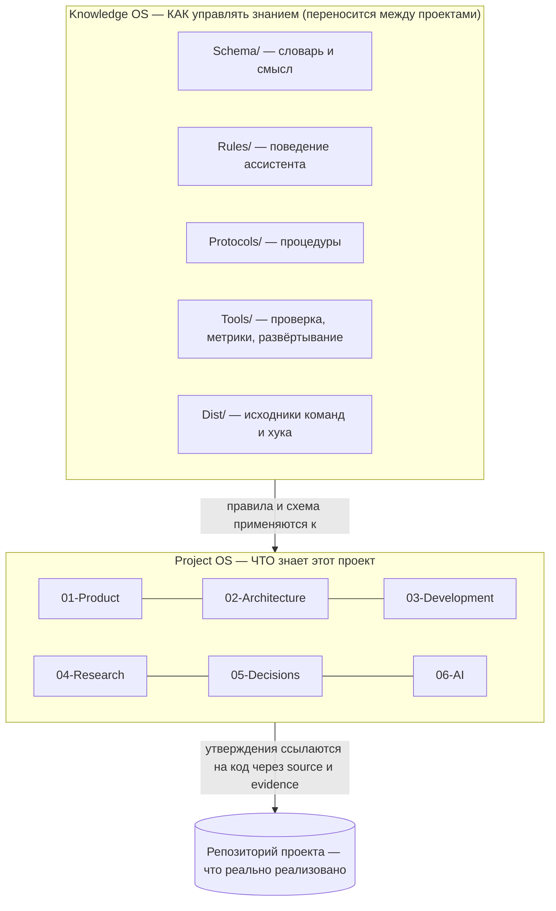

# 02. Устройство системы: слои, папки, корни

> **Описывает:** физическую раскладку MVOS — [[Knowledge-OS/README]], [[Knowledge-OS/os-manifest]], [[Knowledge-OS/Context-Index]], [[Knowledge-OS/Dist/CLAUDE.redirect.md]], [[package.json]].
> **Связано:** [[Docs/01-Purpose-and-Principles]] — зачем нужны два слоя, [[Docs/05-Project-OS/05-1-Sections]] — разделы Project OS подробно, [[Docs/08-Distribution/08-1-OS-Manifest]] — что считается слоем ОС, [[Docs/08-Distribution/08-2-Adoption]] — как файлы попадают в корень проекта, [[Docs/04-Assistant-Behaviour/04-1-Entry-Points]] — с какого файла начинает ассистент.

## Назначение

На этой странице описано, где что лежит, кто это читает и почему граница проведена именно здесь. Почти каждое решение в инструментах — валидатор, развёртывание, синхронизация, провайдер — следует из раскладки, описанной ниже. Поэтому эту страницу стоит прочитать до страниц про инструменты.

## Как работает

### Три слоя: как, что и чем доказано



- **Knowledge OS** (`Knowledge-OS/`) — переиспользуемый слой. Он не знает ничего про конкретный проект. Меняется редко, а когда меняется, изменение доставляется в апстрим ([[Docs/08-Distribution/08-3-Upstream-Sync-and-Upgrade]]).
- **Project OS** (`Project-OS/`) — знание одного проекта. Почти всё здесь — экземпляр. Исключение — несколько структурных файлов, которые входят в слой ОС: шаблоны и ритуал закрытия [[Project-OS/06-AI/AI]]. Подробно — в [[Docs/05-Project-OS/05-1-Sections]].
- **Репозиторий** — свидетельство. Код не часть хранилища, но заметки ссылаются на него, и инструменты сверяют эти ссылки с историей git ([[Docs/06-Tooling/06-2-Stale-Check-and-Graph-Report]]).

### Дерево хранилища

```text
<vault>/                         корень хранилища (в проекте-носителе — MemoValeOS/)
  CLAUDE.md                      точка входа ассистента (не входит в манифест: у каждой копии свой)
  README.md, QA.md               для людей: что это и как проверить (ассистент не читает)
  CHANGELOG.md                   история версий слоя ОС
  Backlog.md                     сток идей по самой ОС (экземпляр, не переносится)
  .os-version                    метка версии слоя ОС, например os-v4
  mvos.config.json               настройки проекта: язык общения и язык заметок (у каждой копии свой, не в манифесте)
  .mvos/install.json             запись установки: корень проекта, режим, файлы с хешами (пишет adopt.mjs)
  package.json                   npm-скрипты и dev-зависимость тестов (acorn); у инструментов зависимостей нет
  LICENSE                        лицензия MIT (входит в манифест)
  Docs/                          эта документация (для людей, слой ОС)
  Knowledge-OS/
    README.md                    оглавление слоя для ассистента
    Context-Index.md             маршрутизация «вопрос → раздел Project OS»
    Knowledge-DB.base            представление Obsidian Bases по lifecycle
    os-manifest                  что составляет слой ОС
    Schema/                      Knowledge-Types, Metadata-Schema, Knowledge-Lifecycle,
                                 Evidence-Schema, Relationship-Types, Provider-Mapping, schema.json
    Rules/                       AI-Governance, Brain-Rules, Context-Rules, Linking-Rules,
                                 Promotion-Rules, Communication-Rules
    Protocols/                   Context-Selection, Knowledge-Promotion, Knowledge-Maintenance,
                                 Project-Initialization, Repository-Survey, Relationship-Discovery,
                                 Deployment, Context-Provider
    Tools/                       *.mjs + *.test.mjs, __fixtures__/, __provider_fixtures__/
    Dist/                        commands/mv-*.md, hooks/budget-audit.cjs,
                                 settings.fragment.json, CLAUDE.redirect.md
  Project-OS/
    00-Home … 07-Resources       знание проекта
    Templates/                   шаблоны сущностей (слой ОС, кроме Task.md)
    Inbox/                       появляется при развёртывании: принятый чужой CLAUDE.md
  Metrics/                       журнал метрик сессий (экземпляр)
  Plans/                         рабочие планы (экземпляр, вне схемы)
  Archive/                       архив (ссылки не проверяются)
```

### Кто что читает

У каждой части свой читатель, и граница между читателями проведена намеренно.

| Читатель | Что читает | Чего не читает | Где это закреплено |
|---|---|---|---|
| Ассистент | `CLAUDE.md`, затем по необходимости Knowledge OS и Project OS — по [[Knowledge-OS/Protocols/Context-Selection-Protocol]] | `README.md`, `QA.md`, `Docs/` | `CLAUDE.md` (проза); [[Knowledge-OS/Tools/context-provider.mjs]], функция `isWrittenForPeople()` (код) |
| Человек | `README.md`, `QA.md`, `Docs/`, заметки Project OS в Obsidian | — | — |
| Валидатор | Всё, что находит обход хранилища, но судит по-разному: см. ниже | dot-папки, `node_modules`, фикстуры, пути из `.mvignore` | [[Docs/06-Tooling/06-1-Validator]] |
| Claude Code | `.claude/commands`, `.claude/hooks`, `.claude/settings.json` в **корне проекта** | `Knowledge-OS/Dist/` (это исходники, а не развёрнутые копии) | [[Docs/08-Distribution/08-2-Adoption]] |

Документация и README для людей отделены от знания для ассистента по двум причинам. Первая — бюджет: тексты «для людей» объясняют, а не предписывают, и они длинные. Вторая — дублирование канона: если ассистент прочтёт пересказ правила рядом с самим правилом, он не будет знать, какой из текстов авторитетен.

### Три области суждения валидатора

Валидатор обходит всё хранилище, но для каждого файла решает три отдельных вопроса.

| Область | Какие файлы | Что проверяется |
|---|---|---|
| owned («своё») | файлы в корне хранилища; `Knowledge-OS/`, `Project-OS/`, `Metrics/`, `Plans/`, `Archive/`, `Docs/` | ссылки внутри файла проверяются, и файл может быть целью ссылки |
| governed («под схемой») | `Knowledge-OS/` и `Project-OS/`, кроме `Templates/`, `Dist/`, `Inbox/` | обязательный frontmatter и все правила схемы |
| template | `Project-OS/Templates/` | облегчённая проверка frontmatter и плейсхолдеров |

Поэтому `Docs/` и `README.md` не требуют frontmatter, но их ссылки обязаны разрешаться. Чужие папки хоста (`docs/`, memory bank) просто не судятся. Подробно — функции `isVaultOwned()`, `isGoverned()` и `isTemplate()` в [[Docs/06-Tooling/06-1-Validator]].

### Корень хранилища и корень проекта

У системы два корня, и путать их нельзя.

- **Корень хранилища** — папка, где лежат `Knowledge-OS/` и `Project-OS/`. Инструменты находят его по собственному расположению (три уровня вверх от `Knowledge-OS/Tools/*.mjs`), а не по текущему каталогу. Поэтому их можно запускать откуда угодно.
- **Корень проекта** — `git rev-parse --show-toplevel` репозитория, где живёт код. Здесь Claude Code ищет `.claude/` и корневой `CLAUDE.md`.

Возможны две раскладки:

| Раскладка | Как выглядит | Где применяется | Особенности |
|---|---|---|---|
| Встроенная (embedded) | `<project>/MemoValeOS/` — хранилище подпапкой репозитория с кодом | проект-носитель Archi | Корневой `CLAUDE.md` — редирект ([[Knowledge-OS/Dist/CLAUDE.redirect.md]]) на `MemoValeOS/CLAUDE.md`. Корневой `package.json` объявляет хранилище npm workspace, поэтому одного `npm install` в корне достаточно для тестов (инструментам он не нужен: `js-yaml` лежит в `Knowledge-OS/Tools/vendor/`). `.claude/` лежит уровнем выше хранилища |
| Самостоятельная (standalone) | хранилище = корень репозитория | апстрим `GoodJaa/MemoValeOS` | `.claude/` лежит внутри хранилища. Валидатор ищет `.claude/` в обоих местах (`findClaudeDir()`), а git-репозиторий — вверх от хранилища (`findRepoRoot()`) |
| Встроенная со своим `.git` | `<project>/MemoValeOS/` с собственным репозиторием внутри репозитория проекта | личная установка (`--local`): хранилище исключено из git проекта, и свой `.git` — единственная история знания | `adopt.mjs` без `--project` здесь отказывает: корень неоднозначен. После установки корень берётся из записи `.mvos/install.json`, и валидатор, и `stale-check` спрашивают репозиторий проекта, а не хранилища |

Какая раскладка у конкретной копии, после первой установки говорит запись `.mvos/install.json` (`projectRoot`, `mode`) — [[Docs/08-Distribution/08-2-Adoption]].

Почему исходники команд лежат в `Knowledge-OS/Dist/`, а не прямо в `.claude/`? Слой ОС доставляется патчем путей манифеста (`os-patch.mjs`), а пути манифеста относительны хранилища: `.claude/` корня проекта лежит вне него. Поэтому канон живёт внутри хранилища, а [[Knowledge-OS/Tools/adopt.mjs]] копирует его в корень проекта. Правило `deployed-command-drift` не даёт копиям разойтись. Подробно — в [[Docs/08-Distribution/08-2-Adoption]].

### Слой ОС и слой проекта

Что именно переносится между проектами, решает одна вещь — [[Knowledge-OS/os-manifest]]. Это список glob-шаблонов. Всё, что он покрывает, — слой ОС. Всё остальное принадлежит проекту, даже если лежит внутри `Knowledge-OS/`. В последнем случае валидатор ответит ошибкой `os-layer-outside-manifest`. Подробно — в [[Docs/08-Distribution/08-1-OS-Manifest]].

## Почему так

- **Почему два слоя, а не один.** Правила работы со знанием одинаковы для любого проекта, а знание — нет. Если их смешать, каждый новый проект начинается с вычищения чужого знания, а улучшение правил нельзя вернуть в общий источник.
- **Почему хранилище — подпапка, а не отдельный репозиторий.** Код и знание о нём должны меняться одним коммитом. Решение проекта-носителя о ветвлении прямо требует «код и знание — в одном squash-коммите». В отдельном репозитории `source: [{path, commit}]` указывал бы на коммиты, которых в нём нет. В Backlog записан ровно этот дефект для раскладки «хранилище — вложенный репозиторий со своим `.git`».
- **Почему чужое не судится.** Первая установка на проект с собственной базой заметок дала два десятка ошибок `broken-link`, и ни одна не была правдой: ссылки чужих заметок указывают в граф, которого хранилищу никто не показывал. «Красный гейт в первый день — то, как валидатор учит читателя перестать смотреть». С тех пор ссылки судятся только в owned-области (фикстура `foreign-tree`).
- **Почему пути без пробелов.** До коммита `a56b29a` папки назывались `Knowledge OS/` и `Project OS/`. Пробелы ломали цитирование путей в командах и в Bash-сессиях. В части старых текстов пробелы остались — см. [[Docs/12-Known-Gaps]].

## Пример

Как ассистент Claude Code попадает в систему во встроенной раскладке:

1. Claude Code открывает `<project>/CLAUDE.md`. Это блок между маркерами `<!-- MemoValeOS:redirect:begin -->` и `<!-- MemoValeOS:redirect:end -->`: «Read `MemoValeOS/CLAUDE.md` first…».
2. `MemoValeOS/CLAUDE.md` задаёт порядок работы и отсылает к [[Knowledge-OS/Protocols/Context-Selection-Protocol]] и [[Knowledge-OS/README]].
3. Slash-команды `/mv-*` доступны, потому что [[Knowledge-OS/Tools/adopt.mjs]] скопировал их из `Knowledge-OS/Dist/commands/` в `<project>/.claude/commands/`.
4. Каждый `Read`, `Grep` и `Glob` проходит через хук `<project>/.claude/hooks/budget-audit.cjs` и записывается в `<project>/.claude/budget-audit.jsonl`.

## Подводные камни

- **Две копии команд.** Править нужно исходник в `Knowledge-OS/Dist/`, а затем выполнить `adopt.mjs --apply`. Если править развёрнутую копию в `.claude/`, валидатор ответит `deployed-command-drift`.
- **Не копируйте команды в `~/.claude/commands/`.** Пользовательская копия видна во всех проектах и молча расходится с репозиторием. В проекте-носителе такая копия `/mv-close` месяц описывала ритуал, которого уже не существовало.
- **`CLAUDE.md` хранилища не в манифесте.** У апстрима свой `CLAUDE.md`, и правка точки входа доставляется туда отдельно.
- **Метрики бюджета предполагают встроенную раскладку.** `context-metrics.mjs` ищет `.claude/budget-audit.jsonl` уровнем выше хранилища. См. [[Docs/06-Tooling/06-3-Context-Metrics]] и [[Docs/12-Known-Gaps]].

## Как менять

- **Новая папка верхнего уровня в хранилище.** Решите, owned ли она (константа `VAULT_OWNED_ROOTS` в [[Knowledge-OS/Tools/validate-vault.mjs]]), governed ли (`isGoverned()`) и переносится ли (строка в [[Knowledge-OS/os-manifest]]). Добавьте фикстуру и тест ([[Docs/06-Tooling/06-6-Tests-and-Fixtures]]) и запись в [[CHANGELOG]]. Так появился `Docs/`.
- **Новый файл в `Knowledge-OS/`.** Добавьте строку в манифест, иначе сработает `os-layer-outside-manifest`.
- **Новый файл, который должен попасть в `.claude/`.** Положите его в `Knowledge-OS/Dist/` и научите [[Knowledge-OS/Tools/adopt.mjs]] его разворачивать ([[Docs/08-Distribution/08-2-Adoption]]).
