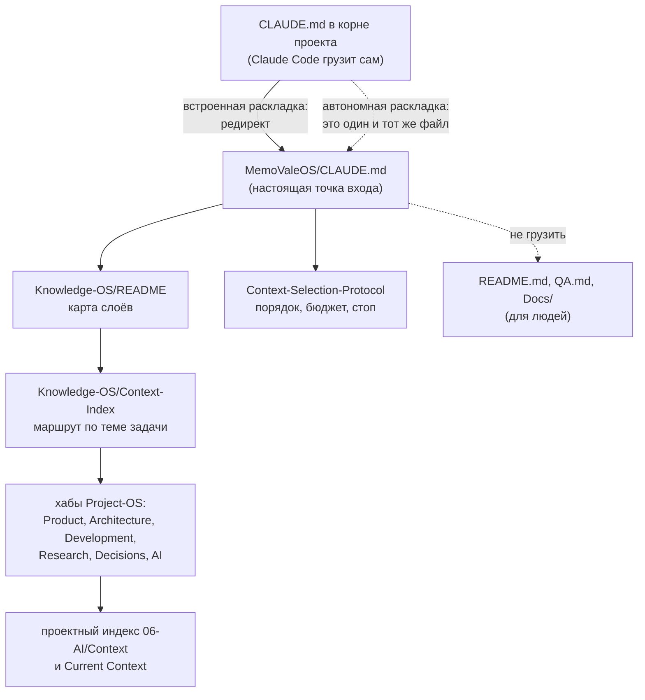

# 04-1. Точки входа ассистента

> **Описывает:** `CLAUDE.md` в корне хранилища, [[Knowledge-OS/Dist/CLAUDE.redirect.md]], [[Knowledge-OS/README]], [[Knowledge-OS/Context-Index]], проектный маршрутный индекс (в проекте-носителе — `Project-OS/06-AI/Context/AI-Context-Index.md`) и [[Project-OS/06-AI/AI]].
> **Связано:** [[Docs/02-System-Layout]] — корень хранилища против корня проекта, встроенная и автономная раскладки, [[Docs/04-Assistant-Behaviour/04-3-Context-Selection]] — что делать после входа, [[Docs/04-Assistant-Behaviour/04-2-Rules]] — правила, на которые ссылаются точки входа, [[Docs/08-Distribution/08-2-Adoption]] — как редирект попадает в проект, [[Docs/05-Project-OS/05-4-Session-Lifecycle]] — `/mv-resume` и Current Context.

## Назначение

Ассистент начинает каждую сессию с нуля. Что он прочитает первым, определяет всё остальное: если первым будет «вся документация», система проиграла до начала работы. Точки входа решают две задачи:

1. **Гарантированно загрузить маленькое ядро** — несколько необратимых правил, которые должны действовать до первого чтения.
2. **Дать маршрут, а не список чтения** — откуда идти к знанию, нужному задаче, и где остановиться.

Принцип, который `CLAUDE.md` называет Prime Directive: *читай наименьшее количество знания проекта, достаточное, чтобы правильно принять текущее решение. Контекст тянет задача, а не толкают в неё.*

## Как работает

### Цепочка

### `CLAUDE.md` в корне проекта и редирект

Claude Code автоматически загружает только `CLAUDE.md` в корне проекта. Во встроенной раскладке хранилище — подпапка `MemoValeOS/` проекта, поэтому в корне проекта лежит **редирект** — содержимое [[Knowledge-OS/Dist/CLAUDE.redirect.md]], три строки: система живёт в `MemoValeOS/`, прочитай `MemoValeOS/CLAUDE.md`, следуй ему, а не этому файлу.

`adopt.mjs` (класс `claude-md`) кладёт редирект между маркерами `<!-- MemoValeOS:redirect:begin -->` и `<!-- MemoValeOS:redirect:end -->`:

- `CLAUDE.md` нет — создаётся из редиректа;
- маркеры уже есть — ничего не делается (идемпотентность);
- файл совпадает с текстом редиректа, но без маркеров — маркеры добавляются на месте (так выглядит любой проект, установленный руками);
- у проекта свой `CLAUDE.md` — редирект добавляется сверху, а прежнее тело переносится дословно в `Project-OS/Inbox/Adopted CLAUDE.md`; раскладывать его по Decisions и Architecture — работа человека по пунктам;
- самостоятельная раскладка (корень проекта = хранилище) — класс ничего не делает и пишет в план «standalone layout: the vault's own CLAUDE.md is the entry point; no redirect».

Текст источника называет папку хранилища `MemoValeOS/`; `planClaudeMd()` заменяет `MemoValeOS/` на фактическое имя папки хранилища относительно корня проекта, так что хранилище под другим именем получает редирект в существующий путь.

Подробно — [[Docs/08-Distribution/08-2-Adoption]].

### `CLAUDE.md` хранилища — настоящая точка входа

Около 2 КБ, примерно 550 токенов. Он грузится в каждой сессии, поэтому в нём только то, что должно действовать всегда:

| Раздел | Что требует |
|---|---|
| Start | до нетривиальной работы — назвать текущую задачу и её границы, осмотреть репозиторий, следовать принятым решениям и архитектуре, не расширять объём без одобрения |
| Context | Knowledge-OS — база знаний, а не контекст по умолчанию, целиком не грузится; порядок, бюджет и условие остановки определены один раз, в [[Knowledge-OS/Protocols/Context-Selection-Protocol]]; `README.md`, `QA.md`, `Docs/` — для людей; начинать с [[Knowledge-OS/README]] |
| Decisions | принятые решения — ограничения, включая решения о том, как ведётся работа (ветвление, коммиты, ревью); до первой правки файла по задаче проверить хаб Decisions; задача `done` только после реального слияния ветки |
| Scope | граница — текущая задача; не чинить постороннее, не рефакторить попутно, записывать находки |
| Evidence | репозиторий — свидетельство реализации; расхождение кода и знания не переписывать молча |
| Knowledge Updates | после работы — обновить только затронутое знание, повышать переиспользуемое |
| Prime Directive | см. выше |

Заметьте, чего в нём нет: он не пересказывает протокол выбора контекста, а ссылается на него. Порядок расширения записан **один раз**.

### `Knowledge-OS/README` — карта слоя

`type: readme`. Перечисляет схемы, правила и протоколы с одной строкой назначения каждого, называет валидатор и фиксирует границу: Knowledge-OS определяет, как управлять знанием; Project-OS содержит знание проекта; код — свидетельство реализации; ни то ни другое не грузится целиком. Навигация — «начни с Context-Index, порядок расширения определяет Context-Selection-Protocol».

### `Knowledge-OS/Context-Index` — маршрут по теме

`type: index`. Таблица «о чём задача → откуда начать»: продукт → хаб `01-Product`, архитектура → `02-Architecture`, текущая работа → `03-Development`, существующие находки → `04-Research`, принятые решения → `05-Decisions`, поведение ИИ в проекте → [[Project-OS/06-AI/AI]]. Раздел Expansion Order снова только ссылается на протокол.

### Проектный индекс и `AI.md`

В Project-OS свой маршрутный индекс: в проекте-носителе это `Project-OS/06-AI/Context/AI-Context-Index.md`. Он прямо говорит о себе: «это маршрутный индекс; он помогает найти знание; это не список чтения». Его ведёт ассистент по мере развития проекта; создавать вручную гигантскую карту контекста запрещено. Он проектный и в слой ОС не входит.

[[Project-OS/06-AI/AI]] — единственная заметка `06-AI`, которая входит в манифест: в ней режим обследования (`Survey Mode`) и ритуал закрытия сессии, который исполняет `/mv-close`. Её соседка Current Context описывает текущую ситуацию проекта и не путешествует.

### Кто что читает

| Файл | Читатель | Механизм |
|---|---|---|
| `CLAUDE.md` корня проекта | ассистент, всегда | Claude Code |
| `CLAUDE.md` хранилища | ассистент, всегда | редирект |
| `Knowledge-OS/README`, `Context-Index` | ассистент, по необходимости | ссылка из `CLAUDE.md` |
| протоколы, правила | ассистент, когда нужны | ссылки, команды `/mv-*` |
| `README.md`, `QA.md`, `Docs/` | люди | ассистенту запрещено прозой в `CLAUDE.md`; провайдер контекста исключает их кодом (`isWrittenForPeople()`) |

## Почему так

**Маленькое ядро, всё остальное — по запросу.** Замеры проекта-носителя: всё хранилище стоило около 7% среднего контекста сессии. Правила читают один раз в начале сессии и почти не перечитывают; связь этого с соблюдением не установлена — ветвление держит хук `pre-push` ([[Docs/04-Assistant-Behaviour/04-2-Rules]]). Идея построить отдельное «ядро правил» с хуком (B5) была проверена замером до постройки и отменена: ядро уже существует — это `CLAUDE.md`. Сохранённый критерий: в ядро попадает только правило, нарушение которого **необратимо** (ветвление до коммита, запись в чужое дерево). По нему же стоит проверять каждую новую строку `CLAUDE.md`, а не дописывать по привычке.

**Ядро стабильно и для кэша.** Префикс контекста держит Claude Code, и в нём из системы только `CLAUDE.md` — без дат и переменного содержимого. Замер показал долю попаданий в кэш 94–99%.

**Один источник порядка.** Раньше порядок расширения был пересказан в `Context-Index` (разделы Context Expansion и Stop) и в `Context-Rules`. Пересказы удалили, оставив ссылки на протокол. История показала цену пересказа: `Context-Index` тогда не входил в манифест, и копия в апстриме сохранила удалённые разделы — решение тихо откатилось, и нашли это только ручным сравнением клонов.

**Редирект, а не копия.** Корень проекта не входит в поддерево хранилища, которое доставляется в апстрим, а Claude Code читает только корень. Одно место не может служить и транспорту, и загрузчику; редирект из трёх строк — минимальная вторая копия, и её текст живёт в `Dist/`.

**Чужой `CLAUDE.md` — это знание.** Часто это единственная письменная запись того, как устроен проект. Поэтому он не перезаписывается и не пересказывается, а переносится дословно в Inbox, где ждёт человека.

## Пример

Старт сессии в проекте-носителе (встроенная раскладка, хранилище в `MemoValeOS/`):

1. Claude Code грузит `Archi/CLAUDE.md` — три строки редиректа.
2. Ассистент читает `MemoValeOS/CLAUDE.md`: задача, решения, граница, Prime Directive.
3. `/mv-resume` читает Current Context, открытые блокирующие строки реестра неопределённостей и grep открытых задач — и только потом объявляет бюджет (см. [[Docs/04-Assistant-Behaviour/04-3-Context-Selection]]).
4. По теме задачи — `Context-Index` → хаб `02-Architecture` → одна архитектурная заметка. Не весь раздел.

В автономной раскладке (клон дистрибутивного репозитория, корень хранилища = корень git) шаг 1 и шаг 2 — один и тот же файл.

## Подводные камни

- **Раньше `claude-md` ломал автономную раскладку.** Там корень проекта совпадает с хранилищем, и `CLAUDE.md` корня — это и есть настоящая точка входа, а `planClaudeMd()` предлагал добавить сверху редирект на `MemoValeOS/CLAUDE.md` и перенести тело настоящего `CLAUDE.md` в `Project-OS/Inbox/`. Теперь класс в этой раскладке ничего не делает (тест «in the standalone layout the vault's own CLAUDE.md is left alone»).
- **Раньше редирект зашивал имя папки `MemoValeOS/`**, и хранилище под другим именем получало редирект в несуществующий путь. Теперь имя подставляется при развёртывании (тест «the redirect names the vault folder it is actually installed in»). Источник [[Knowledge-OS/Dist/CLAUDE.redirect.md]] по-прежнему пишет `MemoValeOS/` — подставляются все вхождения этой строки.
- **`CLAUDE.md` хранилища не в манифесте.** Апстриму каждую правку точки входа приходится переносить отдельно (CHANGELOG упоминает это для строки про `Docs/`).
- **Запрет на чтение `README.md` / `QA.md` / `Docs/` — проза.** Для самого ассистента он ничем не принуждается (QA `BEHAV-11`); кодом его исполняет только провайдер контекста.
- **Проектное в слое ОС.** [[Knowledge-OS/Rules/AI-Governance]] в проекте-носителе ссылается на `ADR-001-Git-Branching-Model` по имени — это зафиксированное постоянное расхождение с апстримом, где та же строка — общая проза. `CLAUDE.md` и `Context-Index` ссылаются на хабы Project-OS, которые должны существовать в любом проекте.
- **Раньше команды искали корень хранилища по старым именам.** `/mv-resume` и ещё восемь команд искали «sibling `Knowledge OS`/`Project OS` folders» — с пробелами, хотя папки давно названы через дефис. Теперь проверка во всех командах — `Knowledge-OS`/`Project-OS`; такие строки в прозе команд ничто, кроме чтения, не проверяет.

## Как менять

- **Правка ядра (`CLAUDE.md` хранилища):** пройти критерий необратимости; не пересказывать протоколы; помнить, что файл не в [[Knowledge-OS/os-manifest]] и в апстрим не уедет сам.
- **Правка редиректа:** [[Knowledge-OS/Dist/CLAUDE.redirect.md]] — источник; `adopt.mjs` сравнивает текст при разметке, поэтому проекты со старым текстом без маркеров получат перенос в Inbox, а с маркерами — останутся со старым текстом (план скажет «redirect already present»).
- **Новый раздел Project-OS** — строка в таблице [[Knowledge-OS/Context-Index]] и хаб `index` (см. [[Docs/05-Project-OS/05-1-Sections]]).
- Проверка: `node "Knowledge-OS/Tools/validate-vault.mjs"` (ссылки точек входа проверяются как ссылки любой заметки) и прогон `adopt.mjs` без `--apply` на целевой раскладке.
