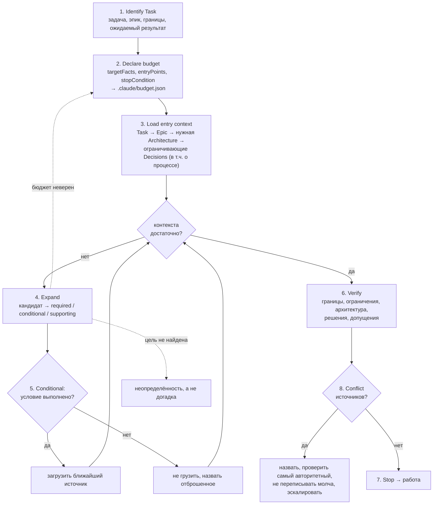

# 04-3. Выбор контекста и бюджет чтения

> **Описывает:** [[Knowledge-OS/Protocols/Context-Selection-Protocol]], [[Knowledge-OS/Rules/Context-Rules]], файл бюджета `.claude/budget.json` и его читателя [[Knowledge-OS/Dist/hooks/budget-audit.cjs]], строки бюджета в [[Knowledge-OS/Dist/commands/mv-resume]] и ритуале [[Project-OS/06-AI/AI]].
> **Связано:** [[Docs/04-Assistant-Behaviour/04-1-Entry-Points]] — откуда начинается чтение, [[Docs/04-Assistant-Behaviour/04-2-Rules]] — классы контекста в Context-Rules, [[Docs/06-Tooling/06-4-Budget-Audit-Hook]] — устройство хука, [[Docs/06-Tooling/06-3-Context-Metrics]] — блок Reading discipline, [[Docs/06-Tooling/06-5-Context-Provider]] — тот же принцип для внешнего потребителя, [[Docs/05-Project-OS/05-4-Session-Lifecycle]] — жизнь `budget.json` в сессии.

## Назначение

Центральное обещание системы — **контекст тянет задача, а не толкают в неё.** Ассистент не грузит базу знаний; он начинает с текущей задачи и расширяется наружу ровно настолько, насколько нужно: задача → эпик → архитектура → решения → исследования → код. Ожидаемое следствие: стоимость не растёт с базой — проект с тысячей заметок грузит не больше контекста, чем с пятьюдесятью, потому что релевантность задаёт задача, а не размер архива.

Протокол выбора контекста — процедура, которая это реализует. Её ключевая часть — **бюджет чтения**: до первого чтения объявить, что ищешь, где ожидаешь найти и что будет считаться достаточным.

## Как работает

### Шаги протокола



1. **Identify Task.** Текущая задача, родительский эпик, границы, ожидаемый результат. Никакого широкого обзора.
2. **Declare a Retrieval Budget.** До чтения: *target facts* — что нужно знать, чтобы действовать правильно; *entry points* — где это ожидается; *stop condition* — что делает поиск завершённым. Чтение за пределами бюджета требует причины из задачи. Ненайденный целевой факт становится неопределённостью, а не догадкой. Если бюджет оказался неверным — переобъявить, а не дрейфовать.
3. **Load Entry Context.** По порядку: задача; эпик, если есть; прямо нужная архитектура; решения, ограничивающие задачу, — и по предмету, и по тому, как ведётся работа (ветвление, коммиты, ревью). Место искать по [[Knowledge-OS/Context-Index]]. Не считать, что каждый пункт обязательно нужен; перед каждым применять Context-Rules.
4. **Expand.** Только когда текущего недостаточно. Для каждого кандидата: определить класс (`required` / `conditional` / `supporting`), применить условие, загрузить только релевантное, переоценить. Идти по связям к архитектуре, решениям, исследованиям, затронутым сущностям, коду. Предпочитать ближайший источник.
5. **Conditional Context.** Исследование парсера — когда меняется поведение парсера; исследование производительности — когда оптимизируется производительность; архитектурное решение — когда меняется затронутая архитектура. По умолчанию не грузить.
6. **Verify.** Перед реализацией: границы понятны, ограничения известны, архитектура понятна, решения известны, нерешённые допущения названы. Неопределённость разрешать самым конкретным источником.
7. **Stop.** Когда можно понять задачу, соблюсти ограничения, следовать архитектуре и безопасно работать. Дальше не грузить без причины.
8. **Conflict.** Назвать; проверить самое авторитетное свидетельство; не переписывать знание молча; эскалировать, если нужен проектный выбор.
9. **Context Boundary.** Не грузить: посторонние области Project-OS; область целиком, потому что часть её релевантна; общее знание, уже известное модели; историческое и архивное без причины.

Принцип протокола: *задача → минимальный контекст → работа → свидетельство → обновление знания.*

### Поиск — это кандидаты, а не список чтения

Grep возвращает кандидатов. Перед открытием — отфильтровать совпадения по текущей задаче, эпику и соседним задачам. Открыть все совпадения без фильтра — это не широкий бюджет, это отсутствие бюджета. Отброшенное назвать и сказать почему: неназванный пропуск неотличим от несостоявшегося. Это **так же связывает субагента**: делегировав поиск, ты не делегировал бюджет.

### Файл бюджета

Бюджет записывается в `.claude/budget.json` в корне проекта до первого чтения. Пример для встроенной раскладки (хранилище в `MemoValeOS/`, код в `src/`):

```json
{
  "task": "T28-Relationship-Storage",
  "targetFacts": [
    "which table shape T26 chose for nodes",
    "how ADR-003 constrains the storage engine",
    "what relationship types the model defines"
  ],
  "entryPoints": [
    "MemoValeOS/Project-OS/03-Development/Tasks/T28-Relationship-Storage.md",
    "MemoValeOS/Project-OS/05-Decisions/ADR-003-Storage-Technology.md",
    "src/storage/",
    "src/core/model.ts"
  ],
  "stopCondition": "the store's schema and the relationship write path are known"
}
```

| Поле | Зачем |
|---|---|
| `task` | имя файла задачи без `.md`; делает устаревший бюджет видимым: метрики находят файл задачи и сверяют его статус |
| `targetFacts` | что ищется; для хука не используется, для дисциплины — главное |
| `entryPoints` | пути относительно **корня проекта**; каталог покрывает всё под ним |
| `stopCondition` | граница, объявленная заранее |

Жизнь файла:

- объявить — в начале задачи, после трёх ориентирующих чтений `/mv-resume` (Current Context, открытые блокирующие неопределённости, grep открытых задач);
- переписать — когда бюджет законно меняется, а не оставлять старый;
- **удалить при закрытии задачи** — шаг 5 Part 3 ритуала закрытия, `/mv-close` делает это сам. Файл — артефакт сессии, игнорируется git'ом рядом с журналом аудита.

### Хук аудита

Хук `PreToolUse` на `Read|Grep|Glob` (блок из [[Knowledge-OS/Dist/settings.fragment.json]] в `.claude/settings.json`) запускает `.claude/hooks/budget-audit.cjs`. Он пишет строку в `.claude/budget-audit.jsonl`:

```json
{"at":"2026-10-01T12:34:56.549Z","session":"ad79c9d1-…","agent":null,"agentId":null,"tool":"Read","path":"src/storage/relationship-store.test.ts","declared":true,"task":"T28-Relationship-Storage","withinBudget":true}
```

- корень — `CLAUDE_PROJECT_DIR`, иначе `cwd` из события, иначе два уровня вверх от хука;
- путь приводится к относительному от корня; совпадение с entry point — точное или как префикс каталога, без учёта регистра;
- `Grep`/`Glob` без `path` не оцениваются (их как `unscopedSearches` считают метрики);
- `agent`/`agentId` заполнены только у вызовов субагента;
- **ничего не блокируется**: все ветви завершаются кодом 0, включая испорченный `budget.json` и недоступный журнал.

Сводку даёт `context-metrics.mjs`, блок Reading discipline: главное число — сколько чтений было **без объявленного бюджета** (`undeclared`), а не сколько вне его. Подробно — [[Docs/06-Tooling/06-4-Budget-Audit-Hook]] и [[Docs/06-Tooling/06-3-Context-Metrics]].

## Почему так

**Граница до, а не после.** «Условие остановки, объявленное заранее, — граница. Условие, оценённое потом, — предпочтение.» Без заранее объявленного стопа «достаточно» наступает тогда, когда надоело читать, — то есть поздно.

**Файл, а не разбор транскрипта.** Распознавать объявление бюджета в свободном тексте значило бы получать правдоподобные, но недостоверные числа. Файл даёт честный ноль: «забыл объявить» считается как `undeclared`.

**Сначала измеритель, потом принуждение.** Через первые двенадцать задач соблюдение бюджета было не измерено вовсе (QA `BEHAV-7` годами стоял с ⚠️). Блокирующий хук, введённый до замера, отключили бы при первой ошибке. Поэтому хук только пишет; решение о блокировке принимается по числам, которые он даёт.

**Удаление при закрытии — урок B21.** `/mv-resume` объявлял бюджет, но ничто его не снимало. Однажды файл объявлял уже закрытую задачу T18, и 18 из 19 чтений сессии записались как «вне бюджета» против границы для законченной работы. Отсутствующий бюджет записывается честно как `undeclared`; устаревший — как нарушение, которого не было. С этой даты число `undeclared` несравнимо с прежним: его рост — исправление замера, а не падение дисциплины.

**Субагент — не лазейка.** Первый же замер показал: делегированное чтение было записано вне объявленного бюджета — субагент унаследовал файл, но не дисциплину. Ровно этот случай протокол и называл.

**Классы — суждение, не метаданные.** Одна заметка `required` для одной задачи и лишняя для другой; поле во frontmatter было бы верно только для части задач. См. [[Docs/04-Assistant-Behaviour/04-2-Rules]].

**Рецитация бюджета — ждёт данных.** Разбор опыта Manus предложил перечитывать бюджет по ходу задачи, держа цель в конце окна внимания. Делать это будут, если замер покажет, что соблюдение падает к концу длинных сессий; иначе это механизм против нуля.

**Что дал замер вообще.** Хранилище стоит около 7% среднего контекста сессии и не выросло при удвоении базы. Это скромнее исходного обещания и защитимее: при такой доле «контекст не растёт с базой» почти тавтология. Отдельный вывод из анализа кэша: перерыв больше часа стоит переобработки всего накопленного контекста, так что закрыть сессию и начать новую дешевле, чем вернуться к старой через полтора часа.

## Пример

Задача: «добавить индекс по типу связи в хранилище графа».

1. Identify: T29, эпик E07, граница — только индекс, результат — запрос по типу быстрее.
2. Budget: факты — форма таблицы связей, ограничения ADR-003; entry points — файл T29, ADR-003, `src/storage/`; стоп — известны схема таблицы и путь записи. Записан `.claude/budget.json`.
3. Entry: T29 → E07 → архитектурная заметка хранилища → ADR-003.
4. Expand: grep `relationship` по `Project-OS/` дал 14 совпадений. Отфильтровано: 11 — задачи других эпиков и находки про анализаторы, отброшены с названной причиной; 2 — исследование производительности (conditional: задача про производительность — да, грузим одно, ближайшее); 1 — эпик E05 (supporting, не нужен).
5. Verify → Stop → работа.
6. Закрытие: `/mv-close` удаляет `.claude/budget.json`.

## Подводные камни

- **`entryPoints` относительны корню проекта, а не хранилища.** Во встроенной раскладке путь к заметке должен начинаться с папки хранилища (`MemoValeOS/`), иначе entry point не совпадёт ни с одним чтением, и все чтения заметок запишутся как `withinBudget: false`. Раньше пример в самом протоколе (`"Project-OS/03-Development/Tasks/T14-Function-Analyzer.md"`) был верен только для автономной раскладки; теперь он написан для встроенной и прямо говорит про обе.
- **Раньше `task` писали меткой** (`"T14 — Function Analyzer"`), которая не совпадала ни с одним файлом, и `staleBudgets` был пуст. Теперь протокол требует имя файла задачи, а `isTaskDone()` в `context-metrics.mjs` находит и старые метки по ведущему идентификатору.
- **Хук не проверяет устаревший бюджет.** Код использует любой разобравшийся `budget.json`, не сверяя `task` (комментарий в `budget-audit.cjs` теперь говорит именно это). Устаревание замечают `context-metrics.mjs` (задача уже `done`) и удаление в ритуале.
- **Раньше `/mv-resume` не мог сам записать файл**: команда требовала объявить бюджет, а её `allowed-tools` были только `Read, Glob, Grep`. Теперь в них есть `Write(.claude/budget.json)` — запись ровно этого файла и никакого другого.
- **Чтения через `Bash` невидимы.** `cat`, `sed`, `rg` из оболочки не проходят через хук `Read|Grep|Glob`; сессия, читающая оболочкой, выглядит как сессия без чтений.
- **Совпадение — по целому сегменту пути, без учёта регистра.** Entry point `src/stor` не покрывает `src/storage/…`: префикс сравнивается с добавленным `/`. Зато `SRC/Storage/` и `src/storage` эквивалентны.
- **Хук записывает и чтения вне проекта** (файлы в `~/.claude/`), с абсолютным путём; они считаются вне бюджета.

## Как менять

- **Формат бюджета** — протокол [[Knowledge-OS/Protocols/Context-Selection-Protocol]] §2 (пример и поля), хук [[Knowledge-OS/Dist/hooks/budget-audit.cjs]] и его тест `budget-audit.test.mjs`, анализ в `context-metrics.mjs`; развёрнутая копия хука в `.claude/hooks/` должна совпадать с `Dist/` (`deployed-command-drift`), обновить её — `adopt.mjs --apply --only hooks`.
- **Блокирующая версия** — отдельное решение по числам `undeclared` и `withinBudget`, а не правка хука «заодно»; политика «никогда не мешать работе» записана в самом хуке.
- **Шаги протокола** — только в протоколе. `CLAUDE.md`, `Context-Index` и `Knowledge-OS/README` на него ссылаются и не должны получать пересказ.
- **Жизненный цикл файла** — ритуал в [[Project-OS/06-AI/AI]] и `/mv-close` правятся вместе: правка команды мимо `AI.md` уже дважды оставляла правило и исполнителя в разногласии.
- Проверка: `npm test` (тест хука изолирован во временном каталоге и не трогает живой журнал), затем рабочая сессия и `node "Knowledge-OS/Tools/context-metrics.mjs"`.
