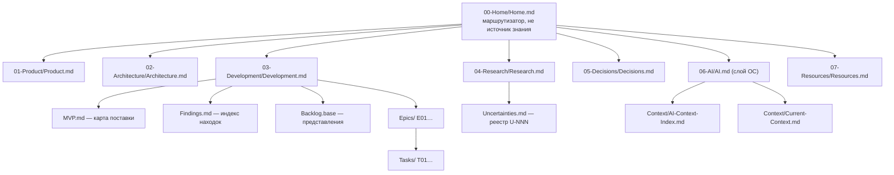

# 05.1. Разделы Project OS

> **Описывает:** структуру `Project-OS/` — разделы `00`–`07`, их индексные (хаб-) заметки, `Templates/` и `Inbox/`; переносимую часть этого слоя: [[Project-OS/06-AI/AI]], [[Project-OS/Templates/Task]] и прочие шаблоны, [[Knowledge-OS/os-manifest]].
> **Связано:** [[Docs/02-System-Layout]] — место Project OS среди слоёв, [[Docs/05-Project-OS/05-2-Delivery-Model]] — что живёт в `03-Development`, [[Docs/05-Project-OS/05-3-Templates]] — шаблоны подробно, [[Docs/05-Project-OS/05-4-Session-Lifecycle]] — как `06-AI` используется в сессии, [[Docs/08-Distribution/08-1-OS-Manifest]] — что считается слоем ОС, [[Docs/03-Knowledge-Model/03-1-Entity-Types]] — типы сущностей, которые здесь лежат.

## Назначение

`Knowledge-OS/` описывает, **как** обращаться со знанием, и не знает ничего о конкретном проекте. `Project-OS/` — обратная сторона: **что** знает этот проект. Здесь лежат продукт, архитектура, эпики и задачи, исследования, решения, неопределённости и состояние текущей работы.

Разделы решают одну задачу: ассистент должен находить нужное знание по **месту**, а не по содержимому. Если вопрос про принятое решение, он идёт в `05-Decisions/`. Если нужна следующая задача — в `03-Development/Tasks/`. Читать что-то ещё для этого не нужно. Так работает главная директива системы — «контекст тянет задача» (см. [[Docs/04-Assistant-Behaviour/04-3-Context-Selection]]). Раскладка по разделам — её физическая опора: узкий поиск возможен только тогда, когда у каждого вида знания есть один предсказуемый адрес.

## Как работает

### Карта разделов



У каждого раздела одна индексная заметка, в Archi её имя совпадает с именем раздела. Индекс сообщает, что лежит в разделе и для чего это. Заметки-хабы — точки входа: в них приходят, чтобы двигаться дальше, а не чтобы дочитать до конца.

| Раздел | Индексная заметка | `type` индекса | Что хранит | Слой |
|---|---|---|---|---|
| `00-Home/` | `Home.md` | `index` | Маршрутизатор: по одной ссылке на хаб каждого раздела и одна строка «для чего». Правила: *Start here only when the required Project OS area is unknown* и *Do not use Home as a source of project knowledge* | экземпляр |
| `01-Product/` | `Product.md` | `product` | Имя, определение, принципы, «чем продукт не должен стать». Через `contains::` ссылается на `Vision`, `Problem`, `Users`, `Product-Scope`, `Positioning`, `MVP`, `Roadmap`, `Ideas`. Слова владельца записываются с `evidence: user-provided` | экземпляр |
| `02-Architecture/` | `Architecture.md` | `architecture` | Архитектурные принципы и список «Major Areas» — по одной заметке на независимо заменяемую границу системы | экземпляр |
| `03-Development/` | `Development.md` | `index` | Рабочий цикл, правило поиска следующей задачи, правила работы. Рядом лежат `MVP.md` (карта эпиков и итераций), `Findings.md` (индекс находок), `Backlog.base` и папки `Epics/`, `Tasks/`, `Findings/` | экземпляр |
| `04-Research/` | `Research.md` | `index` | Индекс исследовательских заметок. Принцип: *Research informs decisions. Research does not automatically become an architectural constraint.* Рядом — `Uncertainties.md`, реестр неопределённостей, и подпапки с материалами исследований (в Archi это `T09/` со скриптом бенчмарка) | экземпляр |
| `05-Decisions/` | `Decisions.md` | `index` | Список ADR (`ADR-001`, …). Принятое решение ограничивает дальнейшую реализацию, но само по себе ещё не становится текущим знанием: оно остаётся `draft`, пока не наберёт порог доказательности. Открытые технологические вопросы лежат не здесь, а в `Uncertainties.md` | экземпляр |
| `06-AI/` | `AI.md` | `index` | Как ассистент работает с этим Project OS: переключатель `Survey Mode` и ритуал закрытия сессии (Session Closing Ritual). В `Context/` лежат `AI-Context-Index.md` (маршрутный индекс), `Current-Context.md` (текущее состояние работы) и, когда проект его завёл, `Environment.md` (как здесь всё запускается) | **`AI.md` — слой ОС**, `Context/` — экземпляр |
| `07-Resources/` | `Resources.md` | `resource` | Внешние источники: документация, статьи, репозитории. *Resources are references, not project truth.* | экземпляр |
| `Templates/` | — | — | Шаблоны сущностей: [[Project-OS/Templates/Task]], [[Project-OS/Templates/Epic]], [[Project-OS/Templates/Finding]] и другие (см. [[Docs/05-Project-OS/05-3-Templates]]) | **слой ОС**, кроме `Task.md` |
| `Inbox/` | — | — | Создаётся только при установке ([[Knowledge-OS/Tools/adopt.mjs]]): здесь дословно лежит прежний `CLAUDE.md` проекта-хозяина в файле `Adopted CLAUDE.md` | экземпляр, вне схемы |

### Индексы разного типа — это не небрежность

Хабы `00`, `03`, `04`, `05`, `06` имеют `type: index`. Это мета-тип, разрешённый в Project-OS только для навигационных заметок. А `Product.md`, `Architecture.md` и `Resources.md` — сущности своего типа (`product`, `architecture`, `resource`). Причина в том, что они не только перечисляют соседей, но и **сами утверждают** что-то о проекте: принципы продукта, принципы архитектуры. Утверждение должно проходить через порог доказательности своего типа (`evidenceFloorByType` в [[Knowledge-OS/Schema/schema.json]]: для `architecture` это `L2`, для `product` — `L4` или `user-provided`). Если записать его как `index`, проверка пройдёт мимо.

Последствие хорошо видно на `Architecture.md` в Archi. Заметка стоит в `lifecycle: draft` сознательно, и в первой строке сказано почему. Структурное утверждение в ней проверено машиной (`eslint-plugin-boundaries`), а принципы — проза без кода за ней. Повысить заметку значило бы выдать принципы за наблюдаемый факт.

Следствие для валидатора ([[Knowledge-OS/Tools/validate-vault.mjs]]): правило `orphaned-note` пропускает мета-типы, потому что точка входа по определению никем не обязана быть процитирована. Сущность же должна быть достижима. Поэтому хабы с `type: index` никогда не попадают в «сироты», а Task, на которую не ссылается ни один Epic, попадает.

### `06-AI/`: где кончается ОС и начинается проект

`06-AI/` — единственный раздел, который делится между слоями.

- **[[Project-OS/06-AI/AI]] — слой ОС.** В нём записан ритуал закрытия сессии из четырёх частей. Это канон, и `/mv-close` обязан его *прочитать*, а не пересказывать (см. [[Docs/07-Commands#/mv-close]]). Поэтому `AI.md` указан в [[Knowledge-OS/os-manifest]] отдельной строкой и уезжает в апстрим. Комментарий в манифесте объясняет причину так: *AI.md is OS layer rather than project state*.
- **`Context/Current-Context.md` — экземпляр.** В нём записано текущее положение дел: эпик, задача, цель, нужная архитектура, нужные решения, относящийся к делу код. У заметки `type: index`, а не `log`: она хранит **состояние**, а не историю. Каждый раздел переписывается в конце каждой сессии, и ничего не дописывается в хвост. У лога старые записи остаются верными, а у этой заметки старое содержимое после движения задачи просто неверно. Подробно — в [[Docs/05-Project-OS/05-4-Session-Lifecycle]].
- **`Context/AI-Context-Index.md` — экземпляр.** Это маршрутный индекс, *not a reading list*: где лежит знание о продукте, архитектуре, разработке. Индекс прямо запрещает строить «гигантскую карту контекста» руками: ассистент ведёт его сам и дополняет по мере развития проекта.

`AI.md` при этом ссылается на соседей-экземпляров (`Current-Context`, `AI-Context-Index`, `03-Development/Development`). В апстриме они существуют в шаблонной форме Project OS. Значит, раскладка `06-AI/Context/` и `03-Development/` — неявный контракт: любой проект, принявший ОС, обязан их иметь.

### `Templates/` и `Inbox/`: два особых случая для валидатора

Обе папки исключены из обычной схемы заметок. Исключения сделаны по разным причинам и реализованы разными механизмами:

- `Templates/` — это заготовки, а не заметки. Вместо значений в их полях стоят `{{title}}` и `{{date}}`, поэтому общая схема к ним не применяется. Для них есть отдельная, более узкая проверка `checkTemplate()` (см. [[Docs/05-Project-OS/05-3-Templates]]). Одновременно путь `Project-OS/Templates/` входит в `OS_LAYER_PREFIXES`. Поэтому любой новый файл в этой папке обязан быть покрыт манифестом, иначе сработает ошибка `os-layer-outside-manifest`.
- `Inbox/` исключён из `isGoverned()` через `isInbox()` и из проверки ссылок через `LINK_EXEMPT`. Чужой `CLAUDE.md` приезжает сюда **без изменений**: если навязать ему frontmatter, файл пришлось бы править, а весь смысл переноса в том, что человек получает его нетронутым и сам раскладывает по разделам. Ссылки в нём указывают в чужую документацию, и проверять их по графу этого хранилища было бы неверно.

### Что из Project OS переносится в другой проект

Ровно три строки [[Knowledge-OS/os-manifest]] касаются `Project-OS/`:

```text
Project-OS/Templates/*.md
!Project-OS/Templates/Task.md
Project-OS/06-AI/AI.md
```

Всё остальное — экземпляр. Индекс `Findings.md` по структуре не менее важен, чем `AI.md`, но в манифест **намеренно не включён**. Индекс состоит из записей, а записи — это экземпляры. Если отправить индекс Archi в апстрим, там появится двадцать с лишним битых ссылок на Findings, которых в апстриме нет. Это обнаружили, когда доставка увезла файл и валидатор апстрима его отверг. Если форма индекса когда-нибудь должна будет переноситься, ей место в `Templates/`.

## Почему так

**Нумерация разделов.** Префиксы `00`–`07` дают одинаковый порядок в любом файловом менеджере и делают пути предсказуемыми для поиска. Шаблон `Grep(…, path="Project-OS/03-Development/Tasks")` работает потому, что у задач ровно один адрес. После переименования путей с пробелами (`03 Development` → `03-Development`) на пути из прозы стали опираться команды, `.base`-фильтры и правило `broken-base-folder`. Раскладка стала частью контракта, а не делом вкуса.

**Хабы вместо одной большой карты.** Альтернатива — один длинный оглавляющий файл, который ассистент читает в начале сессии. Тогда все расходы на навигацию ложатся на старт: читается всё, чтобы найти одно. Хабы позволяют платить за навигацию по мере спуска: Home → хаб → сущность. Home при этом прямо запрещено использовать как источник знания. Иначе он превратился бы в ту самую карту, которую «проталкивают» в контекст.

**Состояние отдельно от истории.** `Current-Context.md` нельзя делать журналом. Журнал растёт, и ассистенту пришлось бы каждый раз искать в нём последнюю запись. Журнал метрик (`Metrics/Context-Metrics.md`) поэтому лежит вне проверяемого дерева, а заметка о состоянии — внутри.

**Честный `draft` у хабов.** Хаб-сущность в `draft` вместе с объяснением причины надёжнее, чем `active` без доказательства. Это следует из общего принципа системы: черновик должен быть отличим от установленного знания (см. [[Docs/03-Knowledge-Model/03-3-Lifecycle]]).

**Inbox вместо автоматической раскладки.** [[Knowledge-OS/Tools/adopt.mjs]] мог бы разобрать чужой `CLAUDE.md` по разделам сам. Но решить, что в нём Decision, что Architecture, а что соглашение проекта, — это суждение. Неразложенная заметка честна. Разложенная неправильно — ложное утверждение о том, что проект решил ([[Knowledge-OS/Protocols/Deployment-Protocol]]).

## Пример

Как ассистент в Archi отвечает на вопрос «над чем работаем?», не открывая лишнего:

1. Раздел известен — это `06-AI/`. Поэтому `Home.md` не читается: правило Home прямо это разрешает.
2. `Project-OS/06-AI/Context/Current-Context.md` называет эпик `E07-Storage`, задачу (на момент написания — «не выбрана», следующая по поиску `T29-Incremental-Update-Foundation`) и цель.
3. Если нужна подробность о решении, переход идёт сразу в `05-Decisions/ADR-003-Storage-Technology.md` по ссылке из раздела `Relevant Decisions`. Индекс `Decisions.md` для этого не нужен.

В этой цепочке Home и хабы не прочитаны ни разу. Хаб нужен, когда раздел известен, а сущность нет, например «какие у нас есть ADR». Home нужен, когда неизвестен даже раздел.

## Подводные камни

- **Ссылки по голому имени файла.** Home ссылается на `[[Development]]`, `[[Decisions]]`, `[[AI]]`, `[[Resources]]` без пути. Пока имена уникальны, это работает. Но `MVP.md` лежит и в `01-Product/`, и в `03-Development/`, поэтому на него везде ссылаются полным путём (`[[Project-OS/01-Product/MVP]]`). Если добавить второй файл с именем, совпадающим с хабом, валидатор выдаст ошибку `ambiguous-basename-link`.
- **Индексы не проверяются по содержимому.** Валидатор проверяет, что ссылки в индексе разрешаются, но не проверяет, что сам индекс полон и верен. `AI-Context-Index.md` в Archi говорит о «fifty tasks» и «two accepted» ADR, а фактически задач 51 и ADR три. Тот же индекс и `Findings.md` всё ещё называют пути через пробел (`03 Development/Epics/`, `03 Development/Findings/`) — это остаток до переименования.
- **`Inbox/` появляется не всегда.** Папки нет, пока `adopt.mjs` не встретил чужой `CLAUDE.md`. В Archi её нет. Исключения `isInbox()` и `LINK_EXEMPT` при этом действуют заранее.
- **Неявный контракт `AI.md`.** Переносимый `AI.md` ссылается на заметки-экземпляры. Проект, где их нет или они называются иначе, получит битые ссылки в файле слоя ОС, и это будет не его ошибка.

## Как менять

- **Новый раздел или хаб.** Хаб с `type: index`, если он только перечисляет. С типом сущности — если он что-то утверждает. Ссылка на хаб из `Home.md` и строка в `AI-Context-Index.md`. Если на папку раздела ссылается какой-нибудь `.base`, правило `broken-base-folder` проверит, что папка существует.
- **Переименование папки.** Нужно найти все пути в прозе и фильтрах: `Development.md` («Finding the Next Task»), [[Project-OS/06-AI/AI]] (Part 3), [[Knowledge-OS/Dist/commands/mv-resume]], `Backlog.base`, шаблоны поиска в [[Knowledge-OS/Dist/commands/mv-close]]. Битую ссылку валидатор поймает. Шаблон `Grep` в прозе он не поймает — переименование `a56b29a` оставило такие следы (см. [[Docs/12-Known-Gaps]]).
- **Сделать файл Project OS частью ОС.** Добавьте строку в [[Knowledge-OS/os-manifest]] и обоснование в комментарии рядом. Проверьте, что файл не ссылается на экземпляры, которых нет в апстриме. Добавьте запись в [[CHANGELOG]]. Подробно — [[Docs/08-Distribution/08-1-OS-Manifest]].
- **Проверка.** `node Knowledge-OS/Tools/validate-vault.mjs` из корня хранилища, затем доставка в апстрим по [[Docs/08-Distribution/08-3-Upstream-Sync-and-Upgrade]] и прогон валидатора *там*.
