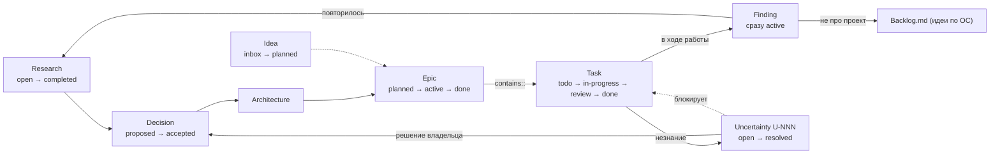

# 05.2. Модель поставки: Epic, Task, Finding, Decision, Idea, Uncertainty

> **Описывает:** как в Project OS движется работа — сущности и их статусы, нумерация, поиск следующей задачи, сведение статуса эпика, индекс находок, сток идей по ОС, принятое решение о ветвлении. Опорные файлы: [[Knowledge-OS/Schema/schema.json]] (`statusByType`), [[Knowledge-OS/Tools/validate-vault.mjs]], [[Project-OS/06-AI/AI]], [[Project-OS/Templates/Epic]], [[Project-OS/Templates/Task]], [[Project-OS/Templates/Finding]], [[Knowledge-OS/Rules/Promotion-Rules]].
> **Связано:** [[Docs/05-Project-OS/05-1-Sections]] — где лежит `03-Development`, [[Docs/05-Project-OS/05-3-Templates]] — форма каждой сущности, [[Docs/05-Project-OS/05-4-Session-Lifecycle]] — когда что закрывается, [[Docs/03-Knowledge-Model/03-2-Metadata-and-Status]] — словарь статусов, [[Docs/03-Knowledge-Model/03-6-Uncertainty-Ledger]] — реестр неопределённостей подробно, [[Docs/06-Tooling/06-1-Validator]] — правила, которые всё это проверяют.

## Назначение

Ассистент выполняет работу кусками размером в сессию, и каждый следующий кусок начинается без памяти о предыдущем. Модель поставки должна давать три ответа, которые не зависят от памяти:

1. **Что делать дальше?** Ответ получается механически, одним поиском, без чтения плана целиком.
2. **Что уже сделано?** Это должно совпадать с тем, что реально лежит в `master`.
3. **Куда записать то, что обнаружилось по ходу?** Место должно быть таким, чтобы находку потом можно было найти.

Отдельного списка задач, который ведут руками, нет. Сами Task-заметки и есть бэклог: *Open work is not tracked by a separate hand-kept list; the Tasks themselves are the backlog* (`Development.md`).

## Как работает

### Сущности и их пути



Цикл из `Development.md`: *Research → Decision → Architecture → Epic → Task → Implementation → Test → Discovery → Knowledge Update.* Последние два шага замыкают цикл: открытие, сделанное во время реализации, должно вернуться в знание, а не остаться только в коде.

| Сущность | Где лежит | Статусы (`statusByType`) | Роль |
|---|---|---|---|
| Epic | `03-Development/Epics/E01-….md` | `planned`, `active`, `blocked`, `done`, `cancelled` | Цель, обоснование, границы. Задачи перечислены через `contains::` |
| Task | `03-Development/Tasks/T01-….md` | `todo`, `in-progress`, `blocked`, `review`, `done`, `cancelled` | Единица поставки размером в сессию. Одна задача — одна ветка — один squash-коммит |
| Finding | `03-Development/Findings/<фраза>.md` | только `active` | Дешёвая фиксация наблюдения. Пишется сразу как `active` |
| Decision | `05-Decisions/ADR-NNN-….md` | `proposed`, `accepted`, `superseded`, `rejected` | Ограничение на будущую реализацию |
| Idea | там, где ей место по смыслу (в Archi — `01-Product/Ideas.md`) | `inbox`, `research`, `planned`, `implemented`, `rejected`, `archived` | Возможная будущая способность. *Do not use `Idea` for current requirements* ([[Knowledge-OS/Schema/Knowledge-Types]]) |
| Uncertainty | строка `U-NNN` в `04-Research/Uncertainties.md` | `open`, `resolved`, `accepted-risk`, `out-of-scope` | Названное незнание. Это не тип заметки, а строка реестра |

`status` и `lifecycle` — разные оси (см. [[Docs/03-Knowledge-Model/03-2-Metadata-and-Status]]). `status` говорит, где сущность находится в работе. `lifecycle` говорит, можно ли считать её текущим знанием. Задача может быть `done` и при этом `draft` — так она и выглядит до закрытия по ритуалу. Валидатор ловит это правилом `lifecycle-behind-status`; то же правило не даёт эпику `active`/`done` и решению `accepted` остаться `draft`.

### Нумерация

- **Задачи** — `T01`, `T02`, … **в порядке поставки**. Имя файла — номер и заголовок: `T28-Relationship-Storage.md`. От этого имени происходит и имя ветки (`task/T28-relationship-storage`), так что ветка, коммит и заметка называются одинаково.
- **Эпики** — `E01`, … тоже по порядку поставки. Эпик перечисляет свои задачи строками `contains:: [[T26-…]]`, а зависимость от предыдущего эпика — строкой `depends-on::`.
- **Решения** — `ADR-001`, … по порядку принятия. **Неопределённости** — `U-001`, … по порядку записи в реестр.
- **Находки** называются не номером, а **предложением, которое формулирует вывод**: `Session-T28-stored-relationships-without-a-foreign-key-so-dangling-endpoints-stay-reportable.md`. Bases показывает только имя файла и frontmatter, поэтому в табличном представлении имя файла — единственная видимая человеку подпись ([[Knowledge-OS/Dist/commands/mv-note]]).

### Как выбирается следующая задача

Правило записано в разделе «Finding the Next Task» в `Development.md`. Ритуал закрытия и `/mv-resume` повторяют его дословно:

```text
Grep("^status: (todo|in-progress|blocked|review)", path="Project-OS/03-Development/Tasks")
```

1. Один поиск по frontmatter всех задач, без открытия файлов.
2. Кандидат — совпадение с **наименьшим номером**.
3. Читается только эта задача, чтобы подтвердить её объём. Дальше контекст расширяется по [[Knowledge-OS/Protocols/Context-Selection-Protocol]].

Набор статусов в шаблоне поиска — это в точности «не `done` и не `cancelled»`. То же множество отбирает представление «Open tasks» в `Backlog.base`. Если доступен живой запрос к `.base` (через Obsidian или MCP), он предпочтительнее. Если нет, поиск даёт тот же ответ. Поэтому `.base` — только представление, а не источник истины (см. [[Docs/09-Obsidian-Integration]]).

### Сведение статуса эпика

У эпика нет собственного «счётчика прогресса». Его статус выводится из статусов задач, перечисленных в `contains::`. Вывод делается дважды: человеком или ассистентом в ритуале и машиной в валидаторе.

- **В ритуале** — шаг 3 части 2 в [[Project-OS/06-AI/AI]]. Если все задачи из `contains::` в статусе `done` или `cancelled`, эпик получает `status: done`; если хоть одна открыта — `status: active`. В обоих случаях эпик в `lifecycle: draft` тем же правкой повышается до `active` с `evidence` по `evidenceActionMap` (обычно `L2`), по [[Knowledge-OS/Protocols/Knowledge-Maintenance-Protocol]].
- **Раньше ритуал оставлял lifecycle эпика в работе нетронутым** («set `status: active` and leave lifecycle alone»), а валидатор такой эпик отвергал (тогда `epic-lifecycle-behind-status`, с os-v5 — `lifecycle-behind-status`). На первом же закрытии задачи в эпике из нескольких задач проверка падала. Правила разошлись в разные стороны, а фикстура валидатора `epic-status-open-tasks` всё это время показывала верную форму: `active` / `active` / `L2`.
- **В валидаторе** — блок, который для каждого `type: epic` собирает статусы задач по строкам `contains::` (константа `EPIC_TERMINAL_TASK_STATUS = ["done", "cancelled"]`):

| Правило | Когда срабатывает |
|---|---|
| `epic-status-behind-tasks` | все задачи завершены, а эпик не `done` |
| `epic-status-ahead-of-tasks` | эпик `done`, а какая-то задача открыта |
| `lifecycle-behind-status` | эпик `active`/`done`, а `lifecycle` всё ещё `draft` (общее правило, не только для эпиков — `activeLifecycleStatuses`) |

Третье правило защищает не аккуратность, а работающий шлагбаум. Эпик в `draft` выводит всё своё поддерево из-под правила `blocking-uncertainty-on-active`: открытая блокирующая неопределённость, указывающая на него, не срабатывает вовсе. Устаревшее поле молча выключает проверку, которая должна останавливать работу на нерешённом вопросе.

### Находки и их индекс

`Finding` — единственный тип без порога доказательности и без стадии `draft`. Он создан, чтобы записать наблюдение было дешевле, чем не записывать ([[Knowledge-OS/Rules/Promotion-Rules]]). У дешёвой записи есть цена: находка, на которую никто не ссылается, достижима только для того, кто уже знает о её существовании. А такому читателю она как раз не нужна. Поэтому у каждой находки две обязательные связи, и обе ставятся **в той же правке**, которой пишется находка:

1. Строка-связь в теле: `affects:: [[…]]`, если находка касается этой сущности, или `related-to:: [[…]]`, если связь слабее. Цель — то, *о чём* наблюдение, обычно задача, из которой оно выросло.
2. Строка в индексе `03-Development/Findings.md`. Индекс сгруппирован **по предмету, а не по дате**: дата уже есть в заметке.

Пропуск ловит предупреждение `orphaned-note`. Это предупреждение, а не ошибка, и так задумано: свежая находка без входящих ссылок — нормальное состояние, и валидатор, который обычно красный, приучает его не читать.

Дальнейшая судьба находки определяется в [[Knowledge-OS/Rules/Promotion-Rules]]. Если несколько находок указывают на одно и то же, их повышают до Research, Decision или Architecture. Одиночная находка остаётся как есть. Недопустимо одно: чтобы находки превратились во второй inbox, который только растёт.

### `Backlog.md`: сток идей по самой ОС

Не всякое наблюдение относится к проекту. Если у находки нет предмета в хранилище, это обычно наблюдение об **операционной системе**: ложный срабатывающий валидатор, команда, разошедшаяся с ритуалом. Такая запись идёт не в `Findings/`, а в `Backlog.md` в корне хранилища. Его устройство:

- Одно правило дисциплины: код ОС правится вне этого файла **только если он блокирует текущую задачу проекта**. Иначе идея записывается сюда одной строкой и ждёт отдельного прохода. Без стока идеи утекают прямо в код, и рабочая копия расходится с апстримом незаметно.
- **Статус записи — это раздел, в котором она лежит**: «Открытые», «Требуют решения» (ждут выбора владельца, а не кода), «Ожидают условия» (условие названо явно). Закрытая запись сразу переносится в соседний `Backlog-Archive.md` — в его раздел «Закрытые», в обратном хронологическом порядке; там же «Архив» исторических записей. Бэклог читают, чтобы выбрать следующее дело, и сделанное в нём только тратит контекст. Когда запись перекладывают в другой раздел, в теле оставляют хеш и дату. Хеш и дата говорят, *чем* закрыто; раздел — *закрыто ли*. Раньше статус писался прозой внутри абзаца, и закрытое лежало вперемешку с открытым.
- Запись начинается с даты и сути одной строкой, ниже идёт обоснование.

`Backlog.md` и `Backlog-Archive.md` — это экземпляр, у каждого проекта они свои. В манифест они не входят, и ссылаться на них из `Docs/` нельзя.

### Принятое решение о ветвлении

Модель ветвления в каждом проекте фиксируется собственным Decision. В слое ОС её упоминает [[Knowledge-OS/Rules/AI-Governance]]: в апстриме это общая формулировка «per the project's accepted branching Decision», в Archi — ссылка на конкретный ADR. Это одно из двух записанных постоянных расхождений ([[CHANGELOG]]). В Archi принято следующее:

- trunk-based разработка, `master` — единственная долгоживущая ветка, всегда зелёная;
- одна короткоживущая ветка на задачу, названная по заметке задачи; живёт часы или дни, не недели;
- слияние squash-ом, один коммит на задачу, поэтому `git log master` — это список действительно выполненных задач;
- **`status: done` ставится только после слияния ветки в `master`**, а не когда реализация закончена на ветке. `master` и заметки задач должны одинаково отвечать на вопрос, что завершено;
- код и знание, которое он меняет, едут в одной ветке и одном коммите;
- работа над самой ОС идёт прямо в `master`;
- конец каждой итерации отмечается тегом `iteration-N`;
- барьер — pre-push хук, который запускает валидатор хранилища, сборку, тесты и линтер. Защита веток в репозитории с одним разработчиком — театр: она останавливает того, кто её настроил.

## Почему так

**Бэклог — это сами задачи.** Отдельный список дублирует статусы и начинает с ними расходиться при первой же забытой правке. Если источник один, расходиться нечему.

**Поиск вместо чтения.** Открыть каждую задачу ради поля `status` — это 50 чтений на вопрос, ответ на который помещается в одну строку. Один `Grep` по frontmatter стоит одного вызова и не зависит от размера бэклога. Так директива «контекст тянет задача» применяется к самому выбору задачи.

**Номер = порядок.** Правило «наименьший открытый номер» требует нулевой памяти и нулевого суждения. Цену этого решения показывает пример в «Подводных камнях».

**`done` только после слияния.** Задача, отмеченная выполненной при неслитой ветке, утверждает то, чего в `master` нет. По Evidence-правилу [[Knowledge-OS/Rules/AI-Governance]] такое расхождение надо выносить наружу, а не носить дальше. Записанное в ADR правило работает только тогда, когда его проверяет команда: в Archi эпик однажды поставили в `done`, пока последняя задача ещё не была слита, и его отклонило `epic-status-ahead-of-tasks`. ADR описывал правило прозой, а соблюдение обеспечил валидатор.

**Работа над ОС — сразу в `master`.** В Archi ветка с переводом прожила одиннадцать коммитов без слияния, и `git checkout master` молча откатил всё хранилище. Знание, которое живёт в ветке, невидимо для любой сессии, работающей с `master`.

**Отклонённые альтернативы ветвления**: GitFlow (решает задачу параллельной поддержки релизов командой; ни релизов, ни команды нет) и чистый trunk без веток (откат неудачной сессии ассистента превращается в правку истории `master`).

## Пример

Задача `T28-Relationship-Storage` в Archi после закрытия:

```yaml
---
type: task
status: done
lifecycle: active
created: 2026-10-01
updated: 2026-10-01
evidence: L2
source:
  - path: src/storage/project-store.ts
    commit: c24afe7
  - path: src/storage/schema.ts
    commit: c24afe7
---
```

`c24afe7` — squash-коммит задачи в `master`, то есть коммит, *который содержит* изменение. Тело заполнено по всем 13 разделам шаблона, в конце строка `depends-on:: [[T27-Node-Storage]]`.

Эпик `E07-Storage` перечисляет `contains::` T26, T27, T28 и T29. Три задачи `done`, T29 `todo`, поэтому эпик стоит в `status: active`, `lifecycle: active`. Поставить ему `done` сейчас — значит получить `epic-status-ahead-of-tasks`. Поиск открытых задач возвращает 22 совпадения, наименьшее — T29. Это и есть следующая задача, и эпик не пришлось открывать, чтобы это узнать.

Находка той же сессии записана одной заметкой с `affects::` на T28 и строкой в разделе «Storage» индекса `Findings.md`.

## Подводные камни

- **Нумерация, кодирующая порядок, не принимает вставок.** Задача T51 в Archi появилась из решения владельца по неопределённости U-013 и должна была выполняться между T24 и T25. Было три плохих варианта: T51 не по порядку, T25a вне схемы имён или растворить работу в T25. Выбранный вариант сработал только потому, что T25 была единственной открытой задачей эпика. Будь открытых две, поиск по наименьшему номеру указал бы не на ту. Пока открытых задач мало, дефект ничего не стоит и потому не виден.
- **Порядок номеров может противоречить зависимостям в коде.** В эпике E05 узлу нужна была локация, но задача о локации шла через две задачи после задачи о модели узла. Записанный порядок `depends-on` оказался обратным тому, что требовал код. Номер — это план, а не граф зависимостей.
- **Шаблон поиска ищет строку, а не поле.** `^status:` совпадёт и со строкой тела, которая начинается с `status:`. На практике такого не случалось, но поиск не разбирает YAML.
- **Список статусов повторён в нескольких местах.** Он записан в шаблоне `Grep` (`Development.md`, [[Project-OS/06-AI/AI]], [[Knowledge-OS/Dist/commands/mv-resume]]) и в фильтре `Backlog.base`. Новый статус в `schema.json` попадёт туда только при ручной правке, и ни одна проверка этого не сравнивает.
- **Хеш в `source`, «рождённый несвежим».** `git rev-parse HEAD`, прочитанный до коммита, указывает на родителя, и `stale-source` срабатывает на только что написанной заметке. Исправление через `git commit --amend` не сходится: amend переписывает хеш, который заметка только что записала. Работает только следующий отдельный коммит. Оба урока записаны в части 2 ритуала.
- **Колонка `priority` в `Backlog.base` пуста.** Представления упорядочены и по `priority`, но в Archi это поле не заполнено ни у одной задачи. Порядок на деле задаёт номер.

## Как менять

- **Новый статус задачи или эпика.** Правка `statusByType` в [[Knowledge-OS/Schema/schema.json]] и смысловое описание в [[Knowledge-OS/Schema/Metadata-Schema]]. Затем вручную синхронизировать шаблон поиска в `Development.md`, [[Project-OS/06-AI/AI]], [[Knowledge-OS/Dist/commands/mv-resume]] (и развёрнутую копию — см. [[Docs/08-Distribution/08-2-Adoption]]) и фильтры `Backlog.base`. Если статус терминальный, добавить его в `EPIC_TERMINAL_TASK_STATUS`.
- **Новое правило сведения.** Добавить его в [[Knowledge-OS/Tools/validate-vault.mjs]] рядом с правилами `epic-status-*`, фикстуру и тест — по [[Docs/06-Tooling/06-6-Tests-and-Fixtures]]. Затем запись в [[CHANGELOG]] о том, какие данные проектов придётся мигрировать.
- **Другая схема нумерации** (например, порядок по зависимостям вместо номера). Меняется шаг 2 правила поиска во всех трёх местах и часть 3 ритуала. Это изменение поведения ассистента, и оно должно быть записано как Decision, а не как правка прозы.
- **Проверка.** `node Knowledge-OS/Tools/validate-vault.mjs` и `node --test Knowledge-OS/Tools/validate-vault.test.mjs` из корня хранилища.
