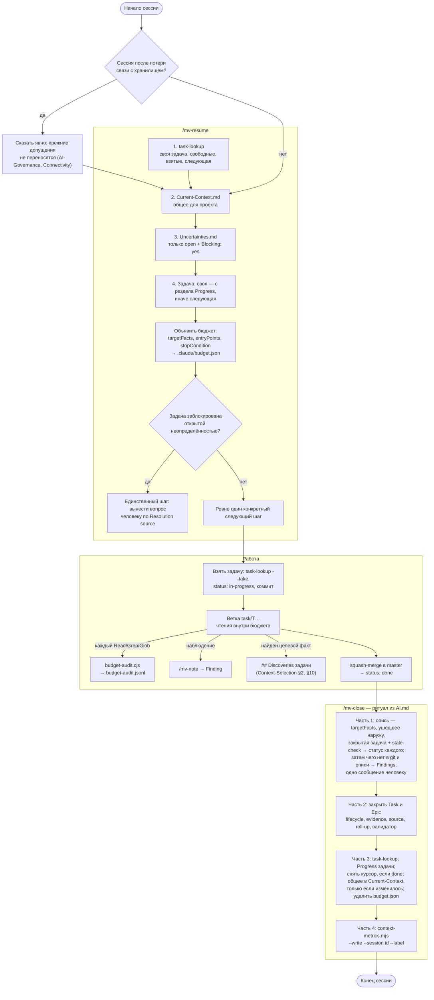

# 05.4. Жизненный цикл сессии

> **Описывает:** путь одной рабочей сессии — [[Knowledge-OS/Dist/commands/mv-resume]] → бюджет чтения → работа → [[Knowledge-OS/Dist/commands/mv-close]] по ритуалу закрытия из [[Project-OS/06-AI/AI]]; передача работы через раздел `Progress` задачи, общий `Current-Context.md` и курсор рабочей копии ([[Knowledge-OS/Tools/task-lookup.mjs]]); жизнь `.claude/budget.json`; правило потери связи из [[Knowledge-OS/Rules/AI-Governance]].
> **Связано:** [[Docs/07-Commands]] — команды подробно, [[Docs/06-Tooling/06-10-Task-Lookup]] — поиск задачи и курсор, [[Docs/04-Assistant-Behaviour/04-3-Context-Selection]] — откуда берётся бюджет, [[Docs/06-Tooling/06-4-Budget-Audit-Hook]] — кто записывает чтения, [[Docs/06-Tooling/06-3-Context-Metrics]] — снимок метрик в конце, [[Docs/05-Project-OS/05-2-Delivery-Model]] — как закрываются Task и Epic, [[Docs/09-Obsidian-Integration]] — что значит «связь с хранилищем».

## Назначение

Каждая сессия ассистента начинается без памяти. Если ничего не предпринять, она восстанавливает картину по тому, что попадётся под руку, и заканчивается, не оставив следующей сессии ничего, кроме кода. Жизненный цикл сессии — две симметричные процедуры вокруг работы:

- **вход** (`/mv-resume`) восстанавливает ориентацию по поиску задачи и трём файлам, а не по памяти, и объявляет границу чтения до первого чтения;
- **выход** (`/mv-close`) возвращает в хранилище всё, что сессия изменила и выяснила: опись установленного, находки, закрытие задачи и эпика, передачу работы, снимок стоимости. Граница чтения снимается.

Между ними только работа над одной задачей. С os-v8 то, что переходит из сессии в сессию, лежит там, где его читают все, кто работает над проектом:

| Что | Где | Кто пишет |
|---|---|---|
| на какой задаче эта рабочая копия | курсор в каталоге git, `git rev-parse --git-path mvos/cursor.json` | `task-lookup --take` / `--release` |
| где остановилась работа над задачей, следующий шаг | раздел `## Progress` заметки задачи | тот, кто ведёт задачу |
| что нужно самой задаче | её разделы: архитектура, решения, исследования | тот, кто ведёт задачу |
| факты, которые работа установила для этой задачи | раздел `## Discoveries` заметки задачи | тот, кто их установил, — сразу, а не при закрытии |
| общее для проекта: активные эпики, архитектура, решения, код, вопросы владельцу | `Project-OS/06-AI/Context/Current-Context.md` | любой, кто это изменил |
| какая задача следующая | нигде: каждый раз выводится поиском | — |

Ни одно место не пишут двое сразу, поэтому слиянию всё равно, как команда работает с ветками ([[Docs/06-Tooling/06-10-Task-Lookup]]).

## Как работает

### Общая схема



### Вход: `/mv-resume`

Команда делает **в этом порядке и больше ничего**:

1. `task-lookup` — на какой задаче эта рабочая копия, какие задачи свободны, какие взяты здесь или на неслитых ветках, какая следующая ([[Docs/06-Tooling/06-10-Task-Lookup]]). Своя задача копии берётся отсюда, а не из Current Context и не из памяти.
2. `Current-Context.md` — общее для проекта: активные эпики, нужные сейчас архитектура, решения, исследования и код, открытые вопросы владельцу.
3. `Uncertainties.md` — только строки, где `Status: open` и `Blocking: yes`.
4. Задача: своя задача копии, начиная с раздела `## Progress`, иначе следующая по поиску. Если поиск не предлагает ни одной (`tasks.next: explicit` или свободных нет), команда спрашивает человека, какую взять из свободных, и не выбирает сама.

Два особых случая идут раньше любой работы над задачей:
- **Current Context старой формы** (`## Current Task`, `## Current Goal`). Следующий шаг — предложить перенос по разделу «Current Context from before os-v8» в [[Project-OS/06-AI/AI]].
- **Курсора нет, а здесь есть взятые задачи.** Одна из них может быть собственной незаконченной задачей этой копии, взятой до курсора или потерявшей его. Команда спрашивает человека и делает `--take --force` только с его слов.

Только после этого объявляется бюджет чтения по [[Knowledge-OS/Protocols/Context-Selection-Protocol]]. Расширение (например, чтение родительского эпика) возможно только внутри бюджета. Команда заканчивается **ровно одним** следующим шагом. Если этот шаг начинает свободную задачу, он начинается с того, что задачу берут: `task-lookup --take`, затем `status: in-progress` («Taking a Task» в [[Project-OS/06-AI/AI]]). Если задача упирается в открытую блокирующую неопределённость, шаг — вынести её человеку как решение, которое принимает он (колонка `Resolution source`). Ассистент не решает её сам.

### Бюджет чтения: `.claude/budget.json`

Протокол требует записать бюджет **до первого чтения** по задаче, в корне проекта:

```json
{
  "task": "T14 — Function Analyzer",
  "targetFacts": ["what shape the analyzer returns", "how T13 resolved specifiers"],
  "entryPoints": ["src/analyzer/", "Project-OS/03-Development/Tasks/T14-Function-Analyzer.md"],
  "stopCondition": "the signature and its test cases are known"
}
```

Жизнь файла:

| Момент | Кто | Что происходит |
|---|---|---|
| Начало задачи | ассистент по протоколу §2 (вызывается из `/mv-resume`) | файл создаётся |
| Каждый `Read`/`Grep`/`Glob` | хук `PreToolUse` [[Knowledge-OS/Dist/hooks/budget-audit.cjs]] | строка в `.claude/budget-audit.jsonl`: путь, `declared`, `task`, `withinBudget`. Хук ничего не блокирует: его задача — измерять, как часто дисциплина реально соблюдается |
| Бюджет законно изменился | ассистент | файл переписывается, а не остаётся старым |
| Закрытие (часть 3, шаг 5) | `/mv-close`, `rm -f` (разрешено в `allowed-tools` как `Bash(rm -f *budget.json)`) | файл удаляется |
| Между сессиями | — | файла нет; чтения до нового объявления записываются как `declared: false` («undeclared») |

Оба файла — `.claude/budget.json` и журнал `.claude/budget-audit.jsonl` — в `.gitignore` проекта (класс `gitignore` у [[Knowledge-OS/Tools/adopt.mjs]]). Это артефакты одной сессии, а не знание.

### Работа

Работа над свободной задачей начинается с захвата: `task-lookup --take <задача>` пишет курсор этой копии, а `status: in-progress` в заметке задачи сообщает о захвате остальным. Другие увидят его, когда коммит с этим статусом дойдёт до ветки, которую они получают через fetch. Дальше работа идёт по принятой в проекте модели ветвления (в Archi — ветка `task/T…`, squash-слияние, `done` только после слияния; см. [[Docs/05-Project-OS/05-2-Delivery-Model]]). Наблюдения по ходу записываются сразу через `/mv-note`, не дожидаясь закрытия. Найденный целевой факт записывается в `## Discoveries` задачи не позже, чем уходит наружу: в ответ, в комментарий трекера, в черновик для человека ([[Docs/04-Assistant-Behaviour/04-3-Context-Selection]], §2 и §10). Запрос, пришедший вместе с ключом `/mv-resume`, — такая же работа, и правила записи для него те же.

### Выход: `/mv-close` и ритуал закрытия

Канон ритуала — раздел «Session Closing Ritual» в [[Project-OS/06-AI/AI]], и это единственная его формулировка: `/mv-close` — указатель, который велит прочитать раздел и выполнить его. Все четыре части обязательны. Ответы берутся из записи самой сессии; человеку задаётся одно сообщение в конце части 1.

**Часть 1 — что сессия установила.** Два шага.

*Шаг 1 — опись по записи сессии.* Источники:
- (а) `targetFacts` из `.claude/budget.json`: файл читается здесь, а удаляется в части 3. Нет бюджета — так и сказать;
- (б) что сессия отправила или подготовила для людей вне хранилища: комментарии трекера, ответы на вопросы, замечания ревью, описания PR;
- (в) если задача дошла до `done`, что из её заметки переживёт её: поведение системы, контракты, связывающие решения, а также то, что заметка Development проекта обещает поднимать при закрытии. Сюда же — вывод `mv.cjs stale-check`, но только Architecture, Research и Decision, чей `source` называет путь, изменённый задачей: такая заметка отстала. Остальной вывод (старые задачи, пути, которых задача не трогала) к этой сессии не относится; в Archi на 2026-10-26 `stale-source` стоит у 26 заметок, и только одна из них архитектурная.

У каждого пункта один статус:

| Статус | Что значит | Что делается |
|---|---|---|
| `recorded: <путь>` | хранилище уже говорит это: `## Discoveries` или `## Progress` задачи, Research, Architecture, реестр | ничего; назвать путь — и есть вся проверка |
| `uncertainty: <строка>` | не найдено, строка реестра есть | ничего |
| `not recorded` | найдено, но сказано только в сессии или вне хранилища | факт только для задачи — сразу в `## Discoveries`; переживающий задачу — предложение адресата по Promotion-Rules (Research, дополнение Architecture, Decision, документ передачи проекта), запись после ответа человека, `source` — коммит с изменением. Противоречие заметке — Conflict, новый выбор — Decision Boundary |
| `nothing to record` | пункт не несёт ничего, что понадобится проекту (Promotion-Rules, «Do Not Promote») | причина в нескольких словах |

Опись — проверка, а не содержание: сессия, чьи факты уже в хранилище, даёт список путей и ничего не пишет.

*Шаг 2 — чего не покрыла опись.* «Что сессия установила такого, чего нет в `git log`, в изменённых заметках и в описи?» и «Что осталось незадокументированным, хотя стоило?». **Пустой ответ — нормальный.** Содержательный ответ становится одним Finding в одну строку в `03-Development/Findings/`, со строкой `affects::`/`related-to::` в той же правке.

Затем человеку одним сообщением: пункты `not recorded` с предложенными адресатами (пишется то, что он одобрил, и туда, куда он сказал); какое действие стоит за каждой предложенной находкой — `read` / `ran` / `used` / `confirmed` (→ `evidence` через `evidenceActionMap`, умолчания нет); **«Что-то ещё добавить?»**. Вопроса «что дальше?» нет сознательно: ответ на него даёт часть 3, а находки, повторявшие поиск задачи, устаревали в тот же день.

**Часть 2 — закрыть задачу и эпик.** Выполняется, если задача дошла до `done` в этой сессии:

1. В файле задачи: `lifecycle: active`, `evidence` по `evidenceActionMap` (обычно `L2`), `created` (если нет), `updated` — сегодня.
2. `source: [{path, commit}]` по реально изменённым файлам. Коммит — тот, **который содержит изменение**, а не родитель, на который указывает `HEAD` до коммита. Исправление — только следующим коммитом, никогда через `--amend`.
3. Свести статус эпика по `contains::`.
4. Запустить [[Knowledge-OS/Tools/validate-vault.mjs]] и сообщить результат. `stale-source` у заметки, которую назвала часть 1 (в), значит, что её обновление отклонено или не сделано, — сказать, что именно.

**Часть 3 — передать работу, всегда.**

1. Запустить `task-lookup`, даже если кажется, что ничего не изменилось.
2. Если сессия работала над задачей, которая ещё открыта, переписать её раздел `## Progress` (добавить, если его нет): что сделано, где остановились, следующий конкретный шаг, что следующей сессии не придётся выяснять заново. С этого места продолжит любой: эта копия, другой человек, другой агент.
3. Если задача в части 2 стала `done` или `cancelled`, снять курсор: `task-lookup --release`.
4. В `Current-Context.md` переписать раздел, только если сессия изменила то, что в нём сказано. Какая задача следующая, туда не пишется.
5. Удалить `.claude/budget.json`: часть 1 уже прочитала его `targetFacts`.

**Часть 4 — снимок метрик, всегда.**

```text
node "Knowledge-OS/Tools/context-metrics.mjs" --write --session <id> --label task
```

`<id>` — последний изменённый файл в `~/.claude/projects/<repo-slug>/`, и передаётся он **явно**. `--label` — класс работы (`task`, `maintenance`, для особых прогонов `control`, `plan-review`). Долю работы над ОС метка не измеряет: сессии над ОС часто закрываются без строки, поэтому C3 считается по git — `Knowledge-OS/Tools/os-share.mjs`. Подробности — в [[Docs/06-Tooling/06-3-Context-Metrics]].

### `Current-Context.md`: общее состояние, а не журнал

Разделы заметки:

| Раздел | Что в нём | Когда переписывается |
|---|---|---|
| `Active Epics` | эпики в работе и их состояние | эпик сменил статус |
| `Required Architecture`, `Relevant Decisions`, `Relevant Research`, `Relevant Code` | что из архитектуры, решений, исследований и кода важно для проекта сейчас | сессия это изменила |
| `Open Questions` | решения, которых ждут от владельца, общие для проекта | вопрос появился или получил ответ |

Свойства:

- `type: index`, `lifecycle: active`, `evidence: L2`.
- Раздел **переписывается целиком**, ничего не дописывается. Старое содержимое не «историческое», а просто неверное.
- Своей задачи и своей цели у заметки нет. До os-v8 в ней были `Current Epic`, `Current Task` и `Current Goal`, и каждая сессия переписывала их. С двумя людьми на двух ветках это давало конфликт при каждом слиянии. Заметку старой формы валидатор отмечает предупреждением `current-context-old-shape`. Её переносят один раз, вместе с владельцем, по разделу «Current Context from before os-v8» в [[Project-OS/06-AI/AI]]: по пунктам, каждый после одобрения, одним коммитом.

### Потеря связи с хранилищем

Если ассистент работает с хранилищем через живое соединение (MCP-коннектор Obsidian, см. [[Docs/09-Obsidian-Integration]]), раздел Connectivity в [[Knowledge-OS/Rules/AI-Governance]] требует при разрыве:

- немедленно прекратить работу и над знанием, и над реализацией;
- не продолжать по памяти: хранилище могло измениться за время разрыва, в том числе руками человека;
- не угадывать состояние файлов и не повторять вслепую последнее действие;
- возобновить работу только после того, как чтение из хранилища снова проверенно удалось;
- заново сориентироваться по текущему состоянию хранилища.

`/mv-resume` — штатный путь возврата: при возобновлении после разрыва он прямо говорит, что прежние допущения не переносятся, и проходит те же шаги.

## Почему так

**Поиск и три файла на входе, а не «прочитать проект».** Оценка стоимости показала, что всё хранилище — около 7% среднего контекста сессии (контрольный прогон C2 в Archi). Дорого не хранилище, а лишние чтения кода и знания, которые цепляются одно за другое. Фиксированные шаги дают ориентацию с ограниченной стоимостью, а бюджет ограничивает остальное.

**Передача работы — в задаче, а не в общем файле.** Требования владельца 2026-10-26: решение не зависит от способа работы с ветками, знание общее для всех людей и агентов, к человеку ничего не привязано. Состояние одной задачи пишет тот, кто её ведёт, а он в каждый момент один, поэтому конфликта нет. Состояние рабочей копии — это курсор вне git. Общее для проекта меняется редко, а когда меняется, конфликт на нём — настоящее расхождение, которое должны увидеть люди. Разбор вариантов — в [[Docs/06-Tooling/06-10-Task-Lookup]], «Почему так».

**Бюджет записывается файлом, а не объявляется словами.** Объявление в тексте ответа нельзя проверить. Файл читает хук, и метрики показывают, как часто бюджета не было вообще. Именно эта цифра интересна, а не число чтений вне бюджета.

**Бюджет удаляется при закрытии.** До этого `/mv-resume` записывал бюджет, и никто его не удалял. В Archi бюджет закрытой задачи T18 продолжал стоять, и 18 из 19 чтений следующей работы записались как «вне бюджета» — относительно границы, проведённой для другой работы. Хуже того: 125 строк журнала не содержали ни одного `undeclared`, потому что устаревший бюджет засчитывался как объявленный. **Устаревший бюджет выглядит как лучшая дисциплина, чем отсутствие бюджета.** Отсутствующий бюджет записывается честно. После исправления число `undeclared` выросло. Это исправление прежнего замера, а не падение дисциплины, и об этом предупреждает шапка `analyseBudget` в `context-metrics.mjs`.

**Команда читает ритуал, а не пересказывает его.** `/mv-close` однажды разошёлся с [[Project-OS/06-AI/AI]]: в команде оставались три вопроса человеку, включая «что дальше?», а ритуал к тому времени был с двумя. Пересказ остался и после этого — 1389 слов против 1332 в самом разделе, около 4 тысяч токенов на каждом закрытии, — и держал своё отличие: жёсткое `evidence: L2` для находок. С os-v5 команда — указатель в несколько строк, а истории, на которых стоят правила ритуала, лежат в [[CHANGELOG]], а не в тексте, который читается при каждом закрытии.

**Первый вопрос — о том, чего нет в git.** Вопрос «Что произошло в этой сессии?» почти всегда имел ответ и гарантировал одну находку на сессию: 51 из 52 находок Archi названы `Session-…`, медиана тела — около 190 слов при спецификации в одну строку (замер 2026-10-13). Что произошло, уже записано в коммитах и изменённых заметках.

**Опись по записи, а не второй вопрос «что произошло» (os-v9).** На рабочем проекте владельца сессия собрала по коду, базе и ТЗ ответы на восемь вопросов тестировщика. Ни один ответ не попал в хранилище, а на закрытии записались две находки про инструменты. Вопрос части 1 этот случай покрывал, но ответ на него собирался по памяти длинной сессии, где поздняя реализация вытеснила раннее исследование. Выход у части был один — Finding в одну строку. Перечень вопросов сессии (`targetFacts`) ритуал не читал и удалял. Вернуть открытый вопрос «что установлено?» значило бы вернуть и «одну находку на сессию». Поэтому перечень берётся из того, что записано независимо от памяти: из бюджета, из ушедшего наружу, из закрытой задачи и `stale-check`. Уже записанное опись только называет путём, поэтому сессия без новых фактов по-прежнему ничего не пишет. «Пустой ответ — нормальный» остаётся для шага 2.

**Подъём из задачи — в части 1, а не в части 2.** План os-v9 ставил подъём при закрытии задачи отдельным шагом части 2. Но предложения Research и Architecture требуют ответа владельца, а ритуал задаёт человеку одно сообщение — в конце части 1. Поэтому закрытая задача стала третьим источником описи. Часть 2 только сверяет итог: валидатор показывает `stale-source` у заметки, которую не обновили.

**Evidence находки спрашивается.** `/mv-close` ставил находкам `L2` жёстко, `/mv-note` спрашивал действие; в итоге у всех 52 находок с полем стояло `L2`, и поле ничего не различало.

**`--session` всегда явно.** По умолчанию берётся «последняя сессия, которая трогала хранилище», и долго это означало «вызывала файловый инструмент». Сессия, работавшая через `Bash`, выпадала из выбора, и снимок молча перезаписывал строку *предыдущей* сессии, завершаясь успешно (`replaced 1 row(s)`).

**Ритуал задаёт человеку одно сообщение.** Ритуал, который спрашивает человека на каждом шаге, превращается в анкету и перестаёт выполняться. Ответы есть в записи сессии; человеку остаются действие за каждой находкой (его не угадать из записи) и один шанс дополнить — в одном сообщении.

## Пример

Сессия Archi по задаче T28, пересказанная по шагам os-v8. Результаты (тесты, коммит, находка) взяты из заметок. Содержимое бюджета и формулировка шагов — иллюстрация: `budget.json` удаляется при закрытии, так что сам файл не сохранился.

1. `/mv-resume`: `task-lookup` — копия ни на чём, взятых нет, следующая T28 как наименьшая свободная. Current Context: E07 активен. Открытых блокирующих неопределённостей нет. Бюджет: `task: "T28-Relationship-Storage"`, `entryPoints: ["src/storage/", "Project-OS/03-Development/Tasks/T28-Relationship-Storage.md"]`. Следующий шаг: «взять T28, прочитать её и `src/storage/schema.ts`».
2. `task-lookup --take T28`, `status: in-progress`, коммит на ветке `task/T28-relationship-storage`. 22 новых теста, squash-слияние как `c24afe7`, затем `status: done`.
3. `/mv-close`. Часть 1 — опись: два целевых факта бюджета уже записаны (`recorded`: `## Discoveries` T28 и архитектурная заметка хранилища), наружу ничего не уходило, T28 закрыта, `stale-check` чист. Затем одна находка о том, что связи хранятся без внешнего ключа, с `affects::` на T28 и строкой в `Findings.md`. Часть 2 — T28 получает `lifecycle: active`, `evidence: L2`, `source` с `c24afe7`. E07 остаётся `active`: T29 открыта. Валидатор чист. Часть 3 — поиск даёт T29; T28 закрыта, поэтому `--release`; в Current Context меняется только `Relevant Code`: у хранилища появилась таблица связей. Бюджет T28 удалён. Часть 4 — строка метрик с `--label task`.

## Подводные камни

- **Бюджет пишет `/mv-resume`, и только в один файл.** В `allowed-tools` команды есть `Write(.claude/budget.json)`. Раньше там были только `Read, Glob, Grep`: команда требовала объявить бюджет, но записать его без отдельного разрешения не могла, и чтения тихо уходили в `undeclared`. `task` в бюджете — имя файла задачи без `.md`. По нему метрики распознают устаревший бюджет ([[Docs/04-Assistant-Behaviour/04-3-Context-Selection]]).
- **Возобновлять старую сессию дороже, чем начать новую.** Три четверти стоимости повторной обработки контекста в Archi дало истечение часового TTL префикс-кэша во время паузы, а не компакция. После часа паузы новая сессия с `/mv-resume` обходится дешевле продолжения прежней.
- **Снимок метрик не включает сам ритуал.** Транскрипт пишется по ходу, поэтому вызовы инструментов части 4 в него не попадают, и стоимость сессии немного занижена. Это свойство измерения изнутри, а не ошибка.
- **Сессия через `Bash` не видна по обходу.** Если хранилище читалось только через `Bash`, колонки обхода в метриках — отсутствие измерения, а не измеренный ноль. Ритуал требует передавать это как есть.
- **Часть 2 без задачи.** Если в сессии ни одна задача не дошла до `done`, часть 2 не выполняется, а часть 3 выполняется всё равно.
- **Захват не виден, пока не отправлен.** `status: in-progress` в незакоммиченной правке или в коммите, который не ушёл на общий сервер, другие копии не видят. Это граница git, а не ошибка поиска.
- **`Progress` — состояние, а не журнал.** Раздел переписывается целиком, как Current Context. История работы лежит в коммитах ветки.
- **Проверка корня хранилища ищет `Knowledge-OS`/`Project-OS`.** До 2026-10-02 команды искали имена с пробелом, которых после переименования путей уже не было (см. [[Docs/07-Commands]]).

## Как менять

- **Изменение ритуала** — сначала [[Project-OS/06-AI/AI]], затем [[Knowledge-OS/Dist/commands/mv-close]] (команда ссылается на нумерацию частей и шагов), затем развёртывание копии в `.claude/commands/` через [[Knowledge-OS/Tools/adopt.mjs]], иначе `deployed-command-drift` ([[Docs/08-Distribution/08-2-Adoption]]). Если шагу нужен новый инструмент, добавьте его в `allowed-tools`: без разрешения шаг молча не выполнится, как чуть не случилось с `rm -f`.
- **Изменение входа** — [[Knowledge-OS/Dist/commands/mv-resume]]. Поиск задачи один — [[Knowledge-OS/Tools/task-lookup.mjs]], — и `Development.md`, часть 3 ритуала и команда его вызывают, а не повторяют.
- **Изменение формы бюджета** — [[Knowledge-OS/Protocols/Context-Selection-Protocol]] §2, [[Knowledge-OS/Dist/hooks/budget-audit.cjs]] и его тест, `analyseBudget` в [[Knowledge-OS/Tools/context-metrics.mjs]] ([[Docs/06-Tooling/06-4-Budget-Audit-Hook]]).
- **Новый раздел `Current-Context.md`** — шаблон заметки в апстриме и шаг 4 части 3: когда раздел переписывается. Раздел, который пишет каждая сессия, сюда не годится: ему место в задаче или в курсоре.
- **Проверка** — `node Knowledge-OS/Tools/validate-vault.mjs`, `node Knowledge-OS/Tools/adopt.mjs --verify`, затем пробный прогон `/mv-close` в тихой сессии: часть 3 должна повторить поиск и ничего не изменить.
