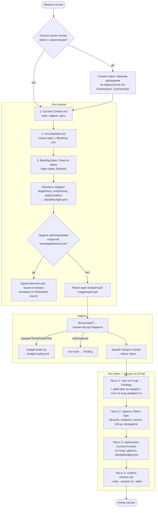

# 05.4. Жизненный цикл сессии

> **Описывает:** путь одной рабочей сессии — [[Knowledge-OS/Dist/commands/mv-resume]] → бюджет чтения → работа → [[Knowledge-OS/Dist/commands/mv-close]] по ритуалу закрытия из [[Project-OS/06-AI/AI]]; `Current-Context.md`; жизнь `.claude/budget.json`; правило потери связи из [[Knowledge-OS/Rules/AI-Governance]].
> **Связано:** [[Docs/07-Commands]] — команды подробно, [[Docs/04-Assistant-Behaviour/04-3-Context-Selection]] — откуда берётся бюджет, [[Docs/06-Tooling/06-4-Budget-Audit-Hook]] — кто записывает чтения, [[Docs/06-Tooling/06-3-Context-Metrics]] — снимок метрик в конце, [[Docs/05-Project-OS/05-2-Delivery-Model]] — как закрываются Task и Epic, [[Docs/09-Obsidian-Integration]] — что значит «связь с хранилищем».

## Назначение

Каждая сессия ассистента начинается без памяти. Если ничего не предпринять, она восстанавливает картину по тому, что попадётся под руку, и заканчивается, не оставив следующей сессии ничего, кроме кода. Жизненный цикл сессии — две симметричные процедуры вокруг работы:

- **вход** (`/mv-resume`) восстанавливает ориентацию по трём файлам, а не по памяти, и объявляет границу чтения до первого чтения;
- **выход** (`/mv-close`) возвращает в хранилище всё, что сессия изменила: находки, закрытие задачи и эпика, текущее состояние, снимок стоимости. Граница чтения снимается.

Между ними только работа над одной задачей. Состояние, которое переходит из сессии в сессию, хранится в одном файле — `Project-OS/06-AI/Context/Current-Context.md`. Именно его выход переписывает, а вход читает первым.

## Как работает

### Общая схема



### Вход: `/mv-resume`

Команда читает три файла **в этом порядке и больше ничего**:

1. `Current-Context.md` — текущие эпик, задача и цель.
2. `Uncertainties.md` — только строки, где `Status: open` и `Blocking: yes`.
3. `Backlog.base` — определения фильтров представлений «Open tasks» и «Blocked». Если в сессии есть живой инструмент запроса к `.base`, лучше использовать его. Если нет, «Open tasks» воспроизводится одним `Grep("^status: (todo|in-progress|blocked|review)", …)` по папке задач (см. [[Docs/05-Project-OS/05-2-Delivery-Model]]), а «Blocked» — фильтром того же результата.

Только после этого объявляется бюджет чтения по [[Knowledge-OS/Protocols/Context-Selection-Protocol]]. Расширение (например, чтение родительского эпика) возможно только внутри бюджета. Команда заканчивается **ровно одним** следующим шагом. Если текущая задача упирается в открытую блокирующую неопределённость, этот шаг — вынести её человеку как решение, которое принимает он (колонка `Resolution source`). Ассистент не решает её сам.

### Бюджет чтения: `.claude/budget.json`

Протокол требует записать бюджет **до первого чтения** по задаче, в корне проекта:

```json
{
  "task": "T14 — Function Analyzer",
  "targetFacts": ["what shape the analyzer returns", "how T13 resolved specifiers"],
  "entryPoints": ["src/analyzer/", "Project-OS/03-Development/Tasks/T14-Function-Analyzer.md"],
  "stopCondition": "the signature and its test cases are known"
}
```

Жизнь файла:

| Момент | Кто | Что происходит |
|---|---|---|
| Начало задачи | ассистент по протоколу §2 (вызывается из `/mv-resume`) | файл создаётся |
| Каждый `Read`/`Grep`/`Glob` | хук `PreToolUse` [[Knowledge-OS/Dist/hooks/budget-audit.cjs]] | строка в `.claude/budget-audit.jsonl`: путь, `declared`, `task`, `withinBudget`. Хук ничего не блокирует: его задача — измерять, как часто дисциплина реально соблюдается |
| Бюджет законно изменился | ассистент | файл переписывается, а не остаётся старым |
| Закрытие (часть 3, шаг 5) | `/mv-close`, `rm -f` (разрешено в `allowed-tools` как `Bash(rm -f *budget.json)`) | файл удаляется |
| Между сессиями | — | файла нет; чтения до нового объявления записываются как `declared: false` («undeclared») |

Оба файла — `.claude/budget.json` и журнал `.claude/budget-audit.jsonl` — в `.gitignore` проекта (класс `gitignore` у [[Knowledge-OS/Tools/adopt.mjs]]). Это артефакты одной сессии, а не знание.

### Работа

Внутри сессии работа идёт по принятой в проекте модели ветвления (в Archi — ветка `task/T…`, squash-слияние, `done` только после слияния; см. [[Docs/05-Project-OS/05-2-Delivery-Model]]). Наблюдения по ходу записываются сразу через `/mv-note`, не дожидаясь закрытия.

### Выход: `/mv-close` и ритуал закрытия

Канон ритуала — раздел «Session Closing Ritual» в [[Project-OS/06-AI/AI]], и это единственная его формулировка: `/mv-close` — указатель, который велит прочитать раздел и выполнить его. Все четыре части обязательны. Ответы берутся из записи самой сессии; человеку задаётся одно сообщение в конце части 1.

**Часть 1 — чего нет в записи.** «Что сессия установила такого, чего нет в `git log` и в изменённых заметках?» и «Что осталось незадокументированным, хотя стоило?». **Пустой ответ — нормальный.** Содержательный ответ становится одним Finding в одну строку в `03-Development/Findings/`, со строкой `affects::`/`related-to::` в той же правке. Затем человеку одним сообщением: какое действие стоит за каждой предложенной находкой — `read` / `ran` / `used` / `confirmed` (→ `evidence` через `evidenceActionMap`, умолчания нет) — и **«Что-то ещё добавить?»**. Вопроса «что дальше?» нет сознательно: ответ на него даёт часть 3, а находки, повторявшие поиск задачи, устаревали в тот же день.

**Часть 2 — закрыть задачу и эпик.** Выполняется, если задача дошла до `done` в этой сессии:

1. В файле задачи: `lifecycle: active`, `evidence` по `evidenceActionMap` (обычно `L2`), `created` (если нет), `updated` — сегодня.
2. `source: [{path, commit}]` по реально изменённым файлам. Коммит — тот, **который содержит изменение**, а не родитель, на который указывает `HEAD` до коммита. Исправление — только следующим коммитом, никогда через `--amend`.
3. Свести статус эпика по `contains::`.
4. Запустить [[Knowledge-OS/Tools/validate-vault.mjs]] и сообщить результат.

**Часть 3 — переписать Current Context, всегда.** Повторить поиск открытой задачи. Переписать `Current Epic`, `Current Task`, `Current Goal` **по результату поиска**, а не по тому, с чем сессия начиналась. `Relevant Code` меняется, только если сессия изменила реальное поведение кода. Остальные разделы трогаются, только если сессия их действительно изменила. Даже в «тихой» сессии поиск повторяется, а не пропускается. Затем удаляется `.claude/budget.json`.

**Часть 4 — снимок метрик, всегда.**

```text
node "Knowledge-OS/Tools/context-metrics.mjs" --write --session <id> --label task
```

`<id>` — последний изменённый файл в `~/.claude/projects/<repo-slug>/`, и передаётся он **явно**. `--label` — класс работы (`task`, `maintenance`, для особых прогонов `control`, `plan-review`). Долю работы над ОС метка не измеряет: сессии над ОС часто закрываются без строки, поэтому C3 считается по git — `Knowledge-OS/Tools/os-share.mjs`. Подробности — в [[Docs/06-Tooling/06-3-Context-Metrics]].

### `Current-Context.md`: состояние, а не журнал

Разделы заметки: Current Epic, Current Task, Required Architecture, Relevant Decisions, Relevant Research, Relevant Code, Current Goal, Context Boundary. Свойства:

- `type: index`, `lifecycle: active`, `evidence: L2`. Уровень L2 оправдан тем, что состояние **выводится повторным запуском поиска**, а не воспроизводится по памяти.
- Каждый раздел **переписывается целиком**, ничего не дописывается. Старое содержимое после движения задачи не «историческое», а просто неверное.
- Это единственное место, где статус задач попадает в текстовое состояние. Ни протокол, ни валидатор, ни другая команда этого не делают. Если пропустить часть 3, состояние устаревает, и никто этого не заметит.

### Потеря связи с хранилищем

Если ассистент работает с хранилищем через живое соединение (MCP-коннектор Obsidian, см. [[Docs/09-Obsidian-Integration]]), раздел Connectivity в [[Knowledge-OS/Rules/AI-Governance]] требует при разрыве:

- немедленно прекратить работу и над знанием, и над реализацией;
- не продолжать по памяти: хранилище могло измениться за время разрыва, в том числе руками человека;
- не угадывать состояние файлов и не повторять вслепую последнее действие;
- возобновить работу только после того, как чтение из хранилища снова проверенно удалось;
- заново сориентироваться по текущему состоянию хранилища.

`/mv-resume` — штатный путь возврата: при возобновлении после разрыва он прямо говорит, что прежние допущения не переносятся, и проходит те же три чтения.

## Почему так

**Три файла на входе, а не «прочитать проект».** Оценка стоимости показала, что всё хранилище — около 7% среднего контекста сессии (контрольный прогон C2 в Archi). Дорого не хранилище, а лишние чтения кода и знания, которые цепляются одно за другое. Три фиксированных чтения дают ориентацию с ограниченной стоимостью, а бюджет ограничивает остальное.

**Бюджет записывается файлом, а не объявляется словами.** Объявление в тексте ответа нельзя проверить. Файл читает хук, и метрики показывают, как часто бюджета не было вообще. Именно эта цифра интересна, а не число чтений вне бюджета.

**Бюджет удаляется при закрытии.** До этого `/mv-resume` записывал бюджет, и никто его не удалял. В Archi бюджет закрытой задачи T18 продолжал стоять, и 18 из 19 чтений следующей работы записались как «вне бюджета» — относительно границы, проведённой для другой работы. Хуже того: 125 строк журнала не содержали ни одного `undeclared`, потому что устаревший бюджет засчитывался как объявленный. **Устаревший бюджет выглядит как лучшая дисциплина, чем отсутствие бюджета.** Отсутствующий бюджет записывается честно. После исправления число `undeclared` выросло. Это исправление прежнего замера, а не падение дисциплины, и об этом предупреждает шапка `analyseBudget` в `context-metrics.mjs`.

**Команда читает ритуал, а не пересказывает его.** `/mv-close` однажды разошёлся с [[Project-OS/06-AI/AI]]: в команде оставались три вопроса человеку, включая «что дальше?», а ритуал к тому времени был с двумя. Пересказ остался и после этого — 1389 слов против 1332 в самом разделе, около 4 тысяч токенов на каждом закрытии, — и держал своё отличие: жёсткое `evidence: L2` для находок. С os-v5 команда — указатель в несколько строк, а истории, на которых стоят правила ритуала, лежат в [[CHANGELOG]], а не в тексте, который читается при каждом закрытии.

**Первый вопрос — о том, чего нет в git.** Вопрос «Что произошло в этой сессии?» почти всегда имел ответ и гарантировал одну находку на сессию: 51 из 52 находок Archi названы `Session-…`, медиана тела — около 190 слов при спецификации в одну строку (замер 2026-10-13). Что произошло, уже записано в коммитах и изменённых заметках.

**Evidence находки спрашивается.** `/mv-close` ставил находкам `L2` жёстко, `/mv-note` спрашивал действие; в итоге у всех 52 находок с полем стояло `L2`, и поле ничего не различало.

**`--session` всегда явно.** По умолчанию берётся «последняя сессия, которая трогала хранилище», и долго это означало «вызывала файловый инструмент». Сессия, работавшая через `Bash`, выпадала из выбора, и снимок молча перезаписывал строку *предыдущей* сессии, завершаясь успешно (`replaced 1 row(s)`).

**Ритуал задаёт человеку одно сообщение.** Ритуал, который спрашивает человека на каждом шаге, превращается в анкету и перестаёт выполняться. Ответы есть в записи сессии; человеку остаются действие за каждой находкой (его не угадать из записи) и один шанс дополнить — в одном сообщении.

## Пример

Сессия Archi по задаче T28. Результаты (тесты, коммит, находка, состояние) взяты из заметок. Содержимое бюджета и формулировка следующего шага — иллюстрация: `budget.json` удаляется при закрытии, так что сам файл не сохранился.

1. `/mv-resume`: Current-Context говорит «E07, следующая T28». Открытых блокирующих неопределённостей нет. Поиск даёт T28 как наименьший открытый номер. Бюджет: `task: "T28 — Relationship Storage"`, `entryPoints: ["src/storage/", "Project-OS/03-Development/Tasks/T28-Relationship-Storage.md"]`. Следующий шаг: «прочитать T28 и `src/storage/schema.ts`».
2. Работа на ветке `task/T28-relationship-storage`, 22 новых теста, squash-слияние как `c24afe7`, затем `status: done`.
3. `/mv-close`. Часть 1 — одна находка о том, что связи хранятся без внешнего ключа, с `affects::` на T28 и строкой в `Findings.md`. Часть 2 — T28 получает `lifecycle: active`, `evidence: L2`, `source` с `c24afe7`. E07 остаётся `active`: T29 открыта. Валидатор чист. Часть 3 — поиск даёт T29; Current Task: «None selected… lookup gives T29»; бюджет T28 удалён. Часть 4 — строка метрик с `--label task`.

## Подводные камни

- **Бюджет пишет `/mv-resume`, и только в один файл.** В `allowed-tools` команды есть `Write(.claude/budget.json)`. Раньше там были только `Read, Glob, Grep`: команда требовала объявить бюджет, но записать его без отдельного разрешения не могла, и чтения тихо уходили в `undeclared`. `task` в бюджете — имя файла задачи без `.md`. По нему метрики распознают устаревший бюджет ([[Docs/04-Assistant-Behaviour/04-3-Context-Selection]]).
- **Возобновлять старую сессию дороже, чем начать новую.** Три четверти стоимости повторной обработки контекста в Archi дало истечение часового TTL префикс-кэша во время паузы, а не компакция. После часа паузы новая сессия с `/mv-resume` обходится дешевле продолжения прежней.
- **Снимок метрик не включает сам ритуал.** Транскрипт пишется по ходу, поэтому вызовы инструментов части 4 в него не попадают, и стоимость сессии немного занижена. Это свойство измерения изнутри, а не ошибка.
- **Сессия через `Bash` не видна по обходу.** Если хранилище читалось только через `Bash`, колонки обхода в метриках — отсутствие измерения, а не измеренный ноль. Ритуал требует передавать это как есть.
- **Часть 2 без задачи.** Если в сессии ни одна задача не дошла до `done`, часть 2 не выполняется, а часть 3 выполняется всё равно.
- **Проверка корня хранилища ищет `Knowledge-OS`/`Project-OS`.** До 2026-10-02 команды искали имена с пробелом, которых после переименования путей уже не было (см. [[Docs/07-Commands]]).

## Как менять

- **Изменение ритуала** — сначала [[Project-OS/06-AI/AI]], затем [[Knowledge-OS/Dist/commands/mv-close]] (команда ссылается на нумерацию частей и шагов), затем развёртывание копии в `.claude/commands/` через [[Knowledge-OS/Tools/adopt.mjs]], иначе `deployed-command-drift` ([[Docs/08-Distribution/08-2-Adoption]]). Если шагу нужен новый инструмент, добавьте его в `allowed-tools`: без разрешения шаг молча не выполнится, как чуть не случилось с `rm -f`.
- **Изменение входа** — [[Knowledge-OS/Dist/commands/mv-resume]]; поиск задачи должен совпадать с `Development.md` и частью 3 ритуала.
- **Изменение формы бюджета** — [[Knowledge-OS/Protocols/Context-Selection-Protocol]] §2, [[Knowledge-OS/Dist/hooks/budget-audit.cjs]] и его тест, `analyseBudget` в [[Knowledge-OS/Tools/context-metrics.mjs]] ([[Docs/06-Tooling/06-4-Budget-Audit-Hook]]).
- **Новый раздел `Current-Context.md`** — шаблон заметки в апстриме и правила части 3 о том, когда раздел переписывается.
- **Проверка** — `node Knowledge-OS/Tools/validate-vault.mjs`, `node Knowledge-OS/Tools/adopt.mjs --verify`, затем пробный прогон `/mv-close` в тихой сессии: часть 3 должна повторить поиск и ничего не изменить.
