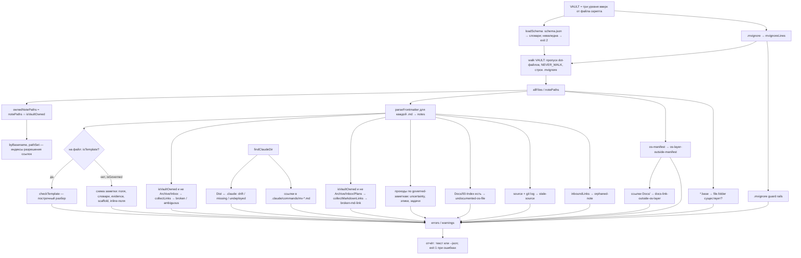

# 6.1. Валидатор хранилища

> **Описывает:** [[Knowledge-OS/Tools/validate-vault.mjs]], [[Knowledge-OS/Tools/validate-vault.test.mjs]], [[Knowledge-OS/Schema/schema.json]], [[Knowledge-OS/Protocols/Knowledge-Maintenance-Protocol]], [[package.json]]
> **Связано:** [[Docs/03-Knowledge-Model/03-7-schema-json]] — откуда берутся все допустимые значения, [[Docs/03-Knowledge-Model/03-5-Relationships-and-Links]] — что такое ссылка и связь с точки зрения модели, [[Docs/06-Tooling/06-6-Tests-and-Fixtures]] — как правила закреплены фикстурами, [[Docs/06-Tooling/06-2-Stale-Check-and-Graph-Report]] — подробные ответы на вопросы, которые валидатор задаёт коротко, [[Docs/08-Distribution/08-1-OS-Manifest]] — правило `os-layer-outside-manifest` с другой стороны, [[Docs/07-Commands]] — `/mv-check`

## Назначение

`validate-vault.mjs` — детерминированная реализация [[Knowledge-OS/Protocols/Knowledge-Maintenance-Protocol]]. Протокол требует проверить, что каждая сущность объявляет `type`, `lifecycle` и `status`, что значения взяты из схемы, что ссылки не битые, что ничего нужного не осиротело, что слой ОС доставляется целиком. Человек или ассистент может сделать это чтением, но чтение двухсот заметок дорого, неповторяемо и пропускает ровно то, что пропускать нельзя. Скрипт делает ту же проверку за секунду и одинаково каждый раз.

Главная задача — не «найти ошибки», а сделать заявления хранилища **проверяемыми**. Если эпик говорит `planned`, а все его задачи `done`, хранилище противоречит само себе; если `active`-заметка не имеет `evidence`, она утверждает больше, чем может обосновать. Валидатор превращает такие противоречия в строки с кодом правила и путём файла.

Запуск (из любого каталога — корень хранилища определяется по расположению самого скрипта):

```bash
node "Knowledge-OS/Tools/validate-vault.mjs"          # человекочитаемо
node "Knowledge-OS/Tools/validate-vault.mjs" --json   # для машин и тестов
npm run validate-vault                                # то же через package.json
```

Единственная зависимость — `js-yaml` 4.3.2, и она не ставится через npm, а лежит в `Knowledge-OS/Tools/vendor/js-yaml.mjs` (с лицензией MIT рядом). Node.js ≥ 18. Obsidian не нужен. До 2026-10-25 `js-yaml` был зависимостью в [[package.json]], и хост со старым или отключённым от сети npm не мог запустить валидатор — первое, что запускает установка.

## Как работает

### Общий конвейер



Скрипт написан как один линейный модуль без функций-обработчиков «на правило»: сначала сбор, затем последовательность проходов, каждый со своим комментарием «почему». Ошибки и предупреждения копятся в двух массивах через `err(file, rule, message)` и `warn(file, rule, message)`.

### Загрузка схемы: `loadSchema()`

Словари не принимаются на веру. `loadSchema(path)` до обхода хранилища проверяет `schema.json`: файл читается и разбирается как JSON; `metadataKeys`, `coreTypes`, `operationalTypes`, `metaTypes`, `lifecycles`, `priorities`, `relationshipTypes`, `evidenceLevels` — массивы строк; `statusByType` и `evidenceFloorByType` — объекты; каждый тип, названный ключом в `statusByType`, `evidenceFloorByType` или `evidenceAlternativeByType`, существует среди типов; список статусов типа непуст; порог из `evidenceFloorByType` — уровень из `evidenceLevels`. Любое нарушение — `schemaFail()`: сообщение `Knowledge-OS/Schema/schema.json is invalid: …` в stderr и **код выхода 2**, ни одна заметка не проверяется.

Раньше отсутствующий ключ всплывал как `TypeError` где-то внутри проверки, а опечатка в имени типа внутри `statusByType` (`tsak`) молча выключала проверку статусов для типа, который имелся в виду, — правило переставало существовать, ничего не сказав. Закреплено тестом «an invalid schema.json stops the run with the reason».

Тип сравнивается без учёта регистра во всех проходах: `typeOf(fm)` возвращает `type` в нижнем регистре без пробелов по краям. Проверки frontmatter приводили регистр всегда, а проходы эпиков, задач и `orphaned-note` раньше сравнивали сырое значение, так что `type: Task` был допустимым типом, которого не видело ни одно правило закрытия (фикстура `task-type-case-insensitive`).

### Корень хранилища и корень репозитория

`VAULT = dirname(dirname(dirname(fileURLToPath(import.meta.url))))` — хранилище там, где структурно лежит сам скрипт (`<vault>/Knowledge-OS/Tools/`), а не `process.cwd()`. Хранилище бывает подпапкой большего проекта (как `MemoValeOS/` внутри Archi); если вызвать скрипт из корня проекта, обход от `cwd` прошёл бы весь проект с зависимостями.

Корень git-репозитория ищет `findRepoRoot(VAULT)`: ближайший предок с `.git`, начиная с самого хранилища. Раньше было `dirname(VAULT)`, что верно для встроенной раскладки и неверно для апстрима, который сам себе корень: `stale-source` там спрашивал не тот репозиторий. Если `.git` не найден вовсе (фикстуры), возвращается `VAULT`. Подробнее о двух раскладках — [[Docs/02-System-Layout]].

`.claude/` ищет `findClaudeDir()`: сначала `<VAULT>/.claude`, затем `<VAULT>/../.claude`. Если нет ни того, ни другого — проверки развёртывания превращаются в предупреждения (см. таблицу).

**Запись установки важнее догадок.** Если есть `<VAULT>/.mvos/install.json` (её пишет `adopt.mjs`, [[Docs/08-Distribution/08-2-Adoption]]), корень проекта берётся из её `projectRoot`. Тогда `.claude/` ищется только в корне проекта, `findRepoRoot` начинает поиск с корня проекта, а признак дистрибутивной копии не ставится. Без этого хранилище со своим `.git` внутри проекта (раскладка, рекомендованная личной установке) спрашивало бы о `source` свой репозиторий, где кода проекта нет, и каждая запись читалась бы как неразрешимая. Тест: «with an install record, a vault with its own .git asks the project's repository». В режиме записи `local` команды и хук приходят плагином `mv`, поэтому проверки развёртывания пропускаются, а итог печатает строку `Personal install: …`. Поле `installMode` в `--json` — режим записи или `null`.

### Обнаружение файлов: `walk`, `NEVER_WALK`, `.mvignore`

`walk(dir)` рекурсивно собирает **все** файлы (не только `.md`) под `VAULT`:

- пропускает всё, что начинается с точки (`.git`, `.obsidian`, `.claude`, `.mvignore` и т. п.);
- пропускает каталоги из `NEVER_WALK`: `node_modules`, `dist`, `build`, `.next`, `coverage`, `.git`, `__fixtures__`, `__provider_fixtures__`. Первые — «страховка» на случай, если код проекта лежит прямо под хранилищем; последние два — тестовые хранилища, которые невалидны **по замыслу**, и сканировать их значило бы докладывать о тестовых данных как о нарушениях;
- если в корне хранилища есть `.mvignore`, каждый путь (в posix-форме относительно `VAULT`) сверяется с его строками через `mvignoreMatches()`. Строка — префикс или glob в духе gitignore (`*` — внутри сегмента, `**` — через сегменты; компилируется той же `manifestToRegExp()`, что и `os-manifest`), `#` — комментарий. Совпавшая строка помечается использованной, исключённый путь увеличивает `mvignoreExcluded`.

Из результата строятся `allFiles` (все файлы) и `notePaths` (только `.md`). Каждая `.md` читается и разбирается в `notes: Map<rel, {fm, body, fmError, raw, text}>`.

### Три области: `isVaultOwned`, `isGoverned`, `isTemplate`

Ключевое решение валидатора — разделить «что я нашёл», «о чём я вправе судить» и «к чему применима схема заметки».

| Предикат | Истина для | Что из этого следует |
|---|---|---|
| `isVaultOwned(rel)` | файлы в корне хранилища (`README.md`, `QA.md`, `CHANGELOG.md`…) и всё под `VAULT_OWNED_ROOTS` = `Knowledge-OS`, `Project-OS`, `Metrics`, `Plans`, `Archive`, `Docs` | ссылки в таких файлах проверяются (кроме папок `Archive`/`Inbox`); только такие файлы участвуют в разрешении ссылок (`byBasename`, `pathSet`) |
| `isGoverned(rel)` | под `Knowledge-OS` или `Project-OS`, но не шаблон, не `Knowledge-OS/Dist/`, не `Project-OS/Inbox/` | применяется схема заметки: frontmatter, обязательные поля, словари, пороги доказательств, форма метаданных, scaffold, inline-поля связей; проходы uncertainty, эпиков и задач; `stale-source`, `orphaned-note` |
| `isTemplate(rel)` | `Project-OS/Templates/**` | вместо схемы заметки — `checkTemplate()` |

Всё, что найдено `walk`, но не `isVaultOwned` (чужой memory bank, `docs/` хост-проекта, `src/`), **обходится, но не судится**. Это исправление после реальной установки: на проекте с собственной базой заметок валидатор выдал двадцать пять «битых ссылок», и ни одна не была правдой — ссылки указывали в граф, который хранилищу никто не показывал. Красный гейт в первый день учит читателя не смотреть на него.

`Docs` добавлен в `VAULT_OWNED_ROOTS` вместе с этой документацией. Положение `Docs/` — **owned, но не governed**, как у `README.md`: frontmatter не требуется (страницы пишутся для людей), но ссылки в них проверяются, и на страницы можно ссылаться из любой заметки. Без этого страница, называющая переименованный инструмент, продолжала бы указывать на него молча, а дрейфующая без сигнала документация хуже отсутствующей. Закреплено фикстурами `docs-broken-link` и `docs-link-target`.

Почему `Dist/` и `Inbox/` не governed: `.md` в `Dist/commands/` несут frontmatter Claude Code (`description`, `allowed-tools`) — другую схему; подчинять их схеме заметок значило бы получать пять ошибок на команду, не сообщающих ничего верного. `Inbox/` хранит чужой `CLAUDE.md`, перенесённый `adopt.mjs` дословно, и требовать от него frontmatter значило бы его править (см. [[Docs/08-Distribution/08-2-Adoption]]). Ссылки `Dist/` при этом проверяются (он owned), а сами файлы покрыты `os-layer-outside-manifest` и `deployed-command-drift`.

### Разбор frontmatter

`parseFrontmatter(text)`:

- нет начального `---` или закрывающего `\n---` → `fm: null` (дальше — `missing-frontmatter`);
- блок есть, `js-yaml` падает → `fmError` со строкой ошибки (дальше — `invalid-yaml-frontmatter`), прогон не прерывается;
- YAML разобрался в скаляр или список → тоже `fmError`: схема метаданных — отображение ключей на значения;
- пустой блок → `fm: {}`;
- иначе `normalizeDates(fm)`: YAML превращает незакавыченное `created: 2026-09-04` в `Date`, а всё остальное в системе сравнивает и показывает даты строками `YYYY-MM-DD` — поэтому даты сразу приводятся обратно.

Шаблоны через YAML не идут: `{{date}}` в позиции значения — валидный YAML, но означает вложенный flow-mapping (`{"[object Object]": null}`). `checkTemplate(rel, raw)` читает блок как текст, строка за строкой `key: value`. Значение принимается, если это плейсхолдер из `CORE_TEMPLATE_PLACEHOLDERS` (`title`, `date` — их подставляет core-плагин Templates в Obsidian) или литерал, допустимый для ключа. Любой другой `{{…}}` — `unfilled-template-placeholder`: так в реальные заметки однажды попал `{{what}}` из старого `Finding.md`. Подробнее о шаблонах — [[Docs/05-Project-OS/05-3-Templates]].

### Ссылки: сбор и разрешение

`stripCodeAndInline(text)` вырезает fenced-блоки и inline-код — wikilink в примере кода не ссылка. `collectLinks(text)` достаёт цели регулярным выражением `\[\[([^\]|#^]+)(?:[#^][^\]|]*)?(?:\|[^\]]*)?\]\]`: алиас после `|` и якорь после `#`/`^` отбрасываются, якоря не проверяются.

Индексы строятся **только из owned-файлов** — иначе чужой `Architecture.md` сделал бы законную голую ссылку `[[Architecture]]` неоднозначной:

- `byBasename: Map<basename, rel[]>` — из `ownedNotePaths` (только `.md`: голая ссылка по имени никогда не попадает в не-заметку; раньше в индекс шли все файлы, и `README` без расширения давал ложную неоднозначность);
- `pathSet` — posix-пути всех owned-файлов, включая не-`.md` (полный путь может адресовать ассет, `.mjs`, `schema.json`).

Ссылка с сегментом пути разрешается так, как её разрешает Obsidian, — функцией `pathLinkCandidates(norm, paths)`: сначала файлы, чей путь **точно** равен цели (с `.md` или без); если таких нет — owned-файлы, чей путь **оканчивается** на `/<цель>` (`[[Schema/Knowledge-Types]]` из `Knowledge-OS` попадает в `Knowledge-OS/Schema/Knowledge-Types.md`). Отката на одно имя файла больше нет.

Функции разрешения:

| Функция | Логика | Где используется |
|---|---|---|
| `linkResolves(target)` | нормализует `\` → `/`, срезает `.md`; цель с `/` — истина, если `pathLinkCandidates` непуст; голая — путь есть в `pathSet` или имя есть в `byBasename` | `broken-link` |
| `ambiguousBareLink(target)` | голая цель — больше одного файла с таким basename; цель с `/` — `pathLinkCandidates` нашёл больше одного файла (частичный путь совпал с концом нескольких путей) | `ambiguous-basename-link` |
| `resolveLinkTargets(target)` | цель с `/` — заметки по тому же правилу `pathLinkCandidates`; голая — все заметки с этим basename | uncertainty, эпики, `orphaned-note` |

Все три функции следуют одному правилу, поэтому ссылка, которую валидатор принял, засчитывается и как входящая для `orphaned-note`, и как задача эпика, и как адресат строки реестра.

Неоднозначность — ошибка, хотя Obsidian что-то всё равно откроет: что именно, решает его собственный tie-break, а не автор. Эта поломка уже случалась с двумя файлами `Context Index`. Точный полный путь от неё освобождён — он называет цель однозначно; частичный путь — нет.

### Отчёт и коды выхода

Текстовый режим печатает строку `Scanned N markdown files, G of them governed notes under Knowledge-OS, Project-OS` (N — все прочитанные `.md`, включая не-owned; G — governed-заметки; с хвостом `(K path(s) excluded by .mvignore)`, если исключения были), затем блоки `ERRORS (n)` и `WARNINGS (n)`, сгруппированные по файлу, и итог — `OK — no schema violations.` либо `FAILED — n error(s).`

```text
Scanned 230 markdown files, 160 of them governed notes under Knowledge-OS, Project-OS.

ERRORS (1)
  Project-OS/03-Development/Epics/E04.md
    [epic-status-behind-tasks] all 3 contained Tasks are done/cancelled but the Epic is still `active`

WARNINGS (1)
  Project-OS/03-Development/Findings/Session-x.md
    [stale-source] `src/storage/project-store.ts` has 1 commit(s) since `c69f68b` — evidence unverified, not necessarily wrong

FAILED — 1 error(s).
```

`--json` печатает `{ "errors": [{file, rule, message}], "warnings": [...], "notes": N }` (N — все прочитанные `.md`). Пути в `file` — в нативной форме ОС (на Windows с `\`); для `.claude/` используется псевдопуть `(.claude) commands/mv-close.md`, для `.mvignore` — просто `.mvignore`.

Код выхода: `2`, если невалиден сам `schema.json` (прогон останавливается до проверки заметок); `1`, если есть хотя бы одна ошибка; `0` иначе. Предупреждения никогда не роняют прогон.

## Полная таблица правил

42 идентификатора. «Где» — к каким файлам применяется. Тест «every rule the validator reports has a row in the Docs/06-1 rule table» сверяет эту таблицу с кодом в обе стороны: правило без строки и строка без правила роняют `npm test`.

### Схема заметки (governed-заметки)

| Правило | Уровень | Срабатывает, когда | Зачем |
|---|---|---|---|
| `missing-frontmatter` | error | у governed-заметки или шаблона нет блока `---` | без frontmatter заметка не имеет ни типа, ни статуса — ни одно другое правило к ней не применимо |
| `invalid-yaml-frontmatter` | error | блок есть, но не разбирается YAML или не является отображением; **также** `*.base`-файл не разбирается как YAML | битая заметка должна дать одну находку, а не уронить весь прогон |
| `missing-required-field` | error | `type`, `status` или `lifecycle` отсутствует, равен `null` или пустой строке (и в шаблонах); `status` не требуется у типа без записи в `statusByType` (`product`, `architecture`); `0` или `false` — значение, а не отсутствие, его дальше проверяет словарь | три поля — минимальный контракт сущности по протоколу обслуживания |
| `unknown-metadata-key` | error | ключ frontmatter не из `metadataKeys` (и в шаблонах) | опечатка в ключе (`lifecyle`) молча выключает все проверки этого поля |
| `unknown-type` | error | `type` (без учёта регистра) нет в `coreTypes` ∪ `operationalTypes` ∪ `metaTypes` | словарь типов закрыт — см. [[Docs/03-Knowledge-Model/03-1-Entity-Types]] |
| `meta-type-outside-knowledge-os` | error | мета-тип, кроме `index`, вне `Knowledge-OS` | `rule`, `protocol`, `schema` описывают ОС, а не проект |
| `project-type-inside-knowledge-os` | error | core- или operational-тип внутри `Knowledge-OS` | зеркало предыдущего; так `Metrics/Context-Metrics.md` (`type: log`) был вынесен из `Knowledge-OS/Tools/` |
| `unknown-lifecycle` | error | `lifecycle` нет в `lifecycles` (и в шаблонах) | см. [[Docs/03-Knowledge-Model/03-3-Lifecycle]] |
| `invalid-status` | error | для типа задан `statusByType`, и статус не из него (и в шаблонах) | закрытый словарь по типу |
| `status-not-allowed-for-type` | error | у известного типа нет записи в `statusByType` (сейчас `product`, `architecture`), а `status` задан (и в шаблонах) | словарь этих типов повторял `lifecycle`, поля расходились: шесть из восьми архитектурных заметок Archi стояли `active` + `draft` |
| `unknown-evidence-level` | error | `evidence` нет ни в `evidenceLevels`, ни среди значений `evidenceAlternativeByType` (и в шаблонах) | см. [[Docs/03-Knowledge-Model/03-4-Evidence]] |
| `evidence-not-allowed-for-type` | error | `evidence` — не уровень, а альтернатива (`user-provided`), и ни тип заметки (`evidenceAlternativeByType`: сейчас `product`, `resource`), ни её `origin` (`origins.*.evidenceAlternatives`: сейчас `decision` с `origin: inherited`) её не разрешают | альтернатива выдаётся по типу и по происхождению; пока её принимали везде, Finding или эпик мог сослаться на авторитет владельца, а `evidenceAlternativeByType.resource` ничего не значил |
| `invalid-metadata-value` | error | `created`, `updated` или `ratified` не в форме `YYYY-MM-DD`; `stale` не булево; `origin` не из `origins` в `schema.json` или стоит на типе, для которого не определён; `key` не строка или (у задачи и эпика) не соответствует `tasks.keyPattern` из `mvos.config.json` | Metadata Schema задаёт эти формы; `created: <YYYY-MM-DD>` из примера или `stale: yes` выглядели заполненными и ничего не значили, а неизвестное `origin` ничего не давало бы молча |
| `origin-incomplete` | error | у заметки `origin`, а поля, которых оно требует, нет: для `inherited` — `source` списком `{path, commit}` всегда и `ratified` при `lifecycle: active`; для `imported` — `key` | унаследованное правило хоста стоит на ратификации владельца вместо `L2`; взамен оно называет файл и коммит хоста, за которыми следит `stale-source`, и дату, когда владелец сделал его правилом проекта (решение владельца 2026-10-25). Законный случай — фикстура `inherited-decision` |
| `unknown-priority` | error | `priority` нет в `priorities` (и в шаблонах) | закрытый словарь |
| `missing-evidence-for-active` | error | `lifecycle: active`, нет `evidence`, тип не мета | активное знание обязано сказать, на чём стоит; именно это ловит вставку шаблона `Finding` в обход `/mv-note` |
| `below-evidence-floor` | error | `active`, у типа есть `evidenceFloorByType`, `evidence` ниже порога по индексу в `evidenceLevels` и не входит в альтернативы типа или его `origin` | порог — минимальная сила доказательства для типа; `user-provided` для `product`/`resource` и для унаследованного `decision` — альтернатива, а не ступень лестницы, поэтому сравнивается не по индексу |
| `active-scaffold` | error | тело после удаления заголовков, цитат, пустых пунктов и `---` пусто, а `lifecycle: active` | заметка из одних заголовков — не знание; протокол прямо запрещает делать её активной |
| `scaffold` | warning | то же, но не `active` | заготовка допустима, но видна |
| `unknown-relationship-field` | error | строка тела (вне кода) начинается с `name::` или с пункта списка `- name::`, и `name` нет в `relationshipTypes` | опечатка в типе связи — тихий отказ: ссылка разрешается, граф рисует ребро, но связь перестаёт существовать для любого запроса по типу |
| `unfilled-template-placeholder` | error | в шаблоне значение `{{x}}`, где `x` не `title`/`date` | такой плейсхолдер дойдёт до реальной заметки дословно |

### Ссылки (owned-файлы, кроме `Archive/` и `Inbox/`, плюс `.claude/commands/mv-*.md`)

| Правило | Уровень | Срабатывает, когда | Зачем |
|---|---|---|---|
| `broken-link` | error | `linkResolves(target)` ложно | переименование на стороне хранилища ломает ссылку молча |
| `ambiguous-basename-link` | error | голая ссылка совпадает с несколькими owned-заметками | какую откроет Obsidian, решает не автор |
| `broken-md-link` | error | Markdown-ссылка `[текст](путь)` или `` (вне кода) в owned-файле, кроме `Archive/`, `Inbox/` и `Plans/`, ведёт на несуществующий файл. Путь считается от файла со ссылкой, путь с `/` — от корня хранилища; `%20` раскодируется, `#якорь` и `?запрос` отбрасываются; URL со схемой (`https:`, `mailto:`) и якорь на ту же страницу — не файлы и не проверяются | wikilink-правило не видело этой формы, и страница могла молча указывать на переименованный файл. В слое ОС таких ссылок пока нет, поэтому правило дешевле всего ввести сейчас. `Plans/` исключён: планы пишутся в редакторе, их ссылки — от корня репозитория (фикстура `md-link-clean`) |

Ссылки в `.claude/commands/` проверяются отдельным обходом `walkClaudeMarkdown()` — `walk()` пропускает dot-каталоги, а `mv-note.md` и `mv-close.md` ссылаются на `Project-OS/Templates/Finding`. Только имена `commands/mv-*.md`: `.claude/agents/reviewer.md` хост-проекта ссылается в его собственную документацию.

### Согласованность между заметками

| Правило | Уровень | Срабатывает, когда | Зачем |
|---|---|---|---|
| `blocking-uncertainty-on-active` | error | в governed-файле, чей путь содержит `uncertaint` (без учёта регистра), строка таблицы вне кода (fenced-блоки и inline-код вырезаются) содержит ячейку `open` и ячейку `yes`/`true`/`blocking`, а ссылка этой строки (через `resolveLinkTargets`) ведёт на `active`-заметку; через `contains::` правило не спускается | открытая блокирующая неопределённость означает, что знание, которого она касается, остаётся `draft`; см. [[Docs/03-Knowledge-Model/03-6-Uncertainty-Ledger]] |
| `epic-status-behind-tasks` | error | все задачи (`type: task` без учёта регистра) по строкам `contains::` (в том числе `- contains::`) governed-эпика в `done`/`cancelled`, а эпик не `done` | статус эпика выводится из задач; эпик, отставший от задач, противоречит собственным ссылкам |
| `epic-status-ahead-of-tasks` | error | эпик `done`, но хотя бы одна задача — нет | обратное противоречие |
| `lifecycle-behind-status` | error | governed-заметка в статусе из `activeLifecycleStatuses` своего типа (задача `done`, эпик `active`/`done`, решение `accepted`), а `lifecycle: draft` | порог доказательств и `blocking-uncertainty-on-active` смотрят только на `active`: задача закрывается без `evidence` (так деградировали T11 и T12 в Archi), черновой эпик выключает гейт. Было два правила по типам, и класс вернулся на решениях (ADR-003/004/005), поэтому правило одно, а статусы — данные |
| `orphaned-note` | warning | governed-заметка под `Project-OS`, не мета-типа, на которую не ссылается ни один другой owned-файл (шаблоны и чужие деревья не в счёт) | протокол требует, чтобы достижимое было достижимо; предупреждение, потому что свежий Finding законно ещё без входящих ссылок |
| `duplicate-number` | error | две governed-заметки одного типа — задачи, эпики или решения — начинаются с одного номера (`T07-…` и `T07-…`; номер сравнивается по значению, поэтому `T7` и `T07` совпадают, а `T07` и `E07` — нет); у двух задач или эпиков один `key`; в реестре неопределённостей две строки с одним `U-NNN` в первой ячейке. Первый файл по пути сохраняет номер, о каждом следующем — одна ошибка | номер берёт тот, кто пишет следующий файл, а «следующий» на двух ветках один и тот же. Git сливает два файла с разными именами молча, и после слияния одному номеру отвечают две задачи. Правило проверяет слитое дерево, как бы команда ни работала с ветками ([[Docs/06-Tooling/06-10-Task-Lookup]]) |
| `current-context-old-shape` | warning | в governed-заметке `Current-Context.md` (вне кода) есть раздел `## Current Task` или `## Current Goal` | до os-v8 эта заметка хранила состояние одной рабочей копии и переписывалась каждой сессией; у двух людей на двух ветках каждое слияние давало конфликт. Теперь в ней только общее для проекта. Предупреждение, а не ошибка: перенос — суждение о том, куда уходит каждая часть, и делается с владельцем ([[Docs/05-Project-OS/05-4-Session-Lifecycle]]) |
| `stale-source` | warning | у governed `active`-заметки запись `source: [{path, commit}]`, и `git log --format=%h <commit>..HEAD -- <path>` непуст, **или** git не может ответить (неизвестный коммит; путь, которого нет в `HEAD`, хотя с цитируемого коммита его никто не трогал — пустой `git log` такой путь не отличает от нетронутого), **или** запись без строковых `path`/`commit`; отдельное сообщение «quote the hash», если хеш из одних цифр YAML прочитал как число | устаревшее доказательство делает знание непроверенным, а не ложным; подробный разбор — `stale-check.mjs`, см. [[Docs/06-Tooling/06-2-Stale-Check-and-Graph-Report]] |

### Слой ОС и развёртывание

| Правило | Уровень | Срабатывает, когда | Зачем |
|---|---|---|---|
| `os-layer-outside-manifest` | error | файл под `Knowledge-OS/` или `Project-OS/Templates/` не покрыт ни одной включающей строкой [[Knowledge-OS/os-manifest]] и не исключён строкой `!…` (проверка выполняется, только если `os-manifest` существует) | файл вне манифеста не доставляется, и копии расходятся молча — так апстрим откатил удаления в `Context Index`. Ошибка, потому что новый файл слоя добавляют сознательно, и строка манифеста стоит одну строку в том же коммите |
| `mvignore-excludes-os-layer` | error | строка `.mvignore` совпадает с `Knowledge-OS/Rules`, `Schema`, `Protocols`, `Tools` (`PROTECTED_FROM_IGNORE`), лежит под ними или является их предком | иначе одной строкой в файле, который никто не ревьюит, отключается `os-layer-outside-manifest` |
| `mvignore-line-unused` | warning | строка `.mvignore` ни с чем не совпала | устаревшее исключение — начало файла, который больше не описывает дерево |
| `deployed-command-drift` | error | `Knowledge-OS/Dist/commands/mv-*.md` или `Dist/hooks/budget-audit.cjs` отличается (после нормализации CRLF) от копии в `.claude/` | две копии, поддерживаемые намерением, расходятся; проверяемое программой дублирование — другой дефект, чем обещанное человеком |
| `deployed-command-missing` | warning | `.claude/` нет вообще или в нём нет копии исходника; **не** выдаётся в дистрибутивной копии — хранилище само корень git (`.git` в нём), а `.claude/` нет нигде: там итог печатает одну строку `Distribution copy: …` | апстрим не является установленным проектом и законно не имеет `.claude/`. Ошибка сделала бы его валидатор красным в день выпуска, а предупреждение на каждый исходник давало двенадцать строк на каждом чистом клоне — то, что горит всегда, перестают читать |
| `undeployed-command-source` | warning | в `.claude/commands` (или `hooks`) есть `mv-*`-файл без исходника в `Dist/` | обычно команда от старой версии, которая продолжает загружаться и отвечать за систему, которая так больше не работает |
| `broken-base-folder` | error | в `*.base` условие `file.folder == "…"` указывает на несуществующий каталог | Bases молча показывает пустую таблицу, неотличимую от «правильно пусто» |
| `docs-link-outside-os-layer` | error | ссылка со страницы `Docs/` (wikilink или Markdown, вне кода) **разрешается**, но ведёт на путь, которого нет в слое ОС: не `Docs/**`, не покрыт включающей строкой манифеста (строки `!…` цель не запрещают — исключённый шаблон есть в каждой копии, просто своей формы) и не входит в `PER_COPY_FILES` (`CLAUDE.md`, `README.md`, `.os-version`, `.obsidian/app.json`, `.obsidian/templates.json`, `Backlog.md`); или выходит за пределы хранилища. Выполняется, только если `os-manifest` существует | `Docs/` едет вместе со слоем ОС, а ссылка на задачу или находку проекта разрешается только здесь. Раньше это правило жило в комментарии манифеста и ловилось лишь в апстриме, на шаге `/mv-sync`, — в самом дорогом месте. Битые ссылки оставлены `broken-link`/`broken-md-link` |
| `invalid-config` | error | `mvos.config.json` в корне хранилища есть, но не разбирается как JSON, не является объектом, содержит неизвестный ключ (известны `format`, `language`, `notes`, `tasks`) или значение не того вида: `format` — `1`, `language` — языковой тег (`ru`, `en`, `pt-BR`), `notes` — `language`, `english` или `split`, `tasks` — объект с необязательными `keying` (`sequence`, `external`), `next` (`lowest-number`, `explicit`), `keyPattern` (регулярное выражение, которое компилируется) и `staleDays` (целое больше нуля). Сообщение перечисляет допустимое | конфиг — то, откуда [[Knowledge-OS/Rules/Communication-Rules]] берёт язык проекта. Опечатка в нём молча возвращает ассистента к догадке; фикстура `config-clean` — все ключи с допустимыми значениями |
| `undocumented-os-file` | error | файл слоя ОС не упомянут ни на одной странице `Docs/`: инструмент `Knowledge-OS/Tools/*.mjs`/`.cjs` (кроме `*.test.mjs`) по имени файла, команда `Dist/commands/mv-*.md` по имени без `.md` (`/mv-check`), хук `Dist/hooks/*` и файл в корне `Dist/` по имени. Код в обратных кавычках считается. Выполняется, только если есть `Docs/00-Index.md` | определение готовности ([[Docs/10-Extending]], «Готово, когда») начинается с актуальной документации; машина видит её дешёвую половину — описано ли вообще. `Docs/00-Index.md` отличает документацию ОС от случайной папки `Docs/` в фикстуре или проекте (фикстура `undocumented-os-file-clean`) |

Про развёртывание подробнее — [[Docs/08-Distribution/08-2-Adoption]]; про Bases — [[Docs/09-Obsidian-Integration]].

## Почему так

**Схема в одном месте.** Словари читаются из [[Knowledge-OS/Schema/schema.json]] при старте. Раньше значения жили в трёх местах (валидатор, `.md` схемы, генератор) и расходились. Теперь `.md` объясняют смысл, JSON — единственный источник значений; разбор — [[Docs/03-Knowledge-Model/03-7-schema-json]].

**Уровень — проектное решение, а не вкус.** Сквозной принцип файла: валидатор, который обычно красный, перестают читать. Поэтому ошибка — только то, что действительно противоречие (поле не из словаря, эпик против задач, дрейф копий), а состояния, которые могут быть законными (`orphaned-note`, `stale-source`, отсутствие `.claude/`), — предупреждения. Поле `stale` в схеме метаданных, «выставляемое и снимаемое вручную», не было выставлено ни разу; `stale-source` его заменяет и сознательно не роняет сборку, иначе его выключили бы за неделю.

**Владение вместо исключений.** Альтернатива — заставлять каждый хост-проект перечислять свои папки в `.mvignore` — перекладывает ошибку валидатора на пользователя. Вместо этого валидатор судит только свою территорию, а `.mvignore` оставлен для редких случаев и сам защищён двумя правилами: подавление без следа — подавление, которого никто не аудирует, поэтому число исключённых путей печатается в итоге.

**Разрешение как в Obsidian.** Ссылки разрешаются так же, как их разрешит приложение: точный путь, иначе уникальный файл, чей путь оканчивается на цель; голая ссылка — уникальный basename. Если бы валидатор был строже Obsidian, он ругался бы на рабочие ссылки; если мягче — пропускал бы неоднозначные.

**Git — через `execFileSync`.** `stale-source` вызывает `git log` на каждую запись `source`. Это дёшево, пока `source` есть у пары десятков заметок; реализация достижимости по объектному графу была бы второй вещью, которую надо держать правильной. Когда станет дорого — группировать по коммиту, а не по заметке.

## Пример

Эпик со всеми закрытыми задачами, но устаревшим статусом:

```markdown
---
type: epic
status: active
lifecycle: active
evidence: L2
---
# E04 Storage

contains:: [[Project-OS/03-Development/Tasks/T26-Node-Store]]
contains:: [[Project-OS/03-Development/Tasks/T27-Persistence]]
```

Если у обеих задач `status: done`, прогон даст `epic-status-behind-tasks` на эпике. Если бы эпик был `status: active, lifecycle: draft`, добавилось бы `lifecycle-behind-status` — и, что важнее, открытая блокирующая неопределённость на этот эпик **не** сработала бы, пока lifecycle не исправлен.

### Рабочий пример: добавить новое правило

Задача: ошибка `updated-before-created`, если в governed-заметке `updated` раньше `created`.

1. **Код.** В блоке проверок governed-заметки (внутри ветки `else` после проверок `fm`) — даты уже строки благодаря `normalizeDates`:

   ```js
   if (fm.created && fm.updated && String(fm.updated) < String(fm.created)) {
     err(rel, "updated-before-created", `updated ${fm.updated} is earlier than created ${fm.created}`);
   }
   ```

   Над ним — комментарий в стиле файла: какой отказ это ловит, почему ошибка, а не предупреждение.

2. **Фикстура** `Knowledge-OS/Tools/__fixtures__/updated-before-created/` — минимальное дерево с **ровно одним** нарушением:

   ```text
   updated-before-created/
     Knowledge-OS/README.md      # type: readme, ссылается на [[Project-OS/Note]], чтобы не было orphaned-note
     Project-OS/Note.md          # type: research, status: open, lifecycle: draft,
                                 # created: 2026-09-10, updated: 2026-09-01, непустое тело
   ```

   `schema.json` и сам валидатор в фикстуру не кладутся — тест копирует их при запуске.

3. **Негативный случай**, если правило может давать ложные срабатывания (например, равные даты): отдельная фикстура `updated-equals-created` и отдельный `test(...)`, утверждающий `errors: []` и `warnings: []`; её имя — в множество `covered`.

4. **`CASES`** в [[Knowledge-OS/Tools/validate-vault.test.mjs]]: `["updated-before-created", "updated-before-created"]`. Тест «every fixture directory under `__fixtures__` is covered by a case» упадёт, если забыть этот шаг.

5. **Прогон:** `node --test "Knowledge-OS/Tools/validate-vault.test.mjs"`, затем `npm test` и сам валидатор на живом хранилище — новое правило может впервые сделать видимыми давние нарушения.

6. **Документация и история:** строка в [[CHANGELOG]] в разделе «Что валидатор начал требовать» с уровнем и тем, нужна ли миграция проектам; строка в таблице правил этой страницы; если правило вводит новое значение схемы — `schema.json` и соответствующий `.md` в `Knowledge-OS/Schema/` синхронно. Новый файл в `Knowledge-OS/` уже покрыт `Knowledge-OS/Tools/__fixtures__/**` в манифесте.

Подробнее о конвенции фикстур — [[Docs/06-Tooling/06-6-Tests-and-Fixtures]].

## Подводные камни

- **Раньше ссылка с путём откатывалась на basename.** `linkResolves` при промахе по полному пути проверял последний сегмент как голое имя, и `[[Wrong/Folder/Note]]` «разрешалась», если где-то была любая `Note.md`; а `resolveLinkTargets` такого отката не делал — одна и та же ссылка была рабочей для `broken-link` и несуществующей для `orphaned-note`. Теперь все три функции идут через `pathLinkCandidates`, и ссылка в несуществующую папку — `broken-link` (фикстура `path-link-wrong-folder`). Частичный путь законен, но может совпасть с концом нескольких путей — тогда это `ambiguous-basename-link`; надёжнее писать полный путь от корня хранилища.
- **Раньше правила согласованности смотрели за пределы governed-области**: проходы эпиков и задач — на любую заметку с `type: epic`/`task`, uncertainty-проход — на любой файл с `uncertaint` в пути, включая `Docs/` и `Plans/`, и читал таблицу-пример в блоке кода как живую строку. Теперь все три прохода — только по governed-заметкам, а из реестра код вырезается (негативная фикстура `uncertainty-example-in-code`).
- **Реестр находится по имени, а слова статусов зашиты в код.** Uncertainty-проход ищет `uncertaint` в пути файла и ячейки `open` и `yes`/`true`/`blocking`; переименованный реестр или другое слово в колонке статуса выключают правило молча. И правило не спускается через `contains::`: строка, ссылающаяся на эпик, не держит его задачи — ссылайтесь на задачи, которые строка блокирует (так и сказано в [[Project-OS/06-AI/AI]]).
- **Входящие ссылки считаются только из owned-файлов.** Ссылка из чужого дерева под хранилищем не делает заметку достижимой: она разрешается в графе, которого хранилищу никто не показывал.
- **Хеш из одних цифр в `source`.** Незакавыченный `commit: 1234567` YAML читает как число, ведущие нули к этому моменту уже потеряны; валидатор говорит «quote the hash», а не пытается восстановить хеш. Пишите `commit: "0123456"`.
- **Имя правила `deployed-command-*` применяется и к хуку** `budget-audit.cjs` — это не только команды.
- **Раньше у части правил не было фикстур** (`epic-status-ahead-of-tasks`, `scaffold`, `undeployed-command-source`), и этого никто не замечал: тест покрытия проверял только обратное — что у каждой фикстуры есть случай. Теперь тест «every rule the validator reports has a fixture case» извлекает идентификаторы из вызовов `err`/`warn` и требует каждый в `CASES` или в коротком списке правил с отдельными тестами (`deployed-command-missing`, `mvignore-line-unused`, `stale-source`). Его регулярное выражение не видит вызов, у которого первый аргумент содержит скобки, — так `undeployed-command-source` (файл `(.claude) …`) не извлекается, хотя фикстура у него есть.
- **Фикстуры без `os-manifest` и `Dist/`** не проверяют `os-layer-outside-manifest` и развёртывание — эти проходы просто пропускаются. Для них есть отдельные фикстуры с нужными файлами.

## Как менять

- **Новое правило** — по рабочему примеру выше: код + фикстура (позитивная, при риске ложных срабатываний — и негативная) + `CASES`/`covered` + [[CHANGELOG]] + таблица на этой странице. Забытая фикстура роняет тест «every rule the validator reports has a fixture case».
- **Новое значение словаря** (тип, статус, уровень доказательства, тип связи) — только в [[Knowledge-OS/Schema/schema.json]] плюс описание в соответствующем `.md` из `Knowledge-OS/Schema/`; код валидатора трогать не нужно. Новый ключ верхнего уровня, который валидатор должен требовать, — ещё и в списки `loadSchema()`. Обратное направление (значение в JSON без описания в `.md`) валидатор не ловит — проверять вручную по §6 протокола обслуживания.
- **Новая owned-папка** — `VAULT_OWNED_ROOTS`; если она должна подчиняться схеме — `KNOWLEDGE_ROOTS` (это гораздо более сильное изменение: на все её заметки сразу лягут все правила). Обновить комментарий над `VAULT_OWNED_ROOTS`, README («Валидатор проверяет только то, чем владеет хранилище»), CHANGELOG с указанием миграции для проектов, у которых такая папка уже есть.
- **Исключение из обхода** — `NEVER_WALK` для каталогов, которые никогда не бывают знанием (и синхронно в `stale-check.mjs`, `graph-report.mjs`, `context-provider.mjs`, где свои копии списка); для единичных проектных случаев — `.mvignore`, а не код.
- **Проверка:** `npm test`, затем `node "Knowledge-OS/Tools/validate-vault.mjs"` на живом хранилище. По [[Knowledge-OS/Protocols/Knowledge-Maintenance-Protocol]] изменение правила без обновления фикстуры считается непроверенным.
