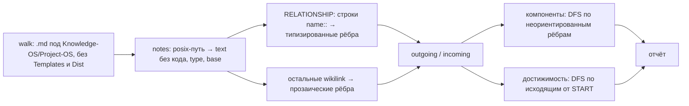

# 6.2. Проверка устаревания и отчёт о графе

> **Описывает:** [[Knowledge-OS/Tools/stale-check.mjs]], [[Knowledge-OS/Tools/graph-report.mjs]], [[Knowledge-OS/Protocols/Knowledge-Maintenance-Protocol]]
> **Связано:** [[Docs/06-Tooling/06-1-Validator]] — правила `stale-source`, `broken-link`, `orphaned-note`, которые эти инструменты разворачивают в подробности, [[Docs/03-Knowledge-Model/03-4-Evidence]] — поле `source` и смысл доказательств, [[Docs/03-Knowledge-Model/03-5-Relationships-and-Links]] — типизированные связи против прозаических ссылок

## Назначение

Оба инструмента **описывают и никогда не роняют**: код выхода всегда `0`. Гейт — валидатор; эти два скрипта отвечают на вопросы, ответ на которые нельзя свести к «нарушение / нет».

- `stale-check.mjs` — для каждой заметки с `source: [{path, commit}]`: менялся ли с тех пор цитируемый код, и **какими коммитами**. Валидатор задаёт тот же вопрос коротко (`stale-source`, число коммитов); здесь названы сами коммиты, и по их сообщениям видно, затронули ли они то, что утверждает заметка.
- `graph-report.mjs` — глобальная форма графа: сколько компонент связности, сколько заметок достижимо от точки входа, какие типы связей используются и какая доля рёбер типизирована. Все правила валидатора о ссылках локальны (смотрят на одну заметку), и хранилище может пройти их все, оставаясь четырьмя несвязанными островами.

## Как работает

### `stale-check.mjs`

```bash
node "Knowledge-OS/Tools/stale-check.mjs"         # текст
node "Knowledge-OS/Tools/stale-check.mjs" --json  # {repo, findings}
```

1. `VAULT` — три уровня вверх от файла; `REPO = findRepoRoot(VAULT)` — ближайший предок с `.git` (та же функция, что в валидаторе). Пути в `source` относительны **корня репозитория**, поэтому во встроенной раскладке они начинаются с `MemoValeOS/…`, а для кода проекта — с `src/…`.
2. `walk()` собирает `.md`, пропуская dot-файлы и свой `NEVER_WALK` (`node_modules`, `dist`, `build`, `.next`, `coverage`, `.git`, `__fixtures__`, `__provider_fixtures__` — тот же список, что у валидатора); дальше остаются только файлы под `Knowledge-OS`/`Project-OS`, кроме `Project-OS/Templates/`, `Knowledge-OS/Dist/` и `Project-OS/Inbox/` — тех же областей, которые валидатор не считает governed: исходники команд и дословно перенесённые файлы хоста не несут собственного `source`.
3. `frontmatter()` разбирает YAML; невалидный YAML молча пропускается — о нём сообщает валидатор.
4. Для каждой записи `source`:
   - нет строковых `path`/`commit` → находка `kind: "malformed"` (сюда же попадает хеш из одних цифр, который YAML прочитал как число; валидатор в этом случае прямо говорит «quote the hash»);
   - `commitsSince(commit, path)` = `git log --format="%h %s" <commit>..HEAD -- <path>`; пустой ответ дополнительно проверяется `git cat-file -e HEAD:<path>`: путь, который никто не трогал с цитируемого коммита, обязан существовать в `HEAD`. Если git упал (неизвестный коммит) или пути нет, `pathIsTracked(path)` (`git ls-files --error-unmatch`) различает `unknown-commit` и `untracked-path`;
   - непустой список → `kind: "stale"` с массивом `commits` и `lifecycle` заметки.

Ключевое решение — `null` вместо пустого списка, когда вопрос нельзя задать: «не на что ответить» и «ничего не изменилось» не должны схлопнуться в одно значение. Первое — сломанная ссылка на доказательство, второе — здоровое знание.

Формат находки в `--json`:

```json
{
  "repo": "C:\\work\\project",
  "findings": [
    {
      "note": "Project-OS\\03-Development\\Findings\\Session-B5s-premise-was-false-before-it-was-built.md",
      "path": "MemoValeOS/Knowledge-OS/Tools/context-metrics.mjs",
      "commit": "b87cf8b",
      "kind": "stale",
      "commits": ["73e56ca Restore the context provider as a generic interface, not a Closure adapter", "a7c2258 delete closure"],
      "lifecycle": "active"
    }
  ]
}
```

### `graph-report.mjs`

```bash
node "Knowledge-OS/Tools/graph-report.mjs"
node "Knowledge-OS/Tools/graph-report.mjs" --from "Knowledge-OS/README.md"
node "Knowledge-OS/Tools/graph-report.mjs" --json
```



- **Узлы** — `.md` под `Knowledge-OS`/`Project-OS`, кроме `Project-OS/Templates/` и `Knowledge-OS/Dist/` (исходники команд — инструкции ассистенту, а не заметки); `NEVER_WALK` включает `__fixtures__` и `__provider_fixtures__`. `type` вытаскивается регулярным выражением `^type:\s*(\S+)` из frontmatter (без YAML) и приводится к нижнему регистру, как `typeOf()` в валидаторе.
- **Код вырезается** до чтения ссылок: fenced-блоки и inline-код удаляются из текста, так что ссылка или строка `name::` в примере не становятся ребром (валидатор делает то же — `stripCodeAndInline`).
- **Разрешение** — `resolveTarget()`: цель с `/` сначала ищется как точный путь, при промахе — по basename последнего сегмента; голая цель — все заметки с таким basename. Самоссылки отбрасываются.
- **Типизированные рёбра** — строки, совпадающие с `^[ \t]*(?:[-*+][ \t]+)?([a-z-]+)::\s*(.+)$` (поле связи в начале строки или пункта списка `- name::`): каждая ссылка в такой строке — ребро с типом `m[1]`, учитывается в `typedCounts`. Сырые ссылки, «занятые» связью, не считаются второй раз как прозаические.
- **Прозаические рёбра** — все прочие wikilink; `proseEdges` увеличивается только для новой пары (источник, цель).
- **Компоненты связности** — обход в глубину по объединению исходящих и входящих рёбер: две заметки в одном теле знания, куда бы ни указывала ссылка. Сортируются по размеру.
- **Изолированные** — ни одного ребра в любую сторону.
- **Достижимость** — обход только по исходящим рёбрам от `START` (по умолчанию `Project-OS/00-Home/Home.md`, если он есть, иначе `Knowledge-OS/README.md`; переопределяется `--from`), то есть так, как идёт читатель.

Текстовый вывод (фрагмент реального прогона на Archi):

```text
Notes in the graph: 179

Edges: 342 typed, 550 prose-only
  38% of edges declare a relationship type

Relationship types in use:
  related-to       80
  depends-on       66
  contains         59
  ...

Connected components: 16
   164 notes (main)
     1 notes: Project-OS/03-Development/Findings/…
     ...

Isolated notes (no link either way): 15
```

Компоненты до пяти заметок перечисляются поимённо, крупнее — только счётом с пометкой `(main)`. Если `START` не найден, отчёт так и говорит и просит `--from`. Недостижимые группируются по типу и показываются первые десять.

`--json`: `{ notes, typedEdges, proseEdges, relationshipsInUse, components: [размеры], isolated, start, reachable, unreachable }`.

## Почему так

**Почему `stale-check` не гейт.** Устаревшее доказательство делает знание *непроверенным*, а не *ложным*. Поле `stale` в [[Knowledge-OS/Schema/Metadata-Schema]] задумывалось как ручной флаг и не было выставлено ни разу: поле, которое может поддерживать только человек, не поддерживает никто. `source: [{path, commit}]` делает вопрос механическим — `git log <commit>..HEAD -- <path>` — и ответ можно получить в любой момент. Протокол обслуживания (§4) прямо говорит: заметка с ушедшим доказательством — кандидат на перепроверку, не на понижение.

**Почему два инструмента, а не флаг валидатора.** Валидатор должен быть быстрым, стабильным по формату и бинарным по смыслу. Список коммитов с сообщениями и топология графа — данные для человека, который принимает решение; их формат будет меняться, и им не место в выводе гейта.

**Почему компоненты и достижимость считаются отдельно.** Компонента отвечает «это одно тело знания?» (направление не важно). Достижимость отвечает «найдёт ли это читатель, идущий от входа?» (направление важно). У хранилища несколько входов — `Project-OS/00-Home` и [[Knowledge-OS/README]], — поэтому заметка, недостижимая от одного, может быть достижима от другого; протокол требует прогнать с `--from`, прежде чем делать вывод.

**Почему доля типизированных рёбер.** Типизированная связь (`depends-on::`) — то, что можно запросить; прозаическая ссылка — только навигация. Доля показывает, насколько граф пригоден для вопросов по типу. Это показатель, а не норма.

## Пример

Заметка утверждает поведение `context-metrics.mjs`:

```yaml
---
type: finding
status: active
lifecycle: active
evidence: L2
source:
  - path: MemoValeOS/Knowledge-OS/Tools/context-metrics.mjs
    commit: "b87cf8b"
---
```

После двух коммитов в этот файл валидатор даёт предупреждение `stale-source … has 2 commit(s) since b87cf8b`, а `stale-check.mjs` печатает:

```text
  Project-OS\03-Development\Findings\Session-B5s-premise-was-false-before-it-was-built.md
    MemoValeOS/Knowledge-OS/Tools/context-metrics.mjs — 2 commit(s) since b87cf8b
        73e56ca Restore the context provider as a generic interface, not a Closure adapter
        a7c2258 delete closure
```

По сообщениям видно, что изменения — переименование провайдера, а не логика метрик; заметку можно перештамповать (`commit` → текущий), не переписывая. Коммит закавычен: короткий SHA из одних цифр YAML прочитал бы как число.

## Подводные камни

- **`stale-check` проверяет все заметки с `source` при любом `lifecycle`, валидатор — только `active`.** Это намеренно: `stale-check` — подробный взгляд, и устаревший `source` у черновика тоже полезно увидеть. Находки обоих инструментов поэтому могут расходиться по количеству. `.mvignore` `stale-check` не учитывает.
- **Раньше оба инструмента обходили тестовые хранилища и `Dist/`.** В `NEVER_WALK` не было `__provider_fixtures__`, и заметки `Knowledge-OS/Tools/__provider_fixtures__/basic/…` были узлами графа — изолированными компонентами, а их `Decisions.md` и `Context-Selection-Protocol.md` давали коллизии basename с настоящими заметками; `graph-report` показывал команды `mv-*.md` и `CLAUDE.redirect.md` как изолированные заметки и считал ссылки из блоков кода рёбрами. Теперь списки исключений совпадают с валидатором, а код вырезается. Урок: у каждого инструмента своя копия `NEVER_WALK`, и расхождение не видно, пока его не покажет отчёт.
- **Разрешение ссылок с путём расходится с валидатором.** `resolveTarget()` при промахе по точному пути откатывается на basename последнего сегмента, а валидатор такой откат убрал (`pathLinkCandidates`: точный путь или уникальное окончание пути). Ссылка `[[Wrong/Folder/Note]]` — `broken-link` для валидатора и ребро к любой `Note.md` для отчёта о графе. На исправленном хранилище (без `broken-link`) разница пропадает.
- **`RELATIONSHIP` принимает только `[a-z-]+`** и не сверяет имя со словарём — опечатка в типе связи будет посчитана как отдельный тип (ловит её валидатор, `unknown-relationship-field`).
- **Вход по умолчанию.** Без `--from` отчёт идёт от `Project-OS/00-Home/Home.md`, а если такой заметки нет — от [[Knowledge-OS/README]]. Раньше хранилище без `Home.md` получало только «вход не найден».

## Как менять

- Список исключаемых каталогов держать синхронным с валидатором (`NEVER_WALK`) — сейчас у каждого инструмента своя копия; при добавлении каталога править все четыре файла (`validate-vault.mjs`, `stale-check.mjs`, `graph-report.mjs`, `context-provider.mjs`).
- Логику разрешения ссылок в `graph-report.mjs` держать согласованной с `resolveLinkTargets()`/`linkResolves()` валидатора — иначе «связно» по отчёту и «не осиротело» по валидатору будут означать разное. С os-v4 `resolveTarget()` повторяет `pathLinkCandidates` валидатора: ссылка с путём больше не откатывается на одно имя файла.
- Новый вид находки `stale-check` (`kind`) — добавить ветку в текстовую печать; формат `--json` используется людьми и командами, поэтому новые поля добавлять, а не переименовывать.
- Тесты — `stale-check.test.mjs` и `graph-report.test.mjs` (см. [[Docs/06-Tooling/06-6-Tests-and-Fixtures]]); вопрос `stale-source` в валидаторе закреплён его собственными тестами. Изменение — тест, прогон на живом хранилище и запись в [[CHANGELOG]].
- **Пустой `git log` не доказывает, что путь существует.** `git log <commit>..HEAD -- <path>` для пути, которого git никогда не видел, отвечает «нет коммитов» с кодом 0, то есть так же, как для нетронутого файла. До os-v4 опечатка в `source.path` проходила как актуальное доказательство и в `stale-check.mjs`, и в `stale-source`. Теперь пустой ответ сверяется с `HEAD`.
