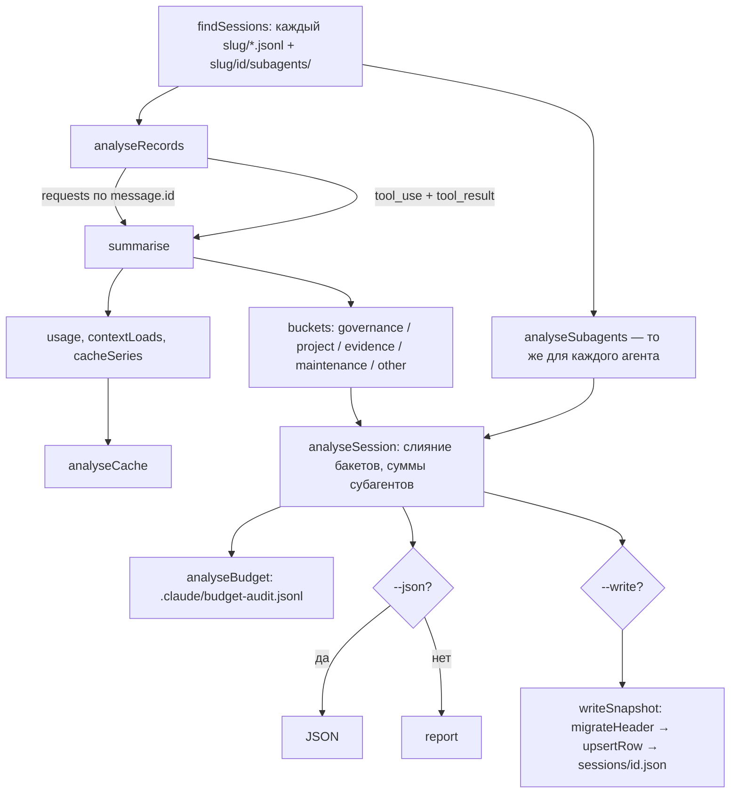

# 6.3. Метрики контекста

> **Описывает:** [[Knowledge-OS/Tools/context-metrics.mjs]], [[Knowledge-OS/Tools/context-metrics.test.mjs]], [[Knowledge-OS/Protocols/Knowledge-Maintenance-Protocol]] (запуск `--write` после значимой работы)
> **Связано:** [[Docs/06-Tooling/06-4-Budget-Audit-Hook]] — откуда берётся блок «Reading discipline», [[Docs/04-Assistant-Behaviour/04-3-Context-Selection]] — дисциплина чтения, которую это измеряет, [[Docs/05-Project-OS/05-4-Session-Lifecycle]] — снимок метрик в ритуале закрытия, [[Docs/07-Commands]] — `/mv-metrics`, `/mv-trend`, `/mv-close`

## Назначение

Система утверждает, что делает работу ассистента дешевле: он читает меньше, точнее и не перечитывает одно и то же. Без измерения это утверждение не проверить. `context-metrics.mjs` читает транскрипты сессий Claude Code (локальные `.jsonl` в `~/.claude/projects/`; ничего никуда не отправляется) и отвечает на вопросы:

- сколько сессия потратила токенов (основная нить и субагенты отдельно);
- насколько загрузился контекст (первый, пиковый, средний, p95 запрос);
- что сделал кэш префикса и сколько токенов было обработано дважды;
- какие файлы хранилища открывались, сколько раз, какой долей каждого файла;
- соблюдался ли объявленный бюджет чтения.

Инструмент **не может** сказать, лучше ли работа с системой, чем без неё: для этого нужна контрольная группа, а не журнал. Это ограничение сформулировано и в `/mv-trend`.

## Как работает

### Запуск и флаги

```bash
node "Knowledge-OS/Tools/context-metrics.mjs"                       # последняя сессия, тронувшая хранилище
node "Knowledge-OS/Tools/context-metrics.mjs" --all                 # все такие сессии
node "Knowledge-OS/Tools/context-metrics.mjs" --session ad79c9d1    # по префиксу id
node "Knowledge-OS/Tools/context-metrics.mjs" --session <id> --json
node "Knowledge-OS/Tools/context-metrics.mjs" --write --label task  # снимок в журнал
```

| Флаг | Действие |
|---|---|
| `--session <id>` | одна сессия по префиксу id; попадает в выборку, даже если хранилище не трогала |
| `--all` | все сессии, тронувшие хранилище, новые сверху |
| `--transcripts <dir>` | корень транскриптов вместо `~/.claude/projects` |
| `--sessions <dir>` | куда `--write` кладёт полные JSON по сессиям (иначе `MEMOVALE_SESSIONS_DIR`, иначе `Metrics/sessions/` в хранилище) |
| `--json` | `{ vault, sessions: [...] }` вместо текста |
| `--write` | строка в `Metrics/Context-Metrics.md` и `<sessions-dir>/<id>.json` |
| `--label <class>` | свободная метка в последнем столбце строки (`task`, `control`, `maintenance`…) |

Выход `1`, если транскриптов нет или ни одна сессия не тронула хранилище.

### Конвейер



### Дедупликация по `message.id`

Claude Code пишет **одну строку на блок контента** ответа и копирует `usage` в каждую. Сумма по сырым строкам завышает расход в разы. `analyseRecords()` кладёт `usage` в `Map` по `msg.id` только при первом появлении; текстовый отчёт показывает обе цифры (`57 (113 raw records, deduped by message.id)`). Порядок вставки в `Map` — порядок транскрипта, поэтому `cacheSeries` строится без второго прохода.

Там же собираются: модели (`msg.model`, кроме служебных `<…>`), вызовы инструментов (`tool_use`), их результаты (`tool_result` → `toolUseResult` по `tool_use_id`), число `system/api_error` (`retries`) и флаг `errorSincePrevious`, который «прилипает» к следующему запросу.

### Бакеты: `categorize`

Для каждого вызова инструмента `toolIntent(name)` определяет намерение — `read` (`Read`, `NotebookRead`, MCP-чтение Obsidian), `write` (`Edit`, `Write`, MCP-патчи), `search` (`Grep`, `Glob`, MCP-поиск) или `other` (всё прочее, включая `Bash` и `PowerShell`, — отбрасывается; их командные строки разбираются отдельно, см. ниже). `pathsFrom(input)` берёт пути из `file_path`, `path`, `filename`, `notebook_path`, `from`, `to`. `resolvePath()` приводит путь к ключу: абсолютный путь внутри хранилища и относительный путь MCP-инструмента — один и тот же файл, иначе повторные чтения не видны.

| Бакет | Правило `categorize(resolved, intent)` | Смысл |
|---|---|---|
| `governance` | `Knowledge-OS/**` при чтении/поиске (кроме `Tools/`); `.claude/**` при чтении | следование правилам ОС — нормальное использование |
| `maintenance` | `Knowledge-OS/Tools/**` всегда; любая запись в `Knowledge-OS/**` или `.claude/**` | работа над самой ОС; исключается из показателей эффективности |
| `project` | `Project-OS/**` | проектное знание |
| `evidence` | любой путь вне хранилища (исходный код проекта) | доказательства, с которыми работают |
| `other` | прочее внутри хранилища (`Metrics/`, `Plans/`, корневые файлы) | — |

Зачем `maintenance`: сессия, в которой строят систему, иначе выглядела бы катастрофически расточительной работой со знанием. Долю такой работы этот бакет не измеряет — см. раздел про C3 ниже. `.claude/` распознаётся по двум кандидатам (`<vault>/.claude` и `<vault>/../.claude`), как `findClaudeDir` у валидатора, — иначе команды ОС попадали бы в `evidence`.

Поиск без пути (`Grep` без `path`) не попадает ни в один бакет, но считается в `unscopedSearches`. Абсолютный путь к `.md` вне хранилища попадает в `evidence`, но отдельно отмечается в `foreignNotes` — почти всегда это то же хранилище из другого рабочего дерева; так уже было в одной сессии, и знание тихо ушло в бакет, означающий противоположное.

Каждый бакет считает `files` (все касания по файлу), `readFiles` (только чтения), `reads`/`writes`/`searches`, а для нативного `Read` — покрытие `numLines / totalLines` из результата. `bucketStats()` выдаёт: `distinctFiles`, `filesRead`, `touches`, `repeats` (лишние чтения: `count − 1` по каждому файлу — повторное *чтение* расточительно, десять правок одного файла — просто работа), `repeatedFiles`, `coverage`, `top` (перечитанные файлы) и полную карту `files` — единственную потерю, которую нельзя восстановить задним числом.

Бакеты субагентов (`<slug>/<id>/subagents/agent-*.jsonl`, метаданные — `*.meta.json` с `agentType`, `spawnDepth`) сливаются с основной нитью: именно субагенты читают большую часть базы.

### Чтения через оболочку

Сессия, работающая через `cat`/`sed`/`grep` или `Get-Content`, не вызывает ни одного файлового инструмента — бакеты пусты, и раньше она выпадала из выборки. Под `/mv-close` в auto-режиме это норма: «последней» становилась *предыдущая* сессия, и `--write` перезаписывал **её** строку, печатая `replaced 1 row(s)` с кодом `0`. Поймано только потому, что записанный id не совпал с новейшим файлом транскрипта.

Смотрятся оба инструмента оболочки, `Bash` и `PowerShell`. До 2026-10-13 PowerShell не смотрелся вовсе.

- `bashTouchesVault(command)` признаёт касание, если в команде (с `\` → `/`) встречается `Knowledge-OS/`, `Project-OS/`, `Metrics/` или `<имя каталога хранилища>/`. Требуется разделитель: `git commit -m 'Knowledge-OS cleanup'` не касание. Признак возвращает сессию в выборку (`touchedVault`).
- `shellReadPaths(command)` разбирает строку на сегменты (`&& || ; |`, перевод строки) с учётом кавычек и у глаголов чтения (`cat head tail less more sed awk grep egrep rg wc type`, `Get-Content`/`gc`, `Select-String`/`sls`) берёт аргументы, похожие на путь. Первый позиционный аргумент `sed`/`grep`/`rg`/`Select-String` — шаблон, если шаблон не передан опцией (`-e`, `-Pattern`). Числовое значение после опции (`head -n 20`) и цель перенаправления пропускаются. `cd`/`Set-Location` задают каталог для относительных путей; путь, начинающийся с имени хранилища, привязывается к хранилищу; `/g/…` из Git Bash становится `g:/…`.
- Найденные пути идут в бакеты как чтения, но **в отдельные счётчики**: `shellFiles`, `shellReads`; `bucketStats` выдаёт `shellReads`, `shellFilesRead`, `shellRepeats`, `shellFiles`. В `Files`, `Re-read` и эффективность они не попадают: это эвристика, а те показатели — от файловых инструментов. Пропустить чтение разбор может (переменная, подстановка, глоб), выдумать — нет: каждый путь написан в команде.

Отчёт печатает блок `Shell reads`, только если оболочка что-то прочитала, и `NOTE vault reached only through the shell … see Shell reads` (`vaultTouchedOnlyViaBash`), если файловые инструменты хранилища не касались.

Транскрипты до `a56b29a` (2026-09-17) называют деревья `Knowledge OS/` и `Project OS/`; `resolvePath` приводит старые имена к новым, иначе перемер старой сессии давал ноль чтений знания. Перемер журнала проекта-носителя с этим разбором — его `Metrics/remeasure-2026-10-13.md`.

### Анализ кэша: `analyseCache`

Вход — `cacheSeries`: на каждый запрос `input`, `cacheRead`, `cacheCreation`, `at`, `model`, `errorSincePrevious`.

- `hitRate = cacheRead / (input + cacheRead + cacheCreation)`, `creationShare`, `readToCreateRatio` (`null`, а не `Infinity`, если ничего не создавалось). Hit rate приведён для полноты: на 35 сессиях он не выходил из 94–99% и ничему не учит.
- **Разрыв префикса** — запрос, чей `cacheRead` *меньше*, чем у предыдущего запроса с ненулевым `cacheRead`: что-то раньше в разговоре изменилось, и всё после изменения обработано заново. Запросы с `cacheRead = 0` пропускаются — иначе рост из нуля в начале сессии давал бы «разрыв» в каждой сессии.
- Стоимость разрыва = `prev.cacheRead − cacheRead + cacheCreation`; сумма — `tokensReprocessed`, самый дорогой — `worstBreak`.
- Причина, в порядке силы объяснения: пауза > `TTL_MINUTES` (60) → `ttlExpiry`; `api_error` перед запросом → `apiError`; смена модели → `modelSwitch`; иначе `unattributed`. Порог не угадан: на 35 сессиях доля разрывов — 0% до минуты, 14% при 15–30 минутах, 100% в диапазоне 60–90. Истечение кэша объяснило 76% переработки; гипотеза о компакции контекста не подтвердилась (в самой длинной сессии 20 из 21 разрыва — до единственного `compact_boundary`). `unattributed` оставлен честной корзиной, а не догадкой.

Анализ кэша выполняется только по основной нити (`summary.cacheSeries`), без субагентов.

### Анализ бюджета: `analyseBudget`

Читает журнал хука `.claude/budget-audit.jsonl` (см. [[Docs/06-Tooling/06-4-Budget-Audit-Hook]]) из корня проекта — сначала `dirname(VAULT)/.claude/` (встроенная раскладка), затем `VAULT/.claude/` (самостоятельная), те же два места, что у `findClaudeDir()` валидатора. Отбирает строки с `session === sessionId` и считает: `reads`, `declared`, `undeclared`, `withinBudget`, `outsideBudget`, `subagentReads`, `subagentUndeclared`, `tasks` (уникальные `task`) и `staleBudgets` — задачи бюджета, чей файл задачи уже `done`/`cancelled`.

Устаревание судит именно этот скрипт, а не хук: хук только повторяет `task` в каждой записи. `isTaskDone(taskName)` (экспортирована) ищет файл задачи в `Project-OS/03-Development/Tasks/`: сначала точно `<task>.md`, иначе — по ведущему идентификатору задачи (`T14 — Function Analyzer` → первый файл `T14-*.md`), и смотрит на строку `status: done` или `status: cancelled`. Значение без идентификатора и без файла — свободная метка, а не устаревший бюджет.

Главное число — `undeclared`, а не `outside`: читать за пределами бюджета протокол разрешает при наличии причины, не объявить бюджет вовсе — невыполнение правила. `undeclared` несравним через границу 2026-09-14: до неё `budget.json` никто не удалял, и чтения в начале сессии засчитывались как `declared` против бюджета прошлой задачи (125 строк журнала — ни одного `undeclared`). Рост числа после этой даты — исправление измерения, а не деградация дисциплины.

### `--write`: журнал и дамп сессии

`writeSnapshot()` создаёт `Metrics/Context-Metrics.md` с `LOG_HEADER` (frontmatter `type: log`, пояснения, заголовок таблицы), если файла нет. Журнал лежит в `Metrics/` — вне `Knowledge-OS` и `Project-OS`: `type: log` внутри `Knowledge-OS` запрещён правилом `project-type-inside-knowledge-os`.

Затем:

1. `migrateHeader(text)` — если заголовок таблицы не совпадает с текущим (сравнение после `trimEnd`, чтобы CRLF не давал «миграцию» на каждом запуске), заменяет его и разделитель; узкие строки дополняются `—`, а не нулями (столбцов тогда не было — нельзя заявлять измерение); строки не уже нового заголовка не трогаются.
2. `upsertRow(text, short, row)` — строка ищется по префиксу `| <первые 8 символов id> |`; найдена — заменяется **безусловно** (второе закрытие сессии видит надмножество первого), иначе дописывается.
3. Полный объект сессии пишется в `<sessions-dir>/<sessionId>.json`.

Столбцы строки:

| Столбец | Значение |
|---|---|
| `Session` | первые 8 символов id |
| `Ended` | `last` до минут |
| `Requests` | дедуплицированные запросы основной нити |
| `Output` | output-токены основной нити + субагентов |
| `Context peak` / `Mean` / `p95` | загрузка контекста на запрос |
| `Notes` | число `.md` под `Project-OS/` **в момент записи** |
| `Files` | `distinctFiles` governance + project |
| `Re-read` | `repeats / reads` по governance + project |
| `Coverage` | среднее покрытие governance и project |
| `Hit%` / `Breaks` / `Reproc` | `hitRate`, `prefixBreaks`, `tokensReprocessed` |
| `Label` | `--label` или `—` |
| `Shell` | `shellFilesRead` governance + project — эвристика по командной строке; строки до 2026-10-13 — `—` |

Схема дампа сессии (`Metrics/sessions/<id>.json` — данные экземпляра, в доставку не входят):

```text
{
  sessionId, slug, rawAssistantRecords, requests, retries, models[], first, last,
  usage:         { input, output, cacheRead, cacheCreation },
  subagentUsage: { input, output, cacheRead, cacheCreation },
  context:       { first, peak, mean, p95 },
  buckets: { governance|project|evidence|maintenance|other:
             { distinctFiles, filesRead, touches, reads, writes, searches,
               repeats, repeatedFiles, coverage|null,
               top: [{file, count}], files: [{file, touches, reads}],
               shellReads, shellFilesRead, shellRepeats, shellFiles: [{file, reads}] } },
  unscopedSearches, foreignNotes[],
  cache:  { requests, hitRate, creationShare, readToCreateRatio|null, prefixBreaks,
            tokensReprocessed, byCause{ttlExpiry,apiError,modelSwitch,unattributed},
            costByCause{…}, longestIdleMinutes, worstBreak|null } | null,
  budget: { staleBudgets[], reads, declared, undeclared, withinBudget, outsideBudget,
            subagentReads, subagentUndeclared, tasks[] } | null,
  subagents: [{ id, agentType, spawnDepth, requests, toolCalls, usage,
                unscopedSearches, foreignNotes, bashVaultTouches }],
  touchedVault, vaultTouchedOnlyViaBash, bashVaultTouches
}
```

### Доля работы над ОС (C3): `os-share.mjs`, не журнал

Метка строки журнала — выбор агента, а строку пишет только сессия, закрытая `/mv-close`. Работа над самой ОС чаще всего идёт без строки, поэтому доля строк `maintenance` мерит записанное, а не сделанное: в журнале проекта-носителя их было 3 из 31, а C3 по журналу — 1,5–2,4 % при пороге 30 %.

[[Knowledge-OS/Tools/os-share.mjs]] спрашивает git: для каждого коммита, тронувшего хранилище, — тронул ли он слой ОС и сколько изменённых строк (`--numstat`, `--no-renames`) пришлось на него; итог и по ISO-неделям. Слой ОС — строки [[Knowledge-OS/os-manifest]] плюс `PER_COPY_FILES` из [[Knowledge-OS/Tools/manifest.mjs]] (README, `CLAUDE.md`, бэклог ОС — файлы системы, которые у каждой копии свои). Путь до переименования `a56b29a` читается под нынешним именем (`currentPathName`). `Plans/` и `Metrics/` в слой не входят. Порог в коде не живёт: инструмент печатает долю.

```text
node "Knowledge-OS/Tools/os-share.mjs" [--since YYYY-MM-DD] [--json]
```

Массовое переименование и перевод засчитываются целиком — такую неделю видно в таблице по неделям. Замер проекта-носителя от 2026-10-13 — его `Metrics/os-share-2026-10-13.md`: 46 % коммитов и 49 % строк за всё время, 4 % строк в неделю заморозки и 82 % в следующую.

## Почему так

**Транскрипт, а не самоотчёт ассистента.** Ассистент, которого спрашивают «сколько ты прочитал», отвечает правдоподобно, но не обязательно верно. Транскрипт — запись того, что произошло.

**Корень хранилища — по расположению скрипта.** Если `cwd` — корень проекта, категоризация по префиксам молча отнесла бы всё не туда; это хуже падения.

**Строки печатаются, только когда есть что сказать.** Строка «prefix breaks 0» в каждом отчёте становится тем, что глаз учится пропускать, — и её нет, когда она наконец важна. Поэтому блок разрывов появляется лишь при `prefixBreaks > 0`.

**Путь к дампам — не абсолютный.** Раньше в скрипте был зашит абсолютный путь одной машины, разъезжавшийся по всем клонам через манифест. Теперь `--sessions`, переменная окружения или `Metrics/sessions/` (каталог в `.gitignore`).

**Эталонные числа в тестах взяты извне.** Тесты `analyseCache` воспроизводят арифметику эталонных сессий `bdd408e9` (3 разрыва, 427 246 токенов) и `d44b653e` (21 разрыв, 17 179 854 токена), посчитанных независимым скриптом до появления функции: изменение должно согласовываться с измерением, а не с собственным выводом.

## Пример

```text
Session ad79c9d1-abca-42e7-9d30-2102f93b8145
  slug        g--Projects-Archi
  span        2026-10-01T12:29:08.188Z → 2026-10-01T12:40:15.835Z  (0.2 h)
  models      claude-opus-5-5
  requests    57   (113 raw records, deduped by message.id)

  Tokens                main            subagents
    output                39,670               0
    input                    114               0
    cache read         5,749,211               0
    cache creation       108,202               0

  Context load per request
    first     43,838   peak    139,852   mean    102,764   p95    138,492

  Prefix cache (B19)
    hit rate                98%   (cache creation 2%)

  Traversal            files   touches    reads   writes  searches   re-read   coverage
    project              1         1        0        1         0         0          —
    evidence             2         3        1        2         0         0        11%
    maintenance*         1         1        0        1         0         0          —
    * work on the operating system itself — excluded from efficiency below

  Reading discipline (B6 — Context Selection Protocol §2)
    reads with a declared budget   1 of 1
    of the declared: inside 1, outside 0
    budgets declared for           T28-Relationship-Storage

  Efficiency (governance + project)
    distinct files opened   1
    re-read share           —   (of 0 reads)
    output tokens per file  39,670
    governance : project    0.00 : 1
```

Читать так: сессия короткая, кэш здоров, разрывов нет (блока нет), хранилище почти не читалось — одна запись в `Project-OS`, одна в `Tools/` (maintenance). «Reading discipline» показывает одно чтение `Read`/`Grep`/`Glob`, и оно было в бюджете.

## Подводные камни

- **Раньше `analyseBudget` искал журнал только в `dirname(VAULT)/.claude/`**, то есть предполагал встроенную раскладку, и в самостоятельном клоне блок «Reading discipline» не появлялся никогда. Теперь проверяются оба места.
- **Раньше `isTaskDone()` искал только `<task>.md` дословно.** Протокол выбора контекста предлагал метку `"T14 — Function Analyzer"`, файлы задач называются `T14-Function-Analyzer.md`, и `staleBudgets` был пуст по построению. Теперь протокол велит писать в `task` имя файла задачи, а метка со старым форматом находится по ведущему `T14`. Если в папке задач два файла с одним идентификатором, берётся первый, который вернёт `readdirSync`.
- **Хук пишет только `Read`/`Grep`/`Glob`**, а бакеты учитывают и MCP-чтения Obsidian; число `budget.reads` и `reads` в бакетах поэтому не обязаны совпадать.
- **`cache` — только основная нить.** Разрывы кэша субагентов не учитываются.
- **`Notes` — на момент записи, а не сессии**; старые строки нельзя сравнивать по этому столбцу как по состоянию на время работы.
- **Шапка журнала не мигрирует** — `migrateHeader` правит только строку заголовка таблицы, пояснения над ней остаются как были. Так в `Metrics/Context-Metrics.md` Archi пояснения долго писали `Knowledge OS/Tools/…` и `Project OS/` с пробелом, пока их не поправили вручную.
- **`--session` по префиксу** может выбрать несколько сессий; все они будут показаны и (с `--write`) записаны.

## Как менять

- **Новая метрика в отчёте** — считать в `summarise`/`analyseSession`, печатать в `report`; если она идёт в журнал — добавить столбец в `LOG_HEADER` (заголовок таблицы объявлен один раз; `HEADER_ROW` и миграция берутся из него), и `migrateHeader` сам дополнит старые строки `—`. Обновить пояснения в `LOG_HEADER`.
- **Новый инструмент или MCP-метод** — регулярные выражения в `toolIntent()` и, если у него новый ключ пути, `PATH_KEYS`.
- **Новый управляемый каталог** — `categorize()` и `VAULT_DIR_NAMES` вместе (комментарий прямо требует держать их рядом).
- **Тесты** — [[Knowledge-OS/Tools/context-metrics.test.mjs]] импортирует экспортированные `analyseCache`, `bashTouchesVault`, `shellReadPaths`, `migrateHeader`, `upsertRow` (`isTaskDone` тоже экспортирована, но тестом пока не покрыта); модуль не запускает `main()` при импорте (проверка `process.argv[1]` против собственного пути). Новую чистую функцию экспортировать и покрыть так же. См. [[Docs/06-Tooling/06-6-Tests-and-Fixtures]].
- Запись в [[CHANGELOG]]; если меняется смысл столбца — отметить, начиная с какой даты строки несравнимы, как это сделано для `Hit%`/`Breaks`/`Reproc`.
