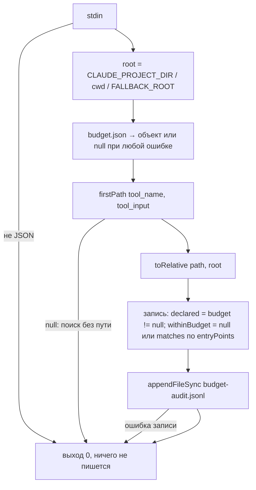

# 6.4. Хук аудита бюджета чтения

> **Описывает:** [[Knowledge-OS/Dist/hooks/budget-audit.mjs]], [[Knowledge-OS/Dist/hooks/budget-audit.test.mjs]], [[Knowledge-OS/Dist/settings.fragment.json]], [[Knowledge-OS/Protocols/Context-Selection-Protocol]] (§2, «Writing the budget down»)
> **Связано:** [[Docs/04-Assistant-Behaviour/04-3-Context-Selection]] — что такое бюджет чтения и зачем он, [[Docs/06-Tooling/06-3-Context-Metrics]] — где журнал сводится в числа, [[Docs/05-Project-OS/05-4-Session-Lifecycle]] — кто создаёт и удаляет `budget.json`, [[Docs/08-Distribution/08-2-Adoption]] — как хук попадает в `.claude/`

## Назначение

[[Knowledge-OS/Protocols/Context-Selection-Protocol]] требует до первого чтения объявить бюджет: целевые факты, точки входа, условие остановки. Это, вероятно, самое ценное правило системы — и единственное, которое ничто не проверяло: тест `BEHAV-7` в [[QA]] носил ⚠️ с момента написания и оставался непроверенным двенадцать задач подряд.

`budget-audit.mjs` — хук Claude Code `PreToolUse`, который на каждый `Read`/`Grep`/`Glob` дописывает строку в журнал: какой путь, был ли бюджет объявлен вообще и попадает ли путь в объявленные точки входа. Хук **только измеряет** и никогда не блокирует.

## Как работает

### Подключение

Канонический источник — `Knowledge-OS/Dist/hooks/budget-audit.mjs`; развёрнутая копия — `.claude/hooks/budget-audit.mjs` в корне проекта (Claude Code грузит хуки только оттуда). Блок в `.claude/settings.json` берётся из [[Knowledge-OS/Dist/settings.fragment.json]]:

```json
{
  "hooks": {
    "PreToolUse": [
      {
        "matcher": "Read|Grep|Glob",
        "hooks": [
          {
            "type": "command",
            "command": "node \"$CLAUDE_PROJECT_DIR/.claude/hooks/budget-audit.mjs\"",
            "timeout": 10
          }
        ]
      }
    ]
  }
}
```

Развёртывание делает `adopt.mjs` (`/mv-adopt`); расхождение копии с источником — ошибка валидатора `deployed-command-drift`, отсутствие копии — предупреждение `deployed-command-missing` (см. [[Docs/06-Tooling/06-1-Validator]]).

### Вход: payload хука

Claude Code передаёт на stdin JSON. Хук использует поля:

| Поле | Использование |
|---|---|
| `tool_name` | `Read`, `Grep` или `Glob` |
| `tool_input.file_path` | путь для `Read` |
| `tool_input.path` | путь для `Grep`/`Glob`; может отсутствовать |
| `session_id` | связывает строку с транскриптом для `context-metrics.mjs` |
| `agent_type`, `agent_id` | есть только у вызовов субагента |
| `cwd` | запасной корень проекта |

Корень проекта: `CLAUDE_PROJECT_DIR`, иначе `payload.cwd`, иначе `FALLBACK_ROOT` — два уровня вверх от файла хука (вычисляется через `fileURLToPath`, а не `new URL().pathname`: последний оставляет `%20` в путях с пробелами, и хук, молча выходящий с `0`, записывал бы не то).

### Бюджет: `.claude/budget.json`

```json
{
  "task": "T14-Function-Analyzer",
  "targetFacts": ["what shape the analyzer returns", "how T13 resolved specifiers"],
  "entryPoints": ["src/analyzer/", "MemoValeOS/Project-OS/03-Development/Tasks/T14-Function-Analyzer.md"],
  "stopCondition": "the signature and its test cases are known"
}
```

Хук читает только `task` и `entryPoints`; `targetFacts` и `stopCondition` — для ассистента и человека. `task` — имя файла задачи без `.md`: по нему `context-metrics.mjs` узнаёт бюджет, оставшийся от закрытой задачи. `entryPoints` — пути от корня проекта (каталога, где лежит `.claude/`); каталог покрывает всё под собой. Во встроенной раскладке пути хранилища поэтому начинаются с его папки (`MemoValeOS/Project-OS/…`), в самостоятельной — нет (см. [[Knowledge-OS/Protocols/Context-Selection-Protocol]]). Файл пишет ассистент в начале задачи, переписывает при законном изменении бюджета и **удаляет при закрытии задачи** (`/mv-close`, часть 3 ритуала). Файл и журнал в `.gitignore` — это артефакты сессии.

### Алгоритм



- `firstPath()` — `file_path` для `Read`, `path` для `Grep`/`Glob`, иначе `null`. Поиск без пути не оценивается: он не читает никакой конкретный файл, и `context-metrics.mjs` уже считает его как `unscopedSearches` — оценить его ещё и как «вне бюджета» значило бы посчитать одно поведение дважды.
- `toRelative()` — срезает корень проекта (без учёта регистра, `\` → `/`); путь вне корня остаётся абсолютным.
- `matches(rel, entry)` — равенство или префикс `entry + "/"`, без учёта регистра, с нормализацией разделителей и хвостового `/`.

### Выход: строка журнала `.claude/budget-audit.jsonl`

```json
{"at":"2026-10-01T12:31:02.114Z","session":"ad79c9d1-abca-42e7-9d30-2102f93b8145","agent":null,"agentId":null,"tool":"Read","path":"src/storage/node-store.ts","declared":true,"task":"T28-Relationship-Storage","withinBudget":true}
```

| Поле | Значение |
|---|---|
| `at` | время записи (ISO) |
| `session` | `session_id` или `null` |
| `agent`, `agentId` | тип и id субагента; `null` у основной нити |
| `tool` | имя инструмента |
| `path` | путь относительно корня проекта |
| `declared` | был ли читаемый `budget.json` |
| `task` | `budget.task` или `null` |
| `withinBudget` | `true`/`false` при объявленном бюджете; **`null`**, если бюджета нет — ничего не объявлено, значит, ничего не нарушено |

## Почему так

**Никогда не блокировать.** Неизвестно, как часто дисциплина нарушается и чего это стоит. Правило, принуждаемое до измерения, отключают при первой же ошибке. Решение о принуждении (бэклог `B5`) принимается по числам, которые даёт этот хук. Поэтому каждая ветка завершается кодом `0` — включая мусор на stdin, испорченный `budget.json` и недоступный для записи журнал: инструмент, способный сломать измеряемую работу, будет выброшен, и правильно.

**Файл, а не разбор транскрипта.** Распознавать объявление бюджета в свободном тексте значило бы получать правдоподобные, но недостоверные числа. Файл делает «забыл объявить» честным `undeclared` — и это главное число, а не чтения вне бюджета: читать вне бюджета протокол разрешает при наличии причины, не объявлять вовсе — нет.

**`task` в бюджете.** Бюджет — на задачу, а не на сессию. Поле `task` делает видимым бюджет, оставшийся от прошлой задачи. Это случилось вживую: бюджет называл уже закрытую `T18`, и 18 из 19 чтений сессии засчитались «вне бюджета» против границы для законченной работы. После этого `/mv-close` стал удалять файл, а `context-metrics.mjs` — предупреждать о бюджете на задачу в статусе `done`.

**`agent_type` записывается.** Протокол утверждает, что делегирование поиска не делегирует бюджет. Хук видит, чей это вызов, — утверждение становится проверяемым.

## Пример

Бюджет объявлен на `src/parser/`:

```json
{ "task": "T99", "entryPoints": ["src/parser/"] }
```

Чтения `src/parser/normalize.ts` и `src/repository/load-repository.ts` дают две строки с `withinBudget: true` и `false` соответственно. `src/parser/deep/nested.ts` — тоже `true`. Без файла бюджета та же `Read` даёт `declared: false, withinBudget: null`. `Grep` без `path` не даёт строки вовсе. Все эти случаи — тесты в [[Knowledge-OS/Dist/hooks/budget-audit.test.mjs]].

## Подводные камни

- **Хук не судит об устаревании.** Любой читаемый `budget.json` считается объявленным, а `task` просто повторяется в каждой записи: хук не знает, какая задача текущая. Устаревание обнаруживает `context-metrics.mjs` (`analyseBudget`, `staleBudgets`) — по файлу задачи, найденному по имени или ведущему идентификатору (см. [[Docs/06-Tooling/06-3-Context-Metrics]]). Раньше комментарий в `main()` обещал, что устаревший бюджет «treated as absent», — код этого никогда не делал; теперь комментарий говорит то, что есть.
- **Видны только `Read`/`Grep`/`Glob`.** Чтение через `Bash` (`cat`, `sed`) и через MCP-инструменты Obsidian хук не видит — `matcher` их не включает.
- **Пути вне корня проекта** записываются абсолютными и в `entryPoints`, заданные относительно, никогда не попадут.
- **Раньше метрики искали журнал только в `dirname(VAULT)/.claude/`**, а хук пишет в `<корень проекта>/.claude/`; в самостоятельной раскладке это разные места, и журнал не читался. Теперь `analyseBudget` проверяет и родителя хранилища, и само хранилище.
- **Тест не должен трогать живой журнал.** Ранняя версия теста работала с настоящим `.claude/` и начиналась с удаления `budget-audit.jsonl` — единственной копии всех записанных чтений. Не дошла до удаления только потому, что падала раньше. Теперь каждый случай — во временном корне через `CLAUDE_PROJECT_DIR`.

## Как менять

- Править **только** `Knowledge-OS/Dist/hooks/budget-audit.mjs`, затем развернуть копию (`node "Knowledge-OS/Tools/adopt.mjs" --apply --only …` или `/mv-adopt`) — иначе валидатор даст `deployed-command-drift`.
- Новое поле записи — добавить в объект `record`, затем учесть в `analyseBudget()` у `context-metrics.mjs`; старые строки журнала нового поля не имеют — читать его с запасным значением.
- Новый инструмент (например, MCP-чтение) — `matcher` в [[Knowledge-OS/Dist/settings.fragment.json]] **и** ветка в `firstPath()`; развёрнутый `.claude/settings.json` обновить тем же развёртыванием.
- Принцип «выход 0 на любом пути» сохранять; тест `garbage on stdin is survived silently` — несущий.
- Тесты: `node --test "Knowledge-OS/Dist/hooks/budget-audit.test.mjs"` (входит в `npm test`). Запись в [[CHANGELOG]].
