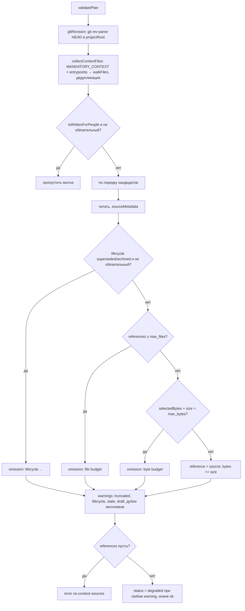

# 6.5. Провайдер контекста

> **Описывает:** [[Knowledge-OS/Tools/context-provider.mjs]], [[Knowledge-OS/Tools/context-provider.test.mjs]], [[Knowledge-OS/Protocols/Context-Provider-Protocol]], [[Knowledge-OS/Schema/Provider-Mapping]], [[Knowledge-OS/Rules/AI-Governance]] (Must Not: автоматическое принятие предложений)
> **Связано:** [[Docs/04-Assistant-Behaviour/04-3-Context-Selection]] — бюджет чтения, который провайдер навязывает внешнему вызывающему, [[Docs/03-Knowledge-Model/03-3-Lifecycle]] — почему `superseded`/`archived` не выдаются, [[Docs/03-Knowledge-Model/03-4-Evidence]] — пороги доказательств кандидатов, [[Docs/04-Assistant-Behaviour/04-4-Protocols]] — протокол продвижения, через который должно пройти любое предложение, [[Docs/06-Tooling/06-6-Tests-and-Fixtures]] — фикстура `__provider_fixtures__/basic`

## Назначение

MemoValeOS может быть долговечным источником проектного контекста для внешнего инструмента — оркестратора, агентной среды, CI-задачи. `context-provider.mjs` — узкий процессный интерфейс к хранилищу: один JSON-запрос на stdin, один JSON-ответ на stdout. Провайдер умеет две вещи: **выдать выбранное знание** (с метаданными, git-ревизией и дайджестом) и **принять предложение нового знания**, вернув его как черновик для человека. Записи он не делает вообще — ни одной операции записи в файле нет.

Контракт — собственный контракт MemoValeOS. Провайдер начинался как адаптер под конкретного потребителя (Closure) и был переименован и отвязан от него: новый потребитель подстраивается под протокол, а не дописывает в него свои поля. Для данных конкретного потребителя есть `adapter_extensions`, которые провайдер игнорирует.

Система от провайдера не зависит: удалите `context-provider.mjs` — валидатор, тесты и метрики продолжат работать.

## Как работает

### Транспорт

```bash
node "<vault>/Knowledge-OS/Tools/context-provider.mjs" --project-root <проект> --vault-root <хранилище> < request.json
npm run context-provider -- --project-root <проект> --vault-root <хранилище>
```

- `main()` читает stdin целиком; больше `MAX_REQUEST_BYTES` (1 МиБ) — ошибка `request-too-large`.
- Аргументы — только `--project-root` и `--vault-root` (`parseArgs`; иное — `invalid-arguments`). Без них оба корня — `process.cwd()`.
- Ответ всегда один JSON на stdout, включая ошибки; код выхода не несёт смысла.
- Запускается как argv-процесс, не через shell. Obsidian и MCP не нужны (тест `CLI speaks one UTF-8 JSON request/response without Obsidian`).
- Модуль экспортирует `handleRequest(input, options)` — для тестов и встраивания; `options.now` подменяет часы.

### Конверт

Запрос (`validateRequest`) должен содержать **ровно** эти семь полей — лишние и отсутствующие отклоняются:

```json
{
  "request_id": "request-health",
  "provider_id": "memovale",
  "operation": "health",
  "payload": {},
  "adapter_extensions": {},
  "message_type": "request",
  "protocol_version": "1.0"
}
```

Проверки: `request_id` — непустая строка; `provider_id === "memovale"` (иначе `provider-identity-mismatch`); `operation` из `OPERATIONS` (иначе `unsupported-operation`); `message_type: "request"` и `protocol_version: "1.0"`; `payload` и `adapter_extensions` — объекты; `adapter_extensions.write_mode === "managed_write"` → `managed-write-forbidden`.

Ответ (`response`):

```json
{
  "request_id": "request-health",
  "provider_id": "memovale",
  "provider_version": "0.1.0",
  "status": "ok",
  "payload": { "healthy": true, "obsidian_required": false, "vault_root": "MemoValeOS" },
  "warnings": [],
  "errors": [],
  "adapter_extensions": {},
  "message_type": "response",
  "protocol_version": "1.0"
}
```

`status` — `ok`, `degraded` или `error`. Ошибка (`errorResponse`) — `status: "error"`, пустой `payload` и элемент `errors`: `{ code, message, retryable, protocol_version }`. Любое исключение, не являющееся `ProviderFault`, превращается в `provider-failure`. Если вход не объект, `request_id` в ответе — `"invalid-request"`.

### Корни и граница доступа

`resolveRoots()` берёт `realpath` обоих корней; хранилище обязано лежать внутри проекта (`vault-outside-project`), оба должны быть каталогами (`vault-unavailable`). `health()` проверяет наличие `CLAUDE.md`, `Knowledge-OS`, `Project-OS` и `Knowledge-OS/Protocols/Context-Selection-Protocol.md` внутри хранилища (`invalid-vault`) и выполняется перед **каждой** операцией, кроме `capabilities`.

Все пути проходят через `authorizedPath()`/`resolveProjectReference()`: относительные, без пустых сегментов, `.` и `..`, после `realpath` — внутри хранилища. `walkFiles()` проверяет каждую символическую ссылку на выход за хранилище (`invalid-entrypoint`), обходит каталоги в стабильном порядке (`stableSort`: сначала без учёта регистра, затем с ним), пропускает `NEVER_WALK` (`.git`, `.obsidian`, `.claude`, `node_modules`, `__fixtures__`, `__provider_fixtures__`) и берёт только `.md`, `.json`, `.base`.

### Операции

#### `capabilities`

Запрос с пустым `payload`. Ответ:

```json
{
  "capabilities": {
    "operations": ["capabilities", "health", "prepare_context", "checkpoint", "restore", "propose_knowledge"],
    "write_modes": ["read_only", "propose"],
    "managed_write": false,
    "durable": true,
    "obsidian_required": false,
    "context_selection": "explicit-entrypoints",
    "checkpoint_storage": "reference-digest-only"
  }
}
```

#### `health`

Пустой `payload`; ответ — пример конверта выше. `vault_root` — путь хранилища относительно проекта (`"."`, если совпадают). Проверяется только файловая раскладка, без Obsidian.

#### `prepare_context`

Запрос (из теста `prepare_context reads only mandatory files and explicit entry points within budget`):

```json
{
  "request_id": "request-prepare_context",
  "provider_id": "memovale",
  "operation": "prepare_context",
  "payload": {
    "plan": {
      "id": "context-plan-task-alpha",
      "task_id": "task-alpha",
      "stage": "context_discovery",
      "target_facts": ["applicable decisions"],
      "provider_ids": ["memovale"],
      "max_files": 3,
      "max_bytes": 32768,
      "stop_condition": "the governing decision is known",
      "protocol_version": "1.0"
    },
    "entrypoints": ["Project-OS/05-Decisions/Decisions.md"]
  },
  "adapter_extensions": {},
  "message_type": "request",
  "protocol_version": "1.0"
}
```

`validatePlan()` требует непустые строки `id`, `task_id`, `stage`, `stop_condition`, `protocol_version: "1.0"`, непустой массив строк `target_facts`, `provider_ids` с `memovale` (иначе `provider-not-requested`) и положительные целые `max_files`, `max_bytes` (`invalid-plan`). Это та же форма, что у бюджета чтения ассистента: целевые факты, точки входа, условие остановки.

Алгоритм:



- **Обязательный контекст** `MANDATORY_CONTEXT` — `CLAUDE.md` и `Knowledge-OS/Protocols/Context-Selection-Protocol.md` — всегда идёт первым и **считается в бюджет**.
- **Только явные точки входа.** Провайдер не грузит хранилище целиком, чтобы самому решить, что релевантно: кандидатные области выбирает вызывающий по целевым фактам задачи, провайдер обеспечивает границу.
- **Документация для людей** (`README.md`, `QA.md`, `Docs/**`, функция `isWrittenForPeople`) не выдаётся никогда, даже если названа точкой входа, — та же граница, что `CLAUDE.md` задаёт ассистенту.
- **Бюджеты.** Файл, не влезающий в `max_files` или `max_bytes`, становится именованным пропуском `"<путь>: file budget"`/`"<путь>: byte budget"`, `truncated: true`, `status: "degraded"`. Отбор продолжается — следующий меньший файл может влезть.
- **Фильтр жизненного цикла — до бюджета.** `superseded` и `archived` пропускаются с `"<путь>: lifecycle <значение>"` и предупреждением, не тратя ни места в `max_files`, ни байтов и не выставляя `truncated`: знание, которое не выдаётся никогда, не должно вытеснять то, что выдаётся; `draft` выдаётся, но перечисляется в `draft_sources` с предупреждением; `stale: true` во frontmatter — в `stale_sources` с предупреждением.
- **Противоречия.** Совпадающие (без учёта регистра) заголовки первого уровня у выбранных источников — `contradictions` и предупреждение «require conflict review».
- **Идентичность.** `id = "memovale-" + sha256("<project-relative path>:<sha256 содержимого>")[0..20]` — детерминирован: тот же файл в том же состоянии даёт тот же id (тест `selection identities are deterministic`).

Ответ (сокращён; полностью — три ссылки и три источника):

```json
{
  "status": "ok",
  "payload": {
    "plan": { "id": "context-plan-task-alpha", "...": "эхо плана" },
    "receipt": {
      "id": "receipt-request-prepare_context",
      "plan_id": "context-plan-task-alpha",
      "provider_id": "memovale",
      "provider_version": "0.1.0",
      "status": "ok",
      "transport": "process",
      "reference_ids": ["memovale-ff5540a6b549b119f7f6", "memovale-10e0e7001efa9ba5a656", "memovale-9af346fb1d2efb0bd846"],
      "facts": [],
      "retrieved_at": "2026-09-12T10:00:00Z",
      "omissions": [],
      "truncated": false,
      "cache_telemetry": null,
      "warnings": [],
      "adapter_extensions": {
        "selected_files": 3,
        "selected_bytes": 572,
        "stop_condition": "the governing decision is known",
        "target_facts": ["applicable decisions"],
        "mandatory_entrypoints": ["CLAUDE.md", "Knowledge-OS/Protocols/Context-Selection-Protocol.md"],
        "requested_entrypoints": ["Project-OS/05-Decisions/Decisions.md"],
        "sources": [
          {
            "reference_id": "memovale-9af346fb1d2efb0bd846",
            "path": "Project-OS/05-Decisions/Decisions.md",
            "title": "Decisions",
            "type": "decision",
            "lifecycle": "active",
            "status": "accepted",
            "evidence": "L2",
            "stale": false,
            "created": "2026-09-10",
            "updated": "2026-09-11",
            "frontmatter_valid": true
          }
        ],
        "stale_sources": [],
        "draft_sources": [],
        "lifecycle_omissions": [],
        "contradictions": [],
        "authority": "project-knowledge"
      },
      "protocol_version": "1.0"
    },
    "references": [
      {
        "id": "memovale-9af346fb1d2efb0bd846",
        "kind": "memovale_note",
        "uri": "",
        "path": "MemoValeOS/Project-OS/05-Decisions/Decisions.md",
        "native_id": "Project-OS/05-Decisions/Decisions.md",
        "revision": "a3cd5c43195fea312bd9c92de0c52f339c0fc6c0",
        "digest": "sha256:bebaef5cf827fec4204beb6b0e2f9754585cf4d27901e5fc62ec50095b3bb47b",
        "environment_id": "memovale-vault",
        "observed_at": "2026-09-12T10:00:00Z",
        "protocol_version": "1.0"
      }
    ]
  }
}
```

Тело заметки в ответ **не входит** — только ссылка (`path` от проекта, `native_id` от хранилища), ревизия и дайджест. Вызывающий читает файл сам и может проверить, что прочитал то же, что было выбрано. Смысл полей — [[Knowledge-OS/Schema/Provider-Mapping]]. `kind` — `memovale_note` для `.md`, `memovale_file` для `.json`/`.base`.

Деградированный ответ (точки входа — черновик, заменённая заметка и заметка с `stale: true`, `max_files: 5`):

```json
{
  "status": "degraded",
  "warnings": [
    "Superseded or archived knowledge was omitted.",
    "Selected stale knowledge: Project-OS/99-Unrelated/Do-Not-Load.md",
    "Selected draft knowledge: Project-OS/04-Research/Draft-Note.md"
  ],
  "payload": { "receipt": {
    "omissions": ["Project-OS/04-Research/Superseded-Note.md: lifecycle superseded"],
    "truncated": false,
    "adapter_extensions": {
      "stale_sources": ["Project-OS/99-Unrelated/Do-Not-Load.md"],
      "draft_sources": ["Project-OS/04-Research/Draft-Note.md"],
      "lifecycle_omissions": ["Project-OS/04-Research/Superseded-Note.md: lifecycle superseded"]
    }
  } }
}
```

С `max_files: 2` для того же запроса, что выше, `Decisions.md` уходит в `omissions` как `file budget`, `truncated: true`, `status: "degraded"` — два места заняли обязательные файлы.

Ошибки: нет точек входа — `invalid-entrypoint`; `"../outside.md"` — `invalid-entrypoint`; нет git — `git-revision-unavailable` (`retryable: true`); ничего не влезло — `no-context-sources`.

#### `checkpoint`

Запрос: `cycle_id`, `envelope_id` (непустые строки) и `references` — обычно `payload.references` из `prepare_context`:

```json
{
  "payload": {
    "cycle_id": "cycle-alpha",
    "envelope_id": "envelope-alpha",
    "references": [ { "id": "memovale-9af346fb1d2efb0bd846", "path": "MemoValeOS/Project-OS/05-Decisions/Decisions.md", "digest": "sha256:bebaef…", "...": "…" } ]
  }
}
```

`minimalReference()` оставляет только `id`, `kind`, `path`, `native_id`, `revision`, `digest` (требует `id`, `path` и `sha256:<64 hex>`); `verifyReference()` сразу перечитывает каждый файл и сверяет дайджест. Ответ:

```json
{
  "checkpoint": {
    "id": "memovale-checkpoint-640ac675828aaf9117c0",
    "cycle_id": "cycle-alpha",
    "envelope_id": "envelope-alpha",
    "reference_ids": ["memovale-ff5540a6b549b119f7f6", "memovale-10e0e7001efa9ba5a656", "memovale-9af346fb1d2efb0bd846"],
    "references": [
      {
        "id": "memovale-9af346fb1d2efb0bd846",
        "kind": "memovale_note",
        "path": "MemoValeOS/Project-OS/05-Decisions/Decisions.md",
        "native_id": "Project-OS/05-Decisions/Decisions.md",
        "revision": "a3cd5c43195fea312bd9c92de0c52f339c0fc6c0",
        "digest": "sha256:bebaef5cf827fec4204beb6b0e2f9754585cf4d27901e5fc62ec50095b3bb47b"
      }
    ],
    "created_at": "2026-09-12T10:00:00Z",
    "storage": "reference-digest-only",
    "protocol_version": "1.0"
  }
}
```

Хранить контрольную точку — дело вызывающего; провайдер ничего не сохраняет. Содержимого заметок в ней нет (тест проверяет, что текст решения не встречается в сериализованном ответе).

#### `restore`

Запрос: `{ "checkpoint": <объект из checkpoint> }`. Проверяются `storage: "reference-digest-only"`, `protocol_version`, совпадение `reference_ids` с `id` из `references`, затем каждый путь и дайджест заново. Ответ:

```json
{ "checkpoint_id": "memovale-checkpoint-640ac675828aaf9117c0", "envelope_id": "envelope-alpha",
  "reference_ids": ["memovale-ff5540a6b549b119f7f6", "memovale-10e0e7001efa9ba5a656", "memovale-9af346fb1d2efb0bd846"],
  "restored": true }
```

Изменённый файл — `checkpoint-digest-mismatch`, пропавший — `checkpoint-source-unavailable`. Восстановление закрывается отказом: контекст, изменившийся с момента выбора, не подаётся как тот же самый.

#### `propose_knowledge`

Запрос (из теста `propose_knowledge validates, detects duplicates, maps type, and never writes`):

```json
{
  "operation": "propose_knowledge",
  "payload": {
    "candidate": {
      "id": "candidate-decision-alpha",
      "kind": "decision",
      "title": "Decisions",
      "content": "Retain the provider boundary.",
      "source_reference_ids": ["source-alpha"],
      "requires_human": true,
      "created_at": "2026-09-12T10:00:00Z",
      "evidence_level": "L2",
      "adapter_extensions": {},
      "protocol_version": "1.0"
    }
  },
  "adapter_extensions": { "write_mode": "propose" }
}
```

`validateCandidate()`: ровно десять полей; `kind` из `CANDIDATE_KINDS`; непустые `title` и `content`; уникальные строки в `source_reference_ids`; `evidence_level` — `""`, `L1`…`L4` или `user-provided`; разбираемая дата `created_at`; для видов из `HUMAN_REVIEW_KINDS` — `decision`, `architecture`, `rule`, `intent` — `requires_human: true` (Decision и Architecture без человека не становятся `active`, правило меняет системный слой, намерение — собственность владельца продукта); `user-provided` — только если тип, в который отображается вид, разрешает его в `EVIDENCE_ALTERNATIVES` (сейчас только `product`, то есть вид `intent`; для остальных — `insufficient-candidate-evidence`), и тогда порог не сравнивается; иначе уровень не ниже порога из `KIND_MAP` (иначе `insufficient-candidate-evidence`).

| `kind` | Тип | Папка | `lifecycle` / `status` | Порог |
|---|---|---|---|---|
| `finding`, `incident`, `skill_change` | `finding` | `Project-OS/03-Development/Findings` | `active` / `active` | L1 |
| `eval` | `research` | `Project-OS/04-Research` | `draft` / `open` | L1 |
| `decision` | `decision` | `Project-OS/05-Decisions` | `draft` / `proposed` | L2 |
| `architecture` | `architecture` | `Project-OS/02-Architecture` | `draft` / — (без `status`) | L2 |
| `rule` | `rule` | `Knowledge-OS/Rules` | `draft` / `active` | — |
| `intent` | `product` | `Project-OS/01-Product` | `draft` / — (без `status`) | L4 или `user-provided` |

У `architecture` и `product` в предложенном frontmatter нет `status`: `schema.json` не даёт этим типам статуса (os-v5).

Дубликаты ищутся по всему хранилищу: заголовок первого уровня каждой `.md` сравнивается с `title` без учёта регистра. Имя файла строит `safeFilename()`: недопустимые символы и пробелы заменяются, пробелы становятся дефисами (`Provider boundary holds` → `Provider-boundary-holds.md`) — как в именах файлов хранилища. `suggested_path` никогда не называет существующий файл: если `<папка>/<имя>.md` занят, подбирается `<имя>-2.md`, `<имя>-3.md` и т. д. Рецензент, принявший предложение как есть, не перезапишет чужую заметку. Ответ:

```json
{
  "status": "ok",
  "payload": {
    "proposal": {
      "candidate_id": "candidate-decision-alpha",
      "mapped_type": "decision",
      "suggested_path": "Project-OS/05-Decisions/Decisions-2.md",
      "duplicate_paths": ["Project-OS/05-Decisions/Decisions.md"],
      "frontmatter": { "type": "decision", "lifecycle": "draft", "status": "proposed", "created": "2026-09-12", "updated": "2026-09-12", "evidence": "L2" },
      "title": "Decisions",
      "body": "Retain the provider boundary.",
      "source_reference_ids": ["source-alpha"],
      "requires_human": true,
      "write_performed": false,
      "proposed_at": "2026-09-12T10:00:00Z"
    }
  },
  "warnings": ["A note with the same heading already exists; review before promotion."]
}
```

`requires_human` в ответе всегда `true`, `write_performed` — всегда `false`; тест после вызова проверяет, что файл не изменился и `git status --porcelain` пуст.

### Гарантия «только чтение»

В модуле нет ни одного вызова записи в файловую систему: импортируются только `existsSync`, `lstatSync`, `readFileSync`, `readdirSync`, `realpathSync`, `statSync`. Единственный внешний процесс — `git rev-parse HEAD`. `managed_write` отклоняется ещё на уровне конверта, до разбора операции. Это не политика, которую можно случайно обойти флагом, — кода записи нет.

## Почему так

**Граница полномочий.** Предложение, пришедшее как `lifecycle: draft` и ждущее человека, сохраняет различие draft/active. Предложение, применённое автоматически, сделало бы внешнюю систему писателем знания этого проекта, и различие перестало бы что-либо значить. Поэтому автоматическое принятие — для любого потребителя — это изменение того, как знание становится истинным, и требует явного Decision, а не правки кода; это записано в [[Knowledge-OS/Rules/AI-Governance]] (Must Not). Фраза протокола «No operation in provider version `0.1.0` promotes a proposal» — свойство версии, а не обещание на будущее, и именно на ней держится вся конструкция.

**Ответ провайдера — не доказательство.** Ссылка доказывает, какой файл был выбран, но не то, что каждое утверждение в нём истинно, и тем более не результат вызывающего. Вызывающий проверяет наблюдаемые утверждения сам. Поэтому `authority: "project-knowledge"`, а не «evidence».

**Ссылки и дайджесты вместо тел.** Контрольная точка без содержимого не может устареть незаметно: `restore` перечитывает файлы и отказывает при любом изменении. Копия тела в чужом хранилище стала бы вторым источником истины, расходящимся с первым.

**`degraded` вместо тихого `ok`.** Усечение бюджетом, черновики, устаревшие и дублирующиеся источники не ошибки, но и не «полный успешный отбор». Протокол запрещает вызывающему трактовать `degraded` как `ok`.

**Явные точки входа вместо поиска по релевантности.** Провайдер, решающий релевантность сам, воспроизвёл бы ровно то поведение, с которым борется [[Knowledge-OS/Protocols/Context-Selection-Protocol]]: чтение «на всякий случай». Бюджет и точки входа — ответственность того, кто знает задачу.

## Пример

Внешний оркестратор перед стадией реализации:

1. `health` — убедиться, что хранилище на месте.
2. `prepare_context` с `target_facts: ["applicable decisions"]`, точкой входа `Project-OS/05-Decisions/` и `max_files: 10`. Получает ссылки, читает файлы сам, смотрит `warnings`.
3. `checkpoint` по полученным `references` — сохраняет у себя.
4. Через час, перед следующей стадией, `restore`. Кто-то тем временем принял новое решение и правил `Decisions.md` → `checkpoint-digest-mismatch`; оркестратор заново вызывает `prepare_context`, а не продолжает на устаревшем контексте.
5. По итогам работы — `propose_knowledge` с `kind: "finding"` и `evidence_level: "L2"`. Получает `suggested_path` и `frontmatter`, передаёт человеку, который проводит его через протокол продвижения.

## Подводные камни

- **`stale` берётся из поля frontmatter `stale`**, которое, по словам валидатора и `stale-check.mjs`, вручную никогда не выставлялось. Механический сигнал устаревания (`source` + `git log`, правило `stale-source`) провайдер не использует, так что `stale_sources` на реальном хранилище почти всегда пуст.
- **`user-provided` — только для `intent`.** Раньше `EVIDENCE_LEVELS` провайдера было только `""`, `L1`…`L4`, и намерение владельца, переданное через провайдер, требовало L4, хотя `schema.json` принимает `user-provided` для `product`. Теперь `user-provided` принимается, но лишь для видов, чей тип разрешает его в `EVIDENCE_ALTERNATIVES`. Эта таблица — копия части `evidenceAlternativeByType`, а не чтение `schema.json`: `resource` в ней нет, потому что ни один вид кандидата в `resource` не отображается; новая альтернатива в схеме потребует правки и здесь.
- **`rule` предлагается с `status: active, lifecycle: draft`** без порога доказательств, а `finding` — сразу `active`/`active`. Это следует схеме (у `rule` и `finding` единственный статус — `active`), но означает, что предложение Finding по форме уже «активно»; гарантию даёт только `write_performed: false` и `requires_human: true`.
- **Раньше `suggested_path` мог назвать существующий файл** (в тестовом примере — ровно так: `Decisions.md`). Теперь подбирается свободное имя с суффиксом `-2`, `-3`; совпадение по заголовку по-прежнему видно в `duplicate_paths`, и решать, новая ли это заметка или правка старой, — рецензенту.
- **Раньше `requires_human: true` на входе требовался только для `decision` и `architecture`**, хотя протокол называет также Product intent и rules. Теперь — для всех четырёх (`HUMAN_REVIEW_KINDS`). На выходе `requires_human` всегда `true`.
- **Раньше бюджет проверялся до жизненного цикла.** Заменённая заметка, не влезающая по байтам, попадала в пропуски как `byte budget`, а не `lifecycle superseded`, и выставляла `truncated: true` — отбор выглядел усечённым из-за файла, который не выдался бы в любом случае. Теперь файл сначала читается и фильтруется по `lifecycle`, и только выдаваемые файлы тратят бюджет (тест «superseded knowledge does not spend the budget or truncate the selection»).
- **Обязательные файлы занимают бюджет.** С `max_files: 2` запрошенная точка входа не попадёт ни разу.
- **Имя `Do-Not-Load.md` в фикстуре относится к одному тесту.** В первом тесте она не названа точкой входа и не должна появиться; в тесте stale/draft её называют явно, и она выдаётся — чтобы проверить `stale_sources`. Явная точка входа сильнее имени файла.
## Как менять

- **Новая операция** — `OPERATIONS`, ветка в `handleRequest`, функция-обработчик, строка в [[Knowledge-OS/Protocols/Context-Provider-Protocol]] (раздел Operations) и тест с запросом/ответом. Тесты — исполняемая спецификация форм, на которую ссылается протокол.
- **Новый `kind` кандидата** — `CANDIDATE_KINDS`, `KIND_MAP` и таблица в [[Knowledge-OS/Schema/Provider-Mapping]] синхронно; значения `type`/`status`/`lifecycle` должны существовать в [[Knowledge-OS/Schema/schema.json]].
- **Новое поле источника** — `sourceMetadata()` и таблица «Context output» в Provider Mapping.
- **Любая операция записи** или автоматическое продвижение — не правка кода, а Decision (см. «Почему так»); до него — не добавлять.
- **Версия.** Изменение формы ответа — повод поднять `PROVIDER_VERSION`; несовместимое изменение конверта — `PROTOCOL_VERSION` и обе проверки (`validateRequest`, `validatePlan`).
- Исключаемые каталоги (`NEVER_WALK`) держать согласованными с валидатором; если появится ещё одна папка «для людей» — `isWrittenForPeople()` и тест `never returns documentation written for people`.
- Проверка: `npm run test:context-provider` (входит в `npm test`); запись в [[CHANGELOG]].
