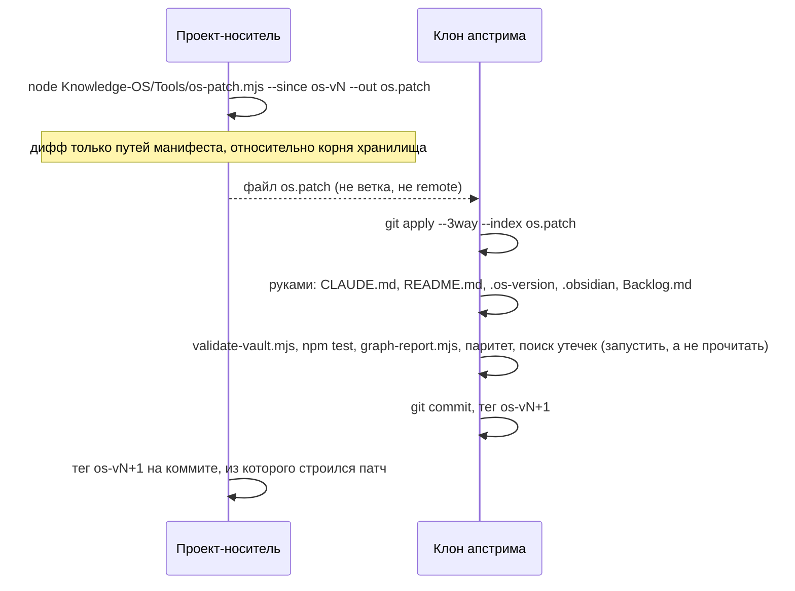

# 08-3. Доставка в апстрим и обновление: `os-patch.mjs`, `upgrade.mjs`

> **Описывает:** [[Knowledge-OS/Tools/os-patch.mjs]], [[Knowledge-OS/Tools/manifest.mjs]], [[Knowledge-OS/Tools/upgrade.mjs]], команду [[Knowledge-OS/Dist/commands/mv-sync.md]].
> **Связано:** [[Docs/08-Distribution/08-1-OS-Manifest]] — что считается слоем ОС, [[Docs/08-Distribution/08-2-Adoption]] — как развёрнуть доставленное в `.claude/`, [[Docs/08-Distribution/08-4-Versioning-and-Changelog]] — как доставка фиксируется версией и тегом, [[Docs/06-Tooling/06-1-Validator]] — проверка, которую обязательно запускать в апстриме.

## Назначение

Слой ОС существует как минимум в двух копиях:
- в **проекте-носителе**, где он разрабатывается (встроенная раскладка: хранилище — папка `MemoValeOS/` внутри проекта);
- в **апстриме** `GoodJaa/MemoValeOS`, публичном дистрибутивном репозитории, где хранилище — корень репозитория (самостоятельная раскладка) и `Project-OS/` — шаблон.

Направление разработки названо явно (os-v2): **слой ОС пишется в проекте-носителе, апстрим — приёмник**. Правки прямо в апстриме допустимы только для того, чего в проекте-носителе нет: шаблонного `Project-OS` и README для внешнего читателя.

На этой странице описаны два механизма переноса:
- `os-patch.mjs` — доставка из проекта в апстрим **патчем, без общей истории**;
- `upgrade.mjs` — обновление установленной копии до новой версии **сравнением файлов, без общей истории** (с os-v6; до него — checkout ref внутри одного репозитория).

## Как работает

### Доставка патчем



Ничего из истории проекта-носителя в апстрим не попадает: в апстриме появляется один новый коммит с содержимым слоя ОС. Проект никогда не добавляется в клон апстрима как remote, его ветки там не сливаются и не выбираются.

### Алгоритм `os-patch.mjs`

1. Корень репозитория берётся у git (`rev-parse --show-toplevel`), префикс хранилища — путь от корня до хранилища (пустой в самостоятельной раскладке).
2. `--since` и `--to` (по умолчанию `HEAD`) должны разрешаться в коммиты, иначе код 1. `--since` — тег прошлой доставки `os-vN` в проекте-носителе: коммит, чей слой ОС уже лежит в апстриме.
3. Манифест читается **на обеих сторонах** (`git show <ref>:<префикс>/Knowledge-OS/os-manifest`), сопоставитель — `compileManifest()` из [[Knowledge-OS/Tools/manifest.mjs]]. Путь попадает в патч, если его называет хотя бы один из двух манифестов: файл, переименованный из слоя ОС, должен удалиться в апстриме, а называл его только старый манифест.
4. `git diff --name-status -z --no-renames <since> <to> -- <префикс>` (`parseNameStatusZ()`), затем отбор путей слоя ОС (`selectOsPaths()`). Список печатается в stderr со статусом `A`/`M`/`D`.
5. Сам патч — `git diff --binary --full-index --no-renames --relative=<префикс>/` по отобранным путям, пачками по сто (длинная командная строка не проходит на Windows). Переименование едет удалением и добавлением; полные id блобов нужны, чтобы апстрим мог применить патч трёхсторонним слиянием.
6. Патч пишется в `--out` или в stdout. Пустой патч — код 0: в слое ОС ничего не менялось.

Читается только закоммиченное: рабочее дерево не смотрится.

### Доставка из копии без тега: `--against`

У копии, поставленной из апстрима, тега прошлой доставки нет. Часто нет и истории: хранилище исключено из git проекта, а на первом реальном проекте его `.git` удалили. Если такая копия что-то улучшила в слое ОС, патч строится от апстрима:

```bash
node "<хранилище>/Knowledge-OS/Tools/os-patch.mjs" --against <клон апстрима> [--base os-vN] --out os.patch
```

1. **База — апстрим на версии копии**, а не его `HEAD`: `.os-version` копии или `--base`. Тег должен быть в клоне (`git fetch --tags`), иначе код 1; без `.os-version` и без `--base` — тоже код 1. Почему не `HEAD`: копия на os-v6 против апстрима на os-v7 откатила бы всё, что пришло с os-v7.
2. **Сравниваются файлы.** С одной стороны блобы базы (`git ls-tree` и `git show` в клоне), с другой — файлы копии на диске. Путь берётся, если его называет манифест базы или копии. `.mvos-new` от конфликта обновления не едет никогда. Текст с диска берётся с LF, как его хранит апстрим, если только сам файл базы не хранится с CRLF.
3. **Патч собирается во временном репозитории.** Первый коммит — блобы базы байт в байт, второй — файлы копии. `git diff --binary --full-index` между ними даёт патч, чьи исходные id блобов есть в апстриме. Поэтому `git apply --3way --index` в апстриме сливает его с тем, что апстрим сделал после этой версии.

Дальше всё как при обычной доставке: применить в ветке апстрима и запустить проверки там. Сюда же входит поиск утечек: патч из чужого проекта особенно легко несёт его имена и пути.

Тесты — `os-patch.test.mjs`:
- разбор `name-status` и отбор по двум манифестам;
- интеграционные случаи строят настоящий проект с хранилищем в `V/`, тегом базы и изменениями всех видов (правка, добавление, удаление, переименование из манифеста, правка знания проекта и исходного кода) и применяют патч к самостоятельной копии со своим `Project-OS`;
- `--against`: копия без git на os-v1 с правкой в CRLF, добавленным и удалённым файлом, заметкой проекта и `.mvos-new`, против апстрима, ушедшего дальше os-v1. После применения в апстриме правки копии на месте, его поздние изменения целы, а заметки и `.mvos-new` в патче нет. Плюс отказ без версии и с версией, которой в апстриме нет.

### Что добавляет команда `/mv-sync`

Скрипт строит патч. Остальное ведёт команда ([[Docs/07-Commands]]):
- установить оба репозитория; оба рабочих дерева чисты, работа над слоем ОС закоммичена;
- найти тег прошлой доставки; без него — остановиться и спросить, а не угадывать базу. Копия без тега и истории строит патч `--against` клона апстрима (выше);
- прочитать список путей патча: заметка проекта, план или исходный код в нём — признак неверного манифеста, и патч не должен покидать машину;
- применить в ветке `sync/os-vN+1` от `master` апстрима; конфликт решается в пользу проекта-носителя, кроме постоянных расхождений;
- перенести руками файлы, которые у каждой копии свои;
- **проверки в апстриме запускаются, а не читаются**: валидатор, `npm test`, `graph-report.mjs`, маркеры конфликта, паритет блобов по манифесту и поиск того, что нельзя публиковать (локальные пути, имена проекта, личное). Найденное в доставленном файле исправляется в проекте-носителе, и патч строится заново;
- коммит описывает доставленное и не называет хешей проекта-носителя — в апстриме этих коммитов нет;
- тег `os-vN+1` ставится на обеих сторонах: в апстриме — на коммит доставки, в проекте — на коммит, из которого строился патч;
- **без `push` и без PR.** Отправка наружу — решение владельца.

### Обратное направление

Правка, сделанная прямо в апстриме (шаблонный `Project-OS`, README), переносится в проект-носитель тем же способом в обратную сторону: `git diff` нужных путей в апстриме и `git apply --3way` в папке хранилища (`--directory=<префикс>`). Общей истории для `subtree pull` больше нет.

### `upgrade.mjs`: обновление копии без общей истории

```
node "<vault>/Knowledge-OS/Tools/mv.cjs" upgrade --from <каталог | github:владелец/репо@тег>            # план
node "<vault>/Knowledge-OS/Tools/mv.cjs" upgrade --from … --apply [--yes] [--accept-errors]
node "<vault>/Knowledge-OS/Tools/mv.cjs" upgrade --from … --base <каталог | github:…@тег>               # база явно
node "<новая>/Knowledge-OS/Tools/upgrade.mjs" --vault <копия> --from <новая> --base …                  # копия до os-v6
```

Сравнение трёхстороннее, по каждому пути слоя ОС:

- **локальная** версия — то, что лежит в копии;
- **новая** — из `--from`: каталог (клон апстрима, распакованный архив) или `github:владелец/репо@тег`, который клонируется во временный каталог;
- **база** — то, чем копия была при прошлой установке или обновлении.

Откуда берётся база, по порядку:
1. `--base` — каталог или `github:…@тег`, с содержимым файлов;
2. `.mvos/os-base.json` — хеши, которые пишет каждое успешное обновление;
3. при `--from github:…` и без `os-base.json` — тот же репозиторий на теге из `.os-version` копии;
4. иначе базы нет.

Пути — объединение файлов, которые покрывает манифест новой версии, и локальных файлов под манифестом новой или локальной версии. Решение по каждому:

| Локально | Новая версия | Итог |
|---|---|---|
| совпадает с новой | — | ничего |
| не менялся с базы | изменена, добавлена, удалена | взять новую: `update`, `add`, `remove` |
| изменён | не менялась с базы | оставить локальную: `keep` |
| изменён | изменена, база с содержимым | `git merge-file`; чисто — `merge`, иначе конфликт |
| изменён | изменена, база только хешами | конфликт |
| файла нет, базы нет | есть | `add` |
| отличается, базы нет | отличается | конфликт |

**Конфликт** оставляет локальный файл как есть и кладёт новую версию рядом, `<путь>.mvos-new`; слить — человеку. `--yes` вместо этого берёт новую версию (`overwrite`).

**Не трогается никогда**, что бы ни говорил манифест: файлы, свои у каждой копии (`PER_COPY_FILES`), `mvos.config.json`, всё под `.mvos/`, и файл, который новый манифест исключает `!`-строкой, хотя сама новая версия его содержит (передан копиям, как `Templates/Task.md`). Знание проекта вне манифеста не рассматривается вовсе.

Без `--apply` печатается план и ничего не пишется. С `--apply`:
1. валидатор (`--json`) — до;
2. запись файлов, `.mvos-new` для конфликтов; прежнее содержимое каждого пути запоминается;
3. `node --check` на каждый записанный `.mjs`/`.cjs`;
4. валидатор — после, уже новый;
5. **откат**, файл за файлом, код 3, если: скрипт не разбирается; валидатор перестал запускаться; правило, которое было в старом валидаторе, сообщает больше ошибок. Исключение — `deployed-command-drift`: развёрнутые копии отстают от новых исходников, пока владелец не применит установку заново;
6. ошибки правил, которых в старом валидаторе не было, — не откат, а **миграция**: отчёт перечисляет их, CHANGELOG версии объясняет в «Что валидатор начал требовать»;
7. `.mvos/os-base.json` — хеши новой версии (база следующего обновления), `.os-version` — версия новой.

В конце — шаги владельца вне хранилища: установка копирует из `Dist/`, а `.claude/` — защищённый путь ([[Knowledge-OS/Protocols/Deployment-Protocol]] §4).

| Запись установки | Что изменилось | Шаг |
|---|---|---|
| `team` | `Dist/` | `mv.cjs adopt --apply --yes` |
| `local` | `Dist/plugin/` или `.claude-plugin/` | `claude plugin marketplace update memovaleos`, `claude plugin update mv@memovaleos --scope local` |
| `local` | остальное в `Dist/` (редирект, хук) | `mv.cjs adopt --apply --yes` |
| нет записи | `Dist/` | `mv.cjs adopt` — план; режим выбирает владелец |

Коды выхода: 0 — план, готово или нечего делать; 1 — не выполнено условие (`--from` не хранилище, клон не удался); 2 — применено, остались конфликты; 3 — откат.

Тесты не запускаются: в установленной копии нет dev-зависимостей, а определение готовности ([[Docs/06-Tooling/06-7-OS-Check]]) проверяется там, где ОС разрабатывается.

## Почему так

- **Почему не общая история.** С os-v2 по os-v4 доставка шла через `git subtree split --prefix=<хранилище>`: апстрим сливал ветку, история которой — вся папка хранилища проекта-носителя. Лишние файлы потом возвращались к версии апстрима (`sync-upstream.mjs`), но **коммиты оставались**. Аудит 2026-10-13 нашёл в публичной истории апстрима 53 коммита со знанием проекта-носителя — задачи, находки, решения, планы, роадмап, локальные пути — и сведения о кодовой базе, на которой гонялся бенчмарк. Фильтр после слияния не может убрать коммит. Поэтому история апстрима пересобрана одним корневым коммитом, а доставка переведена на патч.
- **Почему патч, а не копирование.** До os-v2 перенос шёл копированием с ручной адаптацией путей, и каждый перенос находил новые несоответствия. Патч сохраняет то, ради чего заводили общую историю: пути сдвигает git (`--relative`), а разногласия становятся видимыми конфликтами трёхстороннего слияния. Для этого базы сторон должны совпадать — отсюда теги `os-vN` и проверка паритета после каждой доставки.
- **Почему два манифеста.** Манифест описывает результат, а не переход к нему. При переходе на пути без пробелов (`a56b29a`) новый манифест не называл старые `Knowledge OS/**`, и прежний механизм принял их за проектные файлы. Отбор по объединению двух манифестов доставляет и удаление.
- **Почему обновление не опирается на git.** До os-v6 `upgrade.mjs` делал `git checkout <ref> -- <пути манифеста>` и требовал, чтобы ref апстрима был в истории копии. После пересборки апстрима (os-v5) общей истории нет ни у кого. Первая установка на чужой проект (2026-10) удалила `.git` хранилища как «ненужный», а личная установка держит хранилище вне git проекта. Ни одна из этих копий обновиться не могла (проблема 4.7 отчёта о первом развёртывании). Сравнение файлов требует только двух каталогов и, для слияния, бинарника `git`, а не репозитория.
- **Почему три стороны, а не «взять новое».** Копия правит слой ОС у себя: первый реальный проект менял правила под себя. Двусторонний diff не отличает «апстрим изменил» от «здесь изменили» и затёр бы локальную правку. База отвечает на этот вопрос для каждого файла.
- **Почему база — хеши, а не копия файлов.** Хешей хватает, чтобы решить «менялся ли файл». Содержимое нужно только для слияния, и его даёт `--base` или клон по `.os-version`. Хранить вторую копию слоя в каждой установке ради редкого слияния — лишнее.
- **Почему конфликт оставляет локальный файл.** Локальная правка — это знание копии, новая версия всегда доступна снова. Наоборот было бы необратимо. `.mvos-new` рядом делает конфликт видимым, а не тихим.
- **Почему откат по старым правилам, а миграция по новым.** Правило, которого не было, не могло давать ошибок до обновления; его ошибки — то, что новая версия требует, и CHANGELOG это описывает. Рост ошибок старого правила значит, что новая версия сломала копию. Так сработала проверка на симуляции первого реального проекта: `AI-Governance.md` проекта-носителя ссылается на ADR, которого в копии нет, и обновление откатилось с `broken-link 0 → 1`. Ужесточение старого правила, записанное в CHANGELOG, принимается явно, `--accept-errors`.
- **Почему `--vault`.** Копия до os-v6 несёт только старый, git-овый `upgrade.mjs`. Первое обновление поэтому запускает скрипт новой версии против старой копии.

## Пример

В проекте-носителе, после закрытия версии:

```text
$ node MemoValeOS/Knowledge-OS/Tools/os-patch.mjs --since os-v4 --out ../os-v5.patch
OS layer os-v4 (8c4deab) → HEAD (6a36d0a): 62 path(s)
  M  CHANGELOG.md
  M  Docs/01-Purpose-and-Principles.md
  …
  D  Knowledge-OS/Knowledge-BD.base
  A  Knowledge-OS/Knowledge-DB.base
  …
  M  Project-OS/06-AI/AI.md
  M  Project-OS/Templates/Architecture.md
Wrote ../os-v5.patch. In upstream: git apply --3way --index <path to it>
```

Из `Project-OS/` в списке только `AI.md` и шаблоны — так и должно быть. Затем в клоне апстрима `git apply --3way --index ../os-v5.patch`, файлы отдельных копий, проверки, коммит и теги.

Обновление копии os-v5 без `.git` хранилища (как на первом реальном проекте) до новой версии. Копия ещё не знает `--from`, поэтому запускается скрипт новой версии:

```text
$ git clone --depth 1 --branch os-v6 https://github.com/GoodJaa/MemoValeOS ../mvos-v6
$ node ../mvos-v6/Knowledge-OS/Tools/upgrade.mjs --vault MemoValeOS --from ../mvos-v6 --base github:GoodJaa/MemoValeOS@os-v5
…
keep (1):
  Knowledge-OS/Rules/Context-Rules.md  — changed here; the new version did not touch it

This was a plan; nothing was written. Re-run with --apply to carry it out.
$ node ../mvos-v6/Knowledge-OS/Tools/upgrade.mjs --vault MemoValeOS --from ../mvos-v6 --base github:GoodJaa/MemoValeOS@os-v5 --apply
…
Applied: 108 file(s) written or removed; .os-version is now os-v6.
Validator: 0 error(s) after, 0 before.

Then, outside the vault — for you to run:
  node "…/MemoValeOS/Knowledge-OS/Tools/mv.cjs" adopt
```

Вывод снят на симуляции 2026-10-26: копия апстрима os-v5 с одной локальной правкой правила, обновлённая до слоя ОС проекта-носителя с фразой апстрима в `AI-Governance.md`. Новая версия и база там были локальными каталогами, а у новой версии ещё стояло `os-v5`; строка с версией показана такой, какой она будет после выпуска. Дальнейшие обновления — уже `mv.cjs upgrade --from …`, база берётся из `.mvos/os-base.json`.

## Подводные камни

- **Без тега прошлой доставки `--since` строить не от чего.** Тег `os-v4` не был поставлен вовремя и появился задним числом; его верность подтверждена паритетом блобов с апстримом (расходится только постоянное расхождение `AI-Governance.md`). Копия без тега доставляет `--against` клона апстрима.
- **`--against` читает рабочее дерево копии.** В отличие от `--since`, сюда попадает и незакоммиченное: истории может не быть вовсе. Список путей в stderr — единственный момент увидеть, что едет, до того как патч покинет машину.
- **`AI-Governance.md` не применяется чисто**, когда проект меняет этот файл: в апстриме в нём другая фраза о ветвлении. Это постоянное расхождение: сохранить фразу апстрима, взять остальное.
- **Файлы, которые у каждой копии свои, в манифест не входят и переносятся руками.** Это `CLAUDE.md`, `README.md`, `.os-version`, `.obsidian/app.json`, `.obsidian/templates.json`, `Backlog.md` (`PER_COPY_FILES` в [[Knowledge-OS/Tools/manifest.mjs]]). В манифест их внести нельзя: `upgrade.mjs` в чужом проекте затёр бы ими собственные файлы проекта. `Backlog-Archive.md` с os-v5 не переносится: это летопись закрытия записей проекта-носителя, а не часть системы.
- **Патч несёт содержимое файлов, а не только пути.** Если в доставленный файл попал локальный путь или имя проекта, патч его опубликует. Поэтому поиск утечек — шаг проверки, а не пожелание.
- **Неслитый конфликт становится «локальной правкой».** База после обновления — новая версия, даже для файла с `.mvos-new` рядом. Если человек не слил его, следующее обновление увидит старый файл как изменённый здесь и оставит его. `.mvos-new` удаляет человек после слияния; в слой ОС он не входит, обновление его не рассматривает.
- **База только хешами не сливает.** После первого обновления база — `os-base.json`, и файл, изменённый на обеих сторонах, — конфликт, а не слияние. Чтобы слить автоматически, дайте базу с содержимым: `--base github:GoodJaa/MemoValeOS@<текущая версия>`.
- **`--from` с проекта-носителя, а не с апстрима, несёт его постоянные расхождения.** Фраза `AI-Governance.md` о ветвлении ссылается на ADR, которого больше нигде нет; валидатор копии откатит такое обновление. Обновляйте с апстрима.
- **Тесты не запускаются**, только валидатор и `node --check`. Копия без `npm install` не может их запустить, и это не её определение готовности.
- **В `upgrade.mjs` четыре байта NUL делали файл бинарным для git:** сентинел `**` в прежнем сопоставителе манифеста. Теперь манифест читает `compileManifest()` из `manifest.mjs`, а тест в `upgrade.test.mjs` проверяет, что ни в одном инструменте нет NUL.

## Как менять

- Новый вид пути, который должен или не должен ехать, — строка в манифесте, а не код в скрипте.
- Изменение правила разрешения конфликтов — только через явное решение владельца: это меняет то, чья правка побеждает.
- После любой правки `os-patch.mjs` — тесты и пробная доставка в отдельной ветке апстрима с запущенными проверками.
- После правки `upgrade.mjs` — `upgrade.test.mjs` и пробное обновление копии прошлой версии апстрима во временном каталоге, с локальной правкой: план, `--apply`, повторный запуск ничего не меняет.
- Новый файл состояния копии кладите под `.mvos/`: обновление его не трогает и не переносит.
