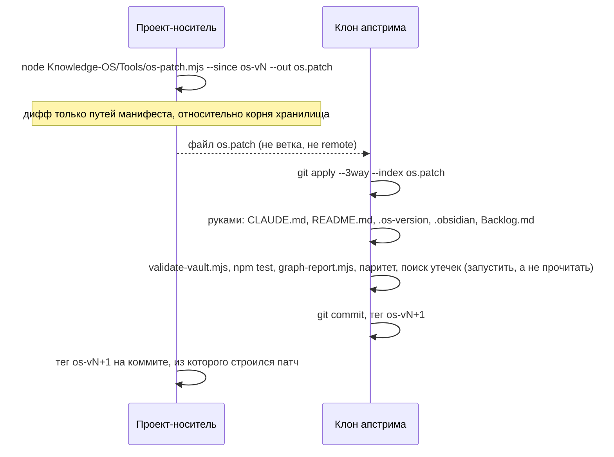

# 08-3. Доставка в апстрим и обновление: `os-patch.mjs`, `upgrade.mjs`

> **Описывает:** [[Knowledge-OS/Tools/os-patch.mjs]], [[Knowledge-OS/Tools/manifest.mjs]], [[Knowledge-OS/Tools/upgrade.mjs]], команду [[Knowledge-OS/Dist/commands/mv-sync.md]].
> **Связано:** [[Docs/08-Distribution/08-1-OS-Manifest]] — что считается слоем ОС, [[Docs/08-Distribution/08-2-Adoption]] — как развёрнуть доставленное в `.claude/`, [[Docs/08-Distribution/08-4-Versioning-and-Changelog]] — как доставка фиксируется версией и тегом, [[Docs/06-Tooling/06-1-Validator]] — проверка, которую обязательно запускать в апстриме.

## Назначение

Слой ОС существует как минимум в двух копиях:
- в **проекте-носителе**, где он разрабатывается (встроенная раскладка: хранилище — папка `MemoValeOS/` внутри проекта);
- в **апстриме** `GoodJaa/MemoValeOS`, публичном дистрибутивном репозитории, где хранилище — корень репозитория (самостоятельная раскладка) и `Project-OS/` — шаблон.

Направление разработки названо явно (os-v2): **слой ОС пишется в проекте-носителе, апстрим — приёмник**. Правки прямо в апстриме допустимы только для того, чего в проекте-носителе нет: шаблонного `Project-OS` и README для внешнего читателя.

На этой странице описаны два механизма переноса:
- `os-patch.mjs` — доставка из проекта в апстрим **патчем, без общей истории**;
- `upgrade.mjs` — забор слоя ОС из другого ref внутри одного репозитория (для проектов, развёрнутых клонированием).

## Как работает

### Доставка патчем



Ничего из истории проекта-носителя в апстрим не попадает: в апстриме появляется один новый коммит с содержимым слоя ОС. Проект никогда не добавляется в клон апстрима как remote, его ветки там не сливаются и не выбираются.

### Алгоритм `os-patch.mjs`

1. Корень репозитория берётся у git (`rev-parse --show-toplevel`), префикс хранилища — путь от корня до хранилища (пустой в самостоятельной раскладке).
2. `--since` и `--to` (по умолчанию `HEAD`) должны разрешаться в коммиты, иначе код 1. `--since` — тег прошлой доставки `os-vN` в проекте-носителе: коммит, чей слой ОС уже лежит в апстриме.
3. Манифест читается **на обеих сторонах** (`git show <ref>:<префикс>/Knowledge-OS/os-manifest`), сопоставитель — `compileManifest()` из [[Knowledge-OS/Tools/manifest.mjs]]. Путь попадает в патч, если его называет хотя бы один из двух манифестов: файл, переименованный из слоя ОС, должен удалиться в апстриме, а называл его только старый манифест.
4. `git diff --name-status -z --no-renames <since> <to> -- <префикс>` (`parseNameStatusZ()`), затем отбор путей слоя ОС (`selectOsPaths()`). Список печатается в stderr со статусом `A`/`M`/`D`.
5. Сам патч — `git diff --binary --full-index --no-renames --relative=<префикс>/` по отобранным путям, пачками по сто (длинная командная строка не проходит на Windows). Переименование едет удалением и добавлением; полные id блобов нужны, чтобы апстрим мог применить патч трёхсторонним слиянием.
6. Патч пишется в `--out` или в stdout. Пустой патч — код 0: в слое ОС ничего не менялось.

Читается только закоммиченное: рабочее дерево не смотрится.

Тесты — `os-patch.test.mjs`: разбор `name-status`, отбор по двум манифестам; интеграционные случаи строят настоящий проект с хранилищем в `V/`, тегом базы и изменениями всех видов (правка, добавление, удаление, переименование из манифеста, правка знания проекта и исходного кода) и применяют патч к самостоятельной копии со своим `Project-OS`.

### Что добавляет команда `/mv-sync`

Скрипт строит патч. Остальное ведёт команда ([[Docs/07-Commands]]):
- установить оба репозитория; оба рабочих дерева чисты, работа над слоем ОС закоммичена;
- найти тег прошлой доставки; без него — остановиться и спросить, а не угадывать базу;
- прочитать список путей патча: заметка проекта, план или исходный код в нём — признак неверного манифеста, и патч не должен покидать машину;
- применить в ветке `sync/os-vN+1` от `master` апстрима; конфликт решается в пользу проекта-носителя, кроме постоянных расхождений;
- перенести руками файлы, которые у каждой копии свои;
- **проверки в апстриме запускаются, а не читаются**: валидатор, `npm test`, `graph-report.mjs`, маркеры конфликта, паритет блобов по манифесту и поиск того, что нельзя публиковать (локальные пути, имена проекта, личное). Найденное в доставленном файле исправляется в проекте-носителе, и патч строится заново;
- коммит описывает доставленное и не называет хешей проекта-носителя — в апстриме этих коммитов нет;
- тег `os-vN+1` ставится на обеих сторонах: в апстриме — на коммит доставки, в проекте — на коммит, из которого строился патч;
- **без `push` и без PR.** Отправка наружу — решение владельца.

### Обратное направление

Правка, сделанная прямо в апстриме (шаблонный `Project-OS`, README), переносится в проект-носитель тем же способом в обратную сторону: `git diff` нужных путей в апстриме и `git apply --3way` в папке хранилища (`--directory=<префикс>`). Общей истории для `subtree pull` больше нет.

### `upgrade.mjs`: обновление внутри одного репозитория

Это инструмент для проектов, развёрнутых **клонированием** MemoValeOS, где слой ОС и ref апстрима живут в одной истории и пути совпадают. Это **checkout, а не merge**: каждый путь манифеста целиком заменяется содержимым ref. Решение «брать апстрим для этого пути» должно быть принято и записано в CHANGELOG **до** запуска.

Алгоритм:
1. Корень репозитория — ближайший предок с `.git`, начиная с самого хранилища (`findRepoRoot()`). Это верно для обеих раскладок.
2. **Рабочее дерево должно быть чистым**, иначе код 1.
3. **Ref должен разрешаться в коммит**, иначе код 1 с подсказкой сначала сделать fetch.
4. `git diff --name-only REF HEAD -- <vault>`. Пути переводятся из относительных к репозиторию в относительные к хранилищу.
5. **Если хоть один изменённый путь вне манифеста — отказ, код 1.** Значит, ref затрагивает знание проекта. Либо манифест надо сначала обновить, либо ref выбран неверно.
6. Нет изменений в путях манифеста — код 0.
7. Печатается список и `git diff --stat`, затем вопрос `[y/N]` (`--yes` пропускает его). Отказ — «Aborted», код 0.
8. `git checkout REF -- <paths>`. Коммит остаётся за человеком.

## Почему так

- **Почему не общая история.** С os-v2 по os-v4 доставка шла через `git subtree split --prefix=<хранилище>`: апстрим сливал ветку, история которой — вся папка хранилища проекта-носителя. Лишние файлы потом возвращались к версии апстрима (`sync-upstream.mjs`), но **коммиты оставались**. Аудит 2026-10-13 нашёл в публичной истории апстрима 53 коммита со знанием проекта-носителя — задачи, находки, решения, планы, роадмап, локальные пути — и сведения о кодовой базе, на которой гонялся бенчмарк. Фильтр после слияния не может убрать коммит. Поэтому история апстрима пересобрана одним корневым коммитом, а доставка переведена на патч.
- **Почему патч, а не копирование.** До os-v2 перенос шёл копированием с ручной адаптацией путей, и каждый перенос находил новые несоответствия. Патч сохраняет то, ради чего заводили общую историю: пути сдвигает git (`--relative`), а разногласия становятся видимыми конфликтами трёхстороннего слияния. Для этого базы сторон должны совпадать — отсюда теги `os-vN` и проверка паритета после каждой доставки.
- **Почему два манифеста.** Манифест описывает результат, а не переход к нему. При переходе на пути без пробелов (`a56b29a`) новый манифест не называл старые `Knowledge OS/**`, и прежний механизм принял их за проектные файлы. Отбор по объединению двух манифестов доставляет и удаление.
- **Почему `upgrade.mjs` отказывает целиком, а не частично.** Частичный checkout при ref, задевшем знание проекта, обновил бы слой ОС под знание, которого ref на самом деле не описывает. Отказ заставляет назвать проблему.

## Пример

В проекте-носителе, после закрытия версии:

```text
$ node MemoValeOS/Knowledge-OS/Tools/os-patch.mjs --since os-v4 --out ../os-v5.patch
OS layer os-v4 (8c4deab) → HEAD (6a36d0a): 62 path(s)
  M  CHANGELOG.md
  M  Docs/01-Purpose-and-Principles.md
  …
  D  Knowledge-OS/Knowledge-BD.base
  A  Knowledge-OS/Knowledge-DB.base
  …
  M  Project-OS/06-AI/AI.md
  M  Project-OS/Templates/Architecture.md
Wrote ../os-v5.patch. In upstream: git apply --3way --index <path to it>
```

Из `Project-OS/` в списке только `AI.md` и шаблоны — так и должно быть. Затем в клоне апстрима `git apply --3way --index ../os-v5.patch`, файлы отдельных копий, проверки, коммит и теги.

## Подводные камни

- **Без тега прошлой доставки патч строить не от чего.** Тег `os-v4` не был поставлен вовремя и появился задним числом; его верность подтверждена паритетом блобов с апстримом (расходится только постоянное расхождение `AI-Governance.md`).
- **`AI-Governance.md` не применяется чисто**, когда проект меняет этот файл: в апстриме в нём другая фраза о ветвлении. Это постоянное расхождение: сохранить фразу апстрима, взять остальное.
- **Файлы, которые у каждой копии свои, в манифест не входят и переносятся руками.** Это `CLAUDE.md`, `README.md`, `.os-version`, `.obsidian/app.json`, `.obsidian/templates.json`, `Backlog.md` (`PER_COPY_FILES` в [[Knowledge-OS/Tools/manifest.mjs]]). В манифест их внести нельзя: `upgrade.mjs` в чужом проекте затёр бы ими собственные файлы проекта. `Backlog-Archive.md` с os-v5 не переносится: это летопись закрытия записей проекта-носителя, а не часть системы.
- **Патч несёт содержимое файлов, а не только пути.** Если в доставленный файл попал локальный путь или имя проекта, патч его опубликует. Поэтому поиск утечек — шаг проверки, а не пожелание.
- **`upgrade.mjs` не запускает валидатор и тесты** ни до, ни после. Это записано в CHANGELOG os-v3 в раздел «Чего в этой версии нет».
- **В `upgrade.mjs` четыре байта NUL делали файл бинарным для git:** сентинел `**` в сопоставителе манифеста. Теперь сопоставитель — тот же посимвольный разбор, что у валидатора и `manifest.mjs`, а тест в `upgrade.test.mjs` проверяет, что ни в одном инструменте нет NUL.

## Как менять

- Новый вид пути, который должен или не должен ехать, — строка в манифесте, а не код в скрипте.
- Изменение правила разрешения конфликтов — только через явное решение владельца: это меняет то, чья правка побеждает.
- После любой правки `os-patch.mjs` — тесты и пробная доставка в отдельной ветке апстрима с запущенными проверками.
