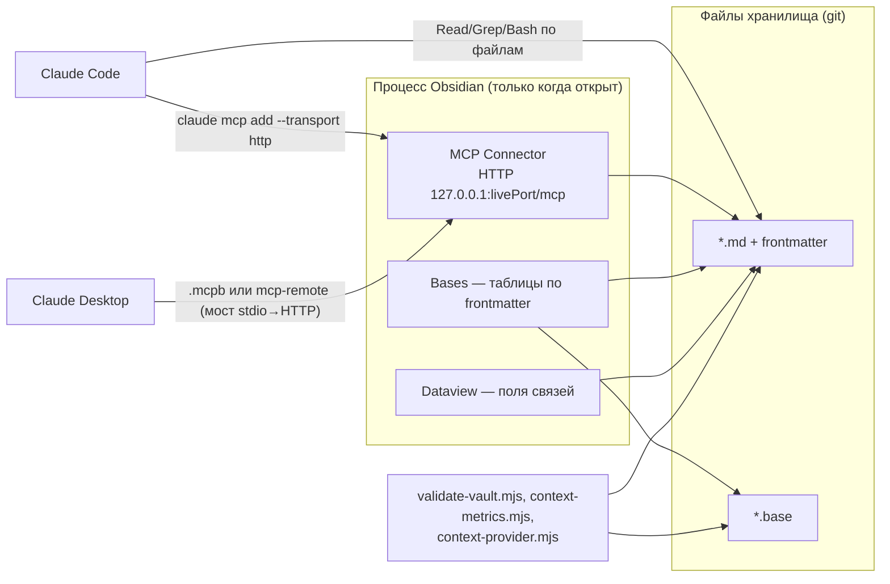

# 09. Интеграция с Obsidian

> **Описывает:** как хранилище используется из Obsidian: представления Bases ([[Knowledge-OS/Knowledge-DB.base]] и `Project-OS/03-Development/Backlog.base`), поля связей Dataview ([[Knowledge-OS/Schema/Relationship-Types]]), шаблоны, MCP Connector и подключение к нему Claude Code и Claude Desktop; файлы `.obsidian/`; почему Obsidian необязателен.
> **Связано:** [[Docs/02-System-Layout]] — два пути доступа к одним файлам, [[Docs/05-Project-OS/05-3-Templates]] — шаблоны и плейсхолдеры, [[Docs/05-Project-OS/05-4-Session-Lifecycle]] — правило потери связи, [[Docs/07-Commands#/mv-deploy]] — команда подключения, [[Docs/06-Tooling/06-1-Validator]] — правило `broken-base-folder`, [[Docs/06-Tooling/06-5-Context-Provider]] — доступ к хранилищу для внешних инструментов без Obsidian.

## Назначение

Хранилище — это папка markdown-файлов с YAML-frontmatter. Obsidian делает её удобной для человека: показывает таблицы по frontmatter, граф ссылок, обратные ссылки, редактор свойств. Плагин MCP Connector даёт ассистенту доступ к хранилищу через запущенный Obsidian.

Главное свойство интеграции: **Obsidian даёт представления, а не механику.** Всё, что система обязана делать, — проверять схему, выбирать следующую задачу, закрывать сессию, считать метрики — работает по обычным файлам. В `README.md` это проверено удалением: на копии без `.obsidian/` и без `.base`-файлов валидатор, тесты и метрики отрабатывают полностью.

## Как работает

### Два пути к одним файлам



### Что хранится в `.obsidian/` и что нет

| Файл | В git | Что задаёт |
|---|---|---|
| `.obsidian/app.json` | да | `alwaysUpdateLinks: true` — Obsidian обновляет ссылки при переименовании, иначе переименование ломает граф. `userIgnoreFilters` — исключённые из поиска, графа и переключателя: `node_modules/`, `Knowledge-OS/Tools/__fixtures__/`, `Knowledge-OS/Tools/__provider_fixtures__/` (намеренно сломанные тестовые хранилища), `Knowledge-OS/Dist/` (команды Claude Code, не заметки), `Plans/`, `Project-OS/Templates/` |
| `.obsidian/core-plugins.json` | да | ядровые плагины. Для системы важны `bases` (таблицы `.base`), `properties` (редактор frontmatter), `templates` (вставка шаблонов), а также `graph`, `backlink`, `outgoing-link` |
| `.obsidian/community-plugins.json` | да | включённые community-плагины: `mcp-tools-istefox` (MCP Connector) и `dataview` |
| `.obsidian/plugins/` | **нет** | код плагинов и их настройки; после клонирования ставятся заново из каталога |
| `workspace.json`, `graph.json`, `appearance.json` | нет | состояние интерфейса на конкретной машине |

Комментарий в `.gitignore` хранилища объясняет это разделение: три сохранённых файла записывают, какие плагины нужны Obsidian, если хранилище откроют в нём. Вне Obsidian ничего из этого не требуется.

Установленные плагины (по `manifest.json`):

| Плагин | id | Версия | Включён | Роль |
|---|---|---|---|---|
| MCP Connector | `mcp-tools-istefox` | 1.0.1, `minAppVersion` 1.7.2, `isDesktopOnly: true` | да | MCP-сервер для ассистента |
| Dataview | `dataview` | 0.5.68 | да | делает поля связей запрашиваемыми |
| Templater | `templater-obsidian` | 2.25.0 | **нет** | установлен, но не включён и системе не нужен (см. «Подводные камни») |

Отсюда требование `README.md`: Obsidian ≥ 1.7.2 и только десктоп — MCP Connector на мобильных не работает.

### Bases: представления по frontmatter

Файл `.base` — YAML со списком представлений (`views`). У каждого есть `type: table`, `name`, `filters` (выражения на языке Bases: `note.<поле>`, `file.folder`, `file.name`) и `order` — колонки. Bases читает **только frontmatter** и метаданные файла. Тело заметки, а значит и строки-связи, ему недоступно.

**[[Knowledge-OS/Knowledge-DB.base]]** — обзор знания по жизненному циклу, слой ОС:

| Представление | Фильтр | Колонки |
|---|---|---|
| Active | `note.lifecycle == "active"` | file.name, type, status |
| Draft | `note.lifecycle == "draft"` | file.name, type, status |
| Superseded | `note.lifecycle == "superseded"` | file.name, type, status |
| Archived | `note.lifecycle == "archived"` | file.name, type |
| Schema violations | `or`: `note.type == null`, `note.lifecycle == null`, `note.status == null` | file.name, type, lifecycle, status |

«Schema violations» — визуальный аналог части проверок валидатора: заметки без обязательного поля. Это не замена валидатору: он проверяет ещё и значения, пороги и связи.

**`Project-OS/03-Development/Backlog.base`** — представления поставки, экземпляр проекта:

| Представление | Фильтр (`and`) | Колонки |
|---|---|---|
| Open tasks | `note.type == "task"`, `file.folder == "Project-OS/03-Development/Tasks"`, `status != "done"`, `status != "cancelled"` | file.name, status, priority |
| Blocked | task, та же папка, `status == "blocked"` | file.name, priority |
| Epics | `note.type == "epic"`, `file.folder == "Project-OS/03-Development/Epics"` | file.name, status |
| Done | task, та же папка, `status == "done"` | file.name, updated |

«Open tasks» и «Blocked» — это то, что читает `/mv-resume`. Без Obsidian та же выборка воспроизводится одним `Grep` по `^status:` (см. [[Docs/05-Project-OS/05-2-Delivery-Model]]).

**Проверка валидатором.** Bases при несуществующей папке в `file.folder` молча показывает пустую таблицу, неотличимую от «правильно пустой». Поэтому [[Knowledge-OS/Tools/validate-vault.mjs]] разбирает каждый `*.base` как YAML. Невалидный YAML — `invalid-yaml-frontmatter`. Затем валидатор вынимает из строк-выражений условия `file.folder == "…"` (регулярным выражением `FILE_FOLDER_CONDITION`, потому что это строка, а не YAML-структура) и выдаёт `broken-base-folder`, если папки нет.

### Dataview: поля связей

Семантические связи записываются не во frontmatter, а строками в теле — inline-полями Dataview ([[Knowledge-OS/Schema/Relationship-Types]], [[Knowledge-OS/Schema/Metadata-Schema]]):

```markdown
## Related

depends-on:: [[T27-Node-Storage]]
constrained-by:: [[ADR-003-Storage-Technology]]
```

Ссылка внутри поля остаётся обычной wikilink: граф, обратные ссылки и валидатор видят её без всякого плагина. Dataview нужен только для того, чтобы **спросить по типу связи**. Это единственный такой читатель в системе: Bases тело не читает. Повторённое поле читается как список, дефис в имени поля экранировать не нужно:

```text
TABLE WITHOUT ID file.link AS entity, depends-on
FROM "Project-OS"
WHERE depends-on
```

```text
LIST FROM "Project-OS"
WHERE contains(depends-on, link("T27-Node-Storage"))
```

Через MCP тот же запрос доступен ассистенту: инструмент `execute_dataview_query` в счётчиках вызовов MCP Connector.

### Шаблоны

Шаблоны из `Project-OS/Templates/` вставляются ядровым плагином `templates`, который подставляет `{{title}}` и `{{date}}` — и ничего больше. Валидатор следит, чтобы других плейсхолдеров в шаблонах не было ([[Docs/05-Project-OS/05-3-Templates]]). Команды `/mv-note` и `/mv-close` шаблон не вставляют, а пишут заметку сразу в нужной форме, поэтому для них Obsidian не нужен.

### MCP Connector: архитектура подключения

**Сервер живёт внутри процесса Obsidian.** Плагин поднимает HTTP MCP-сервер на `127.0.0.1` при загрузке Obsidian. Отдельного демона нет. Отсюда главное следствие: **пока Obsidian закрыт, подключения нет.**

Настройки плагина лежат в `.obsidian/plugins/mcp-tools-istefox/data.json`. Значимые для подключения поля:

- `mcpTransport.livePort` — порт HTTP-сервера (в Archi `27200`);
- `mcpTransport.bearerToken` — **секрет**: токен доступа к хранилищу на запись. Он хранится в этом файле; не публикуйте его, не коммитьте, не вставляйте в issue. Файл защищён тем, что вся `.obsidian/plugins/` в `.gitignore`;
- `mcpTransport.serverName` — имя, под которым сервер представляется клиенту;
- `commandPermissions` — список команд Obsidian, которые клиенту разрешено выполнять (форматирование, навигация, открытие графа и поиска);
- `toolLoading` — профиль загружаемых инструментов. Счётчики вызовов показывают, чем ассистент реально пользовался: `get_vault_file`, `set_note_property`, `search_and_replace`, `patch_vault_file`, `get_backlinks`, `execute_dataview_query` и другие;
- `mcpClientConfig.autoWriteClaudeDesktopConfig: false` — плагин сам не переписывает конфигурацию Claude Desktop.

**Claude Code** (а также Cursor, Cline, Continue) говорит по HTTP MCP напрямую:

```text
claude mcp add --transport http obsidian http://127.0.0.1:<port>/mcp \
  --header "Authorization: Bearer <token>"
```

`/mv-deploy` читает порт и токен прямо с диска, а не через MCP («если бы MCP работал, вас бы здесь не было»), собирает эту команду и показывает её, но запускает только с подтверждения.

**Claude Desktop** нативно HTTP MCP не поддерживает, ему нужен мост. Есть два способа:

- **бандл `.mcpb`** — экспортируется из настроек плагина и открывается двойным щелчком. Внутри бандла зашит абсолютный путь к хранилищу, на котором его создали, поэтому чужой бандл не работает. Это касается и `obsidian-mcp-connector.mcpb` в корне хранилища Archi: он в `.gitignore` как «installable artifact, not vault content»;
- **`mcp-remote`** — запись в `claude_desktop_config.json` с `"command": "npx"` и `"args": ["-y", "mcp-remote", "http://127.0.0.1:<port>/mcp", "--header", "Authorization: Bearer <token>"]`.

### Что происходит, когда Obsidian закрыт

- MCP-сервера нет. Клиент получает отказ в соединении (в Claude Code — `ECONNREFUSED` при подключении сервера `obsidian`), инструменты `mcp__obsidian__*` недоступны.
- Если связь пропала **посреди** сессии, действует правило Connectivity из [[Knowledge-OS/Rules/AI-Governance]]: остановить работу, не продолжать по памяти, не повторять вслепую последнее действие, возобновить только после проверенно успешного чтения. Возврат — через `/mv-resume` (см. [[Docs/05-Project-OS/05-4-Session-Lifecycle]]).
- Файловый путь продолжает работать полностью. Claude Code читает и пишет файлы хранилища своими инструментами. Работают `validate-vault.mjs`, `context-metrics.mjs` и `context-provider.mjs` ([[Docs/06-Tooling/06-5-Context-Provider]] прямо «не требует открытого Obsidian»). Представления `.base` заменяются тем же `Grep`.
- Незаметная разница одна: правки, сделанные мимо Obsidian, Obsidian увидит при следующем открытии. При переименовании файла мимо Obsidian `alwaysUpdateLinks` не сработает, и ссылки придётся править самому — но битую ссылку найдёт валидатор.

## Почему так

**Представления, а не механика.** Если бы ритуал закрытия зависел от Bases или MCP, система переставала бы работать при закрытом приложении, на сервере CI, в чужой агентной среде. Каждая механическая операция поэтому имеет файловую реализацию, а Obsidian — лишь способ на неё посмотреть. По той же причине `.base` — не источник истины: «Open tasks» выводится и grep'ом, и ритуал делает именно так.

**Связи — в теле, а не во frontmatter.** Bases умеет только frontmatter. Казалось бы, удобнее положить связи туда. Но [[Knowledge-OS/Schema/Metadata-Schema]] разрешает во frontmatter только ключи из `metadataKeys`, а у связи есть место в смысловом разделе заметки («Tasks», «Decisions»). Inline-поле видно и как ссылка (граф, валидатор), и как поле (Dataview). Платой стало то, что по типу связи спрашивает только Dataview.

**Сервер в процессе Obsidian.** Так устроен выбранный плагин. Плюс — сервер видит то же, что видит Obsidian: индекс, свойства, Dataview. Минус — подключение живёт ровно столько, сколько открыто приложение. Поэтому в правилах есть раздел Connectivity, а команда `/mv-resume` прямо называет «восстановление после разрыва» своим случаем.

**Секрет вне git по построению.** Токен лежит внутри `.obsidian/plugins/`, а эта папка игнорируется целиком. Отдельного правила для одного файла нет: он защищён, пока защищена папка.

## Пример

Подключение Claude Code к хранилищу на новой машине:

1. Установить Obsidian ≥ 1.7.2, открыть папку хранилища, поставить из каталога MCP Connector и Dataview (после клонирования `.obsidian/plugins/` пуст), убедиться, что ядровые `bases` и `properties` включены.
2. Запустить Obsidian один раз — появится `.obsidian/plugins/mcp-tools-istefox/data.json`.
3. `/mv-deploy` → хранилище уже развёрнуто → `validate-vault.mjs` → `OK` → команда `claude mcp add … http://127.0.0.1:27200/mcp …`, показанная для подтверждения.
4. С этого момента ассистент может, например, вызвать `execute_dataview_query` по `depends-on` вместо обхода задач по одной. Когда Obsidian закрыт, тот же ассистент продолжает работать по файлам.

## Подводные камни

- **Templater системе не нужен.** Шаблоны написаны в синтаксисе ядрового плагина Templates (`{{title}}`, `{{date}}`), и `.obsidian/templates.json` указывает ему папку `Project-OS/Templates`. Templater остался установленным от прежнего способа развёртывания: его `templates_folder: "OS Deployment"` указывает на несуществующую папку, и в `community-plugins.json` он не включён. До 2026-10-02 `/mv-deploy` ещё велел включить его и «запустить генератор». Генератора не было, а файла `templates.json` тоже не было, так что после клонирования папку шаблонов приходилось задавать вручную.
- **Список плагинов один.** README (шаг 2 установки и таблица требований) и `/mv-deploy` называют одно и то же: MCP Connector и Dataview из community, `bases` и `properties` из ядровых. Таблица требований в README до 2026-10-02 была без шапки, а `/mv-deploy` добавлял Templater.
- **Примеры Dataview** в [[Knowledge-OS/Schema/Relationship-Types]] используют `FROM "Project-OS"`. До исправления там стояло имя с пробелом, и запрос по примеру молча возвращал пустой результат. Это и есть главный риск Dataview: неверный путь не ошибка, а пустая таблица.
- **Node, установленный менеджером версий, не виден Obsidian и Claude Desktop** — они запускаются не из оболочки пользователя. Нужен системный Node (`README.md`, «Про Node»).
- **Пустая таблица `.base` — не доказательство пустоты.** Правило `broken-base-folder` ловит только несуществующую папку. Неверное имя поля в фильтре (например, `note.staus`) по-прежнему даёт молча пустую таблицу.

## Как менять

- **Новое представление** — добавить его в `views` нужного `.base`. Если фильтр использует `file.folder`, папка должна существовать, иначе сработает `broken-base-folder`. `Knowledge-DB.base` — слой ОС ([[Knowledge-OS/os-manifest]]), его изменение — запись в [[CHANGELOG]]. `Backlog.base` — экземпляр.
- **Новый `.base` в слое ОС** — файл под `Knowledge-OS/` автоматически попадает под `os-layer-outside-manifest`. Добавьте строку в манифест.
- **Новый обязательный плагин** — включить его в `core-plugins.json` или `community-plugins.json`, добавить строку в таблицу требований `README.md` и в ручной путь `/mv-deploy` ([[Knowledge-OS/Dist/commands/mv-deploy]] → `adopt.mjs` → [[Docs/08-Distribution/08-2-Adoption]]). Прежде чем это делать, спросите себя, не превращаете ли вы представление в механику: всё, что плагин делает, должно иметь файловую альтернативу.
- **Смена MCP-плагина** — меняются путь к настройкам и имена полей (`mcpTransport.livePort`, `mcpTransport.bearerToken`) в `/mv-deploy`, раздел «Подключение ассистента» в `README.md` и записи `.gitignore`, если секрет окажется вне `.obsidian/plugins/`.
- **Проверка** — `node Knowledge-OS/Tools/validate-vault.mjs`. Затем откройте хранилище в Obsidian и убедитесь, что представления не пусты там, где не должны быть пусты.
