# 11. Как построить подобную систему с нуля

> **Описывает:** систему целиком как набор конструктивных решений: [[Knowledge-OS/Schema/schema.json]], [[Knowledge-OS/Tools/validate-vault.mjs]], [[Knowledge-OS/Protocols/Context-Selection-Protocol]], [[Project-OS/06-AI/AI]], [[Knowledge-OS/os-manifest]], [[Knowledge-OS/Tools/adopt.mjs]].
> **Связано:** [[Docs/01-Purpose-and-Principles]] — какие задачи решаются, [[Docs/02-System-Layout]] — итоговая раскладка, [[Docs/10-Extending]] — как расширять уже построенное, [[Docs/12-Known-Gaps]] — что в текущей реализации не доделано.

## Назначение

Эта страница — сборка всей документации в один маршрут. В каком порядке строить систему вроде MVOS, какие решения принять на каждом шаге и чего каждое решение стоит. Порядок выбран так, чтобы на каждом этапе система уже приносила пользу и чтобы следующий этап опирался на проверяемое основание, а не на договорённость.

## Как работает

```mermaid
flowchart LR
  E1[1. Точка входа и директива] --> E2[2. Модель знания]
  E2 --> E3[3. Словарь в коде]
  E3 --> E4[4. Валидатор + фикстуры]
  E4 --> E5[5. Правила и протоколы]
  E5 --> E6[6. Структура проекта и шаблоны]
  E6 --> E7[7. Ритуалы сессии и команды]
  E7 --> E8[8. Измерение]
  E8 --> E9[9. Дистрибуция]
  E9 --> E10[10. Внешний интерфейс]
```

### Этап 1. Точка входа и главная директива

**Что сделать.** Файл, который ассистент читает первым: для Claude Code это `CLAUDE.md`. Короткий, императивный, без пересказа правил. Он говорит, с чего начинать (текущая задача), что считать ограничениями (принятые решения), где граница работы (задача) и что делать с расхождениями (сообщать, а не исправлять молча). Главное правило звучит так: «прочитай минимум, достаточный для правильного решения».

**Почему первым.** Всё остальное — это то, к чему этот файл отсылает. Если точка входа длинная, она сама становится тем контекстом, который грузится целиком. Подробно — [[Docs/04-Assistant-Behaviour/04-1-Entry-Points]].

### Этап 2. Модель знания

**Что сделать.** Определите пять измерений, по которым описывается любая заметка:

| Измерение | Вопрос | В MVOS |
|---|---|---|
| Тип | Что это за знание? | `type`: продукт, архитектура, эпик, задача, исследование, решение, идея + операционные + мета ([[Docs/03-Knowledge-Model/03-1-Entity-Types]]) |
| Рабочий статус | Где это в процессе? | `status`, свой набор для каждого типа ([[Docs/03-Knowledge-Model/03-2-Metadata-and-Status]]) |
| Жизненный цикл | Можно ли этому верить сейчас? | `lifecycle`: `draft`, `active`, `superseded`, `archived` ([[Docs/03-Knowledge-Model/03-3-Lifecycle]]) |
| Доказательство | Как это установлено? | `evidence`: L1 прочитано, L2 выполнено, L3 видно на реальной поверхности, L4 подтверждено владельцем; `user-provided` ([[Docs/03-Knowledge-Model/03-4-Evidence]]) |
| Связи | С чем это связано и как? | типизированные поля `depends-on:: [[X]]` в теле ([[Docs/03-Knowledge-Model/03-5-Relationships-and-Links]]) |

Плюс отдельный реестр незнания ([[Docs/03-Knowledge-Model/03-6-Uncertainty-Ledger]]).

**Ключевое решение — развести `status` и `lifecycle`.** «Задача выполнена» и «знание о задаче достоверно» — разные утверждения. Если их смешать, закрытая задача с непроверенным результатом выглядит так же, как проверенная. В MVOS задача может быть `done`, но её знание остаётся `draft`, пока не достигнут порог L2. Валидатор не даёт этому состоянию застрять: `lifecycle-behind-status`. Какие статусы «закрепляют» знание, задайте данными (в MVOS — `activeLifecycleStatuses`), а не отдельным правилом на тип: при правиле на тип расхождение вернулось на типе, у которого правила не было. И не заводите `status` там, где его словарь повторяет `lifecycle`.

**Ключевое решение — порог по типу, а не общий.** Архитектурное утверждение не становится доказанным оттого, что рядом прошёл тест. О назначении продукта нельзя узнать из кода, его знает только владелец (`user-provided`). Единый порог был бы либо слишком строгим для исследований, либо слишком мягким для решений.

**Минимум.** Можно начать только с `type`, `lifecycle` и `evidence`. Без `lifecycle` система не отличает каркас от факта, и пропала главная ценность.

### Этап 3. Словарь — в коде, смысл — в прозе

**Что сделать.** Один машиночитаемый файл со всеми допустимыми значениями (в MVOS — [[Knowledge-OS/Schema/schema.json]]) и заметки, объясняющие смысл каждого значения. Проверка импортирует файл напрямую.

**Почему.** Первая версия держала значения и в прозе, и в коде валидатора. Они разошлись, и никто этого не заметил, потому что проза не исполняется. Подробно — [[Docs/03-Knowledge-Model/03-7-schema-json]].

### Этап 4. Валидатор и фикстуры

**Что сделать.** Скрипт без зависимостей, кроме YAML-парсера. Он обходит хранилище и проверяет:
- frontmatter по словарю;
- пороги доказательств;
- ссылки;
- согласованность (эпик и его задачи, неопределённость и знание, на которое она ссылается);
- каркасы, выдающие себя за знание.

На каждое правило — фикстура с ровно одним нарушением и тест, требующий, чтобы каждая фикстура была покрыта. Подробно — [[Docs/06-Tooling/06-1-Validator]], [[Docs/06-Tooling/06-6-Tests-and-Fixtures]].

**Решения, которые стоит принять сразу:**
1. **Ошибка или предупреждение.** Ошибка — только то, что делает знание недостоверным. Всё остальное — предупреждения: они не роняют гейт.
2. **Три области суждения.** Что обходить, что судить по ссылкам (owned), что судить по схеме (governed). Без этого первая установка в чужой проект утонет в ложных ошибках.
3. **Корень — от расположения скрипта.** Тогда инструмент работает из любого каталога.
4. **Свежесть доказательства.** Поле `source: [{path, commit}]` и проверка `git log commit..HEAD -- path` дают предупреждение `stale-source`, когда код, на котором основано утверждение, изменился. Это дешёвый способ связать знание с репозиторием-свидетельством ([[Docs/06-Tooling/06-2-Stale-Check-and-Graph-Report]]).

### Этап 5. Правила поведения и протоколы

**Что сделать.** Отдельные короткие заметки, а не один большой документ:
- **правила** — что ассистенту можно, что обязательно и что запрещено ([[Docs/04-Assistant-Behaviour/04-2-Rules]]);
- **протоколы** — пошаговые процедуры для повторяющихся ситуаций: выбор контекста, повышение знания, сопровождение, инициализация, обследование репозитория ([[Docs/04-Assistant-Behaviour/04-4-Protocols]]);
- **оглавление** со ссылкой на каждую заметку и одной строкой описания.

**Главный протокол — выбор контекста.** Он определяет:
- порядок расширения: задача → эпик → архитектура → решения → исследования → код;
- классы контекста: обязательный, условный, вспомогательный;
- бюджет чтения, объявленный заранее: целевые факты, точки входа, условие остановки.

«Условие остановки, объявленное заранее, — граница. Оценённое после — предпочтение» ([[Docs/04-Assistant-Behaviour/04-3-Context-Selection]]).

**Форма заметки.** Назначение одной фразой, шаги, раздел `Boundary` (что заметка определяет и что отдаёт соседям) и `Principle`. `Boundary` не даёт правилам дублироваться: каждое утверждение живёт в одном месте, остальные на него ссылаются.

### Этап 6. Структура знания проекта и шаблоны

**Что сделать.** Нумерованные разделы:
- продукт;
- архитектура;
- разработка (эпики, задачи, находки);
- исследования (плюс реестр неопределённостей);
- решения;
- надстройка для ассистента;
- ресурсы.

У каждого раздела индексная заметка, которая только маршрутизирует. Таблица маршрутизации «вопрос → раздел» — для ассистента. На каждый тип — шаблон с правильным начальным состоянием. Подробно — [[Docs/05-Project-OS/05-1-Sections]], [[Docs/05-Project-OS/05-3-Templates]].

**Тонкость — дешёвая фиксация.** Нужен тип для одной строки «что замечено, когда и где». В MVOS это Finding, который рождается `active`. Без такого типа наблюдения либо теряются, либо раздувают исследования. Чтобы Finding не стал вторым инбоксом, ритуал периодически просматривает находки и продвигает повторяющиеся ([[Knowledge-OS/Rules/Promotion-Rules]]).

**Тонкость — выбор следующей задачи.** Задачи нумеруются в порядке поставки. Следующая задача — наименьший номер среди свободных, найденный одним вызовом инструмента, а не чтением задач. Ассистенту не нужно открывать каждую задачу ([[Docs/05-Project-OS/05-2-Delivery-Model]]). Если в проекте больше одного человека, «свободна» должно учитывать чужие ветки: задача, взятая там, в вашей рабочей копии ещё `todo`. Состояние сессии тоже нельзя держать в одном общем файле, который каждая сессия переписывает: на нём будет конфликт при каждом слиянии ([[Docs/06-Tooling/06-10-Task-Lookup]]).

### Этап 7. Ритуалы сессии и команды

**Что сделать.** Две процедуры на границах сессии ([[Docs/05-Project-OS/05-4-Session-Lifecycle]]):

- **Возобновление.** Прочитать текущий контекст (одну короткую заметку состояния), открытые блокирующие неопределённости и открытые задачи. Объявить бюджет. Предложить ровно один следующий шаг.
- **Закрытие.** Ответить на два вопроса: «что сессия установила такого, чего нет в `git log`» и «что осталось незаписанным, но стоило записать». Пустой ответ — нормальный; вопрос «что произошло» почти всегда имеет ответ и превращает находки в журнал сессий. Каждый непустой ответ становится Finding в одну строку, а уровень доказательности спрашивается, а не ставится по умолчанию. Затем закрыть задачу и эпик с доказательством и коммитом, переписать текущий контекст, удалить бюджет и снять метрики.

Каждая процедура оформлена slash-командой, которая ссылается на канон, а не пересказывает его ([[Docs/07-Commands]]).

**Почему ритуал, а не дисциплина.** Знание теряется на стыке сессий. Ритуал закрытия — единственное место, где «то, что я понял сегодня» гарантированно превращается в файл. Вопрос «что дальше» намеренно не задаётся: следующий шаг выбирает владелец, а не ассистент ([[Knowledge-OS/Rules/AI-Governance]]).

### Этап 8. Измерение

**Что сделать.** Два источника данных:
- **хук `PreToolUse`**, который записывает каждое чтение и сверяет его с объявленным бюджетом. Он никогда не блокирует ([[Docs/06-Tooling/06-4-Budget-Audit-Hook]]);
- **анализатор журналов сессий**: токены, пик контекста, кэш, обращения к знанию по категориям (правила, проект, код, сама система), повторные чтения ([[Docs/06-Tooling/06-3-Context-Metrics]]).

Снимок каждой сессии пишется строкой в журнал с меткой класса сессии.

**Почему.** Без измерения утверждение «контекст не растёт с базой» остаётся рекламой. Измерение в MVOS подтвердило гипотезу в скромной форме. Наблюдение «правила не читают, но соблюдают» пришлось исправить: метрика видела только файловые инструменты, а с учётом чтений через оболочку правила читались почти в каждой сессии, хоть и без повторов. Соблюдение ветвления держал хук. Считайте чтения через оболочку с первого дня — иначе сессия, работающая через `cat`, выглядит как сессия, которая ничего не читала.

### Этап 9. Дистрибуция

**Что сделать.** Отделите переносимый слой от экземпляра:
- **манифест** — список glob-шаблонов. Валидатор требует, чтобы каждый файл переносимого префикса был в нём назван ([[Docs/08-Distribution/08-1-OS-Manifest]]);
- **транспорт** — патч путей манифеста от тега прошлой доставки, применяемый трёхсторонним слиянием ([[Docs/08-Distribution/08-3-Upstream-Sync-and-Upgrade]]). Не делите с публичным дистрибутивом историю проекта, где система разрабатывается: MVOS так делал через `git subtree split`, и вся история знания проекта оказалась в публичном репозитории;
- **установщик** для файлов, которые должны жить вне хранилища, в `.claude/` корня проекта. По умолчанию он печатает план, применяет изменения по классам и ничего чужого не трогает. Расхождение копий — ошибка валидатора ([[Docs/08-Distribution/08-2-Adoption]]);
- **история версий**, где у каждой версии два раздела: что новая проверка заставляет мигрировать и что изменилось внутри ([[Docs/08-Distribution/08-4-Versioning-and-Changelog]]).

**Урок, который стоит учесть заранее.** Ручное копирование между двумя копиями системы накапливало долг на каждой итерации. Обратный перенос дважды находил расхождения, которых не было видно заранее. Общая git-история нужна с первого дня. Без неё её потом приходится восстанавливать.

### Этап 10. Внешний интерфейс (необязательно)

**Что сделать.** Провайдер контекста — stdin/stdout JSON. Он отдаёт ссылки на выбранные заметки с `lifecycle`, `evidence`, ревизией и дайджестом и принимает предложения знания только как `draft`. Записи в нём нет физически ([[Docs/06-Tooling/06-5-Context-Provider]]).

**Почему последним.** Это граница доверия. Различие «черновик / установленное» должно пересекать её, а не теряться на ней. Строить интерфейс до того, как это различие проверяется валидатором, значит экспортировать то, что ещё ничего не гарантирует.

## Почему так

Порядок этапов задаёт зависимость доверия: каждый следующий механизм опирается на то, что предыдущий уже проверяется программой.
- Ритуалы без валидатора записывают знание, но не гарантируют его форму.
- Метрики без бюджета считают чтения, но не знают, были ли они нужны.
- Дистрибуция без манифеста переносит экземпляр вместе со слоем.

**Компромиссы, сознательно принятые в MVOS:**

| Выбор | Цена | Почему принят |
|---|---|---|
| Plain markdown + YAML frontmatter | Нет транзакций и индексов, связи — только синтаксис | Читаемо человеком и любым инструментом, работает в git и Obsidian, без сервера |
| Obsidian необязателен | `.base`-представления — удобство, а не истина; процедуры дублируют их grep'ом | Система работает из голого клона, Claude Code не зависит от открытого приложения |
| Связи в теле, а не во frontmatter | Bases их не видит, читает только Dataview | Frontmatter остаётся минимальным и проверяемым, связь стоит рядом с текстом, который её объясняет |
| Предупреждения вместо ошибок для состояния | Предупреждения можно игнорировать | Гейт остаётся зелёным и поэтому читаемым |
| Слой ОС и экземпляр в одном репозитории проекта | Нужен манифест и скрипт синхронизации | Код и знание меняются одним коммитом; `source.commit` разрешим |
| Человек принимает повышение знания | Медленнее | Единственная защита от тихого дрейфа «правдоподобного» в «установленное» |

## Пример

Минимальная жизнеспособная версия, которую можно собрать за день по этапам 1–4:
- `CLAUDE.md` в 30 строк;
- `schema.json` с полями `type`, `lifecycle`, `status`, `evidence` и порогами по типу;
- скрипт на 200 строк, проверяющий frontmatter, пороги и разрешимость wikilinks;
- пять фикстур и тест покрытия;
- папки `Product/`, `Architecture/`, `Decisions/`, `Tasks/`, `Uncertainties.md`.

Уже эта версия решает «он догадывается»: каркас нельзя повысить до `active` без доказательства, и проверка это ловит. «Он забывает» решается на этапе 7, ритуалом закрытия.

## Подводные камни

- **Не начинайте с инструментов отображения.** Красивые представления над непроверяемыми данными создают ощущение порядка без самого порядка.
- **Не храните процедуры в нескольких копиях.** Команда, правило и ритуал, пересказывающие друг друга, разойдутся. Так было в MVOS трижды.
- **Не измеряйте только то, что легко измерить.** Метрика, которая видит один класс инструментов, честно должна называть свои слепые зоны.
- **Не путайте «принято» и «доказано».** Принятое решение остаётся `draft`, пока не достигнут его порог доказательства.

## Как менять

Если в MVOS появляется новый фундаментальный механизм (новый этап), добавьте его сюда в правильное место цепочки зависимостей и объясните, на что он опирается.
